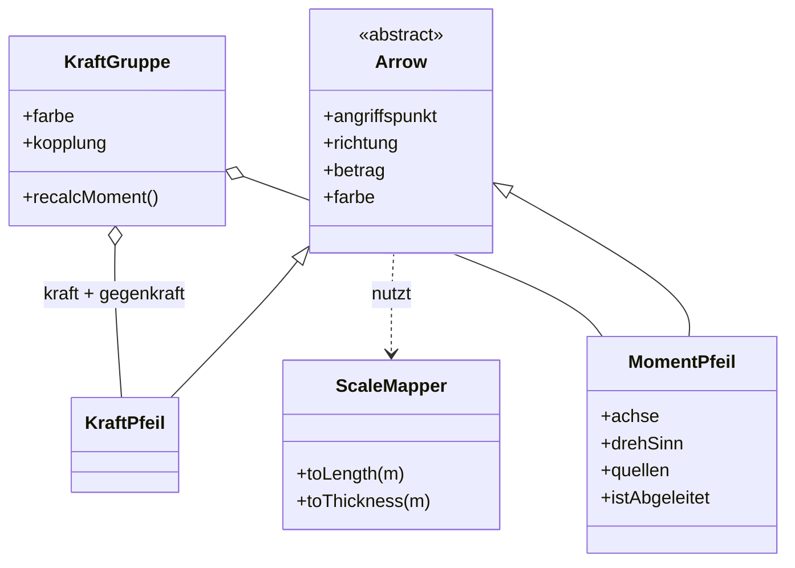

# Spezifikation: Kraft- und Momentendarstellung (Version 1.0)

Beispielanwendung: Boot mit Auftriebskraft, Gewichtskraft sowie Krängungs- und Rollmoment.

---

## 0. Konventionen

| ID | Festlegung |
|---|---|
| KO-01 | Einheiten: SI (N, N·m, m). Intern double, Anzeige gerundet mit 4 signifikanten Stellen. |
| KO-02 | Koordinatensystem: x = längsschiffs (nach vorn), y = quer, z = nach oben. Ursprung: Kielmitte. |
| KO-03 | ID-Schema: `C` Klasse, `S` Skalierung, `R` Rendering, `B` Verhalten, `I` Interaktion, `E` Beispielinstanz. Instanz-IDs: `F-xx` Kraftpfeil, `M-xx` Momentpfeil, `GR-xx` Kraftgruppe, `SM-xx` ScaleMapper. |
| KO-04 | Vektoren als Vector3 (double³), Richtungen immer normiert (Betrag 1). |

---

## 1. Klassen

### C-01 `ScaleMapper` – zentrale log-Skalierung (2 Instanzen: SM-F für Kräfte, SM-M für Momente)

| ID | Member | Typ | Beschreibung |
|---|---|---|---|
| C-01.1 | `magMin`, `magMax` | double | Physikalischer Bereich (Auto-Range über alle sichtbaren Pfeile, manuell überschreibbar) |
| C-01.2 | `lenMin`, `lenMax` | double | Längenintervall in Pixeln, Default 30…200 |
| C-01.3 | `thkMin`, `thkMax` | double | Strichstärkenintervall in Pixeln, Default 1…4 |
| C-01.4 | `toLength(m)` | Methode | siehe S-01 |
| C-01.5 | `toThickness(m)` | Methode | siehe S-02 |
| C-01.6 | `updateRange(pfeile)` | Methode | Auto-Range: min/max über alle sichtbaren Instanzen, mit 10 % Rand |

**Regel:** Pro Szene existiert genau ein SM-F und ein SM-M (C-01.1 gilt global), damit Pfeile untereinander vergleichbar bleiben.

### C-02 `Arrow` – abstrakte Basisklasse

| ID | Member | Typ | Beschreibung |
|---|---|---|---|
| C-02.1 | `id` | string | eindeutig, z. B. „F-01" |
| C-02.2 | `angriffspunkt` | Vector3 | Fußpunkt des Pfeils in Weltkoordinaten (bei Kraft: Angriffspunkt der Kraft; bei Moment: Bogenmittelpunkt) |
| C-02.3 | `richtung` | Vector3 | normiert; Kraftpfeil: Wirkrichtung; Momentpfeil: Achse |
| C-02.4 | `betrag` | double | > 0; Einheit N bzw. N·m |
| C-02.5 | `farbe` | Color | gesetzt von der Kraftgruppe (B-03) bzw. manuell bei freien Pfeilen |
| C-02.6 | `label` | string | auto-generiert: Wert + Einheit, einblendbar |
| C-02.7 | `sichtbar` | bool | Ausblenden ohne Physikverlust |
| C-02.8 | `render(sm)` | Methode | nutzt ScaleMapper `sm`, erzeugt Geometrie |
| C-02.9 | `pickTest(ray)` | Methode | Picking mit erweiterter Hitbox (R-07) |

### C-03 `KraftPfeil extends Arrow`

| ID | Member | Typ | Beschreibung |
|---|---|---|---|
| C-03.1 | – | – | keine zusätzlichen Datenmember; `angriffspunkt` ist der Kraftangriffspunkt, Spitze zeigt in `richtung` |
| C-03.2 | `kopfGroessePx` | const int | Pfeilkopf in fester Bildschirmgröße (R-02), nicht mit Länge skalierend |

### C-04 `MomentPfeil extends Arrow`

| ID | Member | Typ | Beschreibung |
|---|---|---|---|
| C-04.1 | `bezugspunkt` | Vector3 | Mittelpunkt des Bogens (= Drehpunkt); `angriffspunkt` (C-02.2) wird darauf abgebildet |
| C-04.2 | `achse` | Vector3 | normiert; identisch mit geerbtem `richtung` (C-02.3) |
| C-04.3 | `drehSinn` | enum {POS, NEG} | Vorzeichen bzgl. `achse` (Rechte-Hand-Regel) |
| C-04.4 | `bogenWinkel` | const double | fix 270° (R-04) |
| C-04.5 | `quellen` | List<KraftPfeil> | beteiligte Kräfte; **leer = extern aufgeprägtes Moment** |
| C-04.6 | `istAbgeleitet` | bool | true → Betrag/Achse werden von der Gruppe rekalkuliert (B-02); false → freies Moment (z. B. Wellenerregung) |

### C-05 `KraftGruppe` – Composite aus Kraft, Gegenkraft, Moment

| ID | Member | Typ | Beschreibung |
|---|---|---|---|
| C-05.1 | `id`, `name` | string | z. B. „GR-01 / Auftrieb–Gewicht" |
| C-05.2 | `farbe` | Color | Gruppenfarbe, wird an alle enthaltenen Pfeile vererbt (B-03) |
| C-05.3 | `kraft` | KraftPfeil | wirkende Kraft |
| C-05.4 | `gegenkraft` | KraftPfeil | Reaktionskraft |
| C-05.5 | `kopplung` | enum {STARR, FREI} | STARR: F_gegen = −F, |F_gegen| = |F| automatisch (B-01); FREI: beide unabhängig editierbar |
| C-05.6 | `moment` | MomentPfeil | abgeleitet, `istAbgeleitet = true` (B-02) |
| C-05.7 | `setKraft(f)` | Methode | setzt `kraft`; bei STARR sofort `gegenkraft` synchronisieren |
| C-05.8 | `recalcMoment()` | Methode | M = Σ r_i × F_i mit r_i = Abstand Bezugspunkt → Angriffspunkt i; setzt Betrag, Achse, DrehSinn von `moment`; wird bei **jeder** Änderung von Position oder Betrag aufgerufen (kein Speichern, kein Drift möglich) |

### Klassendiagramm

---

## 2. Skalierung (S)

| ID | Regel |
|---|---|
| S-01 | Länge: L = L_min + (L_max − L_min) · (log10(m) − log10(m_min)) / (log10(m_max) − log10(m_min)); strikt monoton, auf [L_min, L_max] begrenzt. L_min ≥ 3 × Pfeilkopfhöhe. |
| S-02 | Strichstärke: t = t_min + (t_max − t_min) · gleicher log-Anteil wie S-01. |
| S-03 | Bogenradius des Momentpfeils: konstant (bildschirmabhängig), **keine** Größenkodierung über den Radius; Größe nur über Dicke (S-02) + Label. |
| S-04 | Auto-Range: `updateRange()` bei jeder Änderung der Pfeilmenge; bei laufender Simulation Hysterese (Range nur ändern, wenn Wert > 20 % außerhalb), damit die Darstellung nicht flackert. |
| S-05 | Exakte Werte stehen immer im Label (C-02.6) – die log-Skala ist nie alleinige Größenquelle. |

---

## 3. Rendering (R)

| ID | Regel |
|---|---|
| R-01 | Kraftpfeil: Gerade von `angriffspunkt` in Richtung `richtung` mit Länge L (S-01); Fußpunkt markiert den Angriffspunkt (kleines Kugelsymbol), Spitze zeigt die Richtung. |
| R-02 | Pfeilkopf: feste Bildschirmgröße, skaliert nicht mit L. |
| R-03 | Farbe = Gruppenzugehörigkeit (B-03). Strichstärke = Betrag (S-02). Kein Kanal doppelt belegt. |
| R-04 | Momentpfeil: Bogenpfeil (270°) in der Ebene senkrecht zur `achse` um `bezugspunkt`; Pfeilspitze gemäß `drehSinn` (Rechte-Hand-Regel). |
| R-05 | Achse zusätzlich als gestrichelte Linie durch `bezugspunkt` entlang `achse` zeichnen → Drehachse direkt ablesbar. |
| R-06 | Hover/Selektion eines Moments: alle `quellen` hervorheben, Hebelarme r_i als gestrichelte Verbindungslinien einblenden, Label zeigt M = Σ r_i × F_i mit Einzelbeiträgen. |
| R-07 | Picking-Hitbox ≥ 12 px um Geometrie, unabhängig von tatsächlicher Strichstärke. |
| R-08 | Legende im HUD: Maßstabsbalken „─ 10 kN ─" bzw. „↻ 1 kN·m" entsprechend aktuellem Auto-Range. |
| R-09 | Depth-Test gegen die Szene ja, zwischen Pfeilen nein (kleine Pfeile werden nicht von großen verdeckt). |

---

## 4. Verhalten (B)

| ID | Regel |
|---|---|
| B-01 | `kopplung = STARR`: `setKraft(f)` setzt `gegenkraft = −f` (gleicher Betrag, entgegengesetzt). Beispiel: Auftrieb ↔ Gewicht im Gleichgewicht. |
| B-02 | Das Gruppenmoment wird **nie gespeichert**, sondern in jedem Frame bzw. bei jeder Änderung via `recalcMoment()` neu berechnet (Kreuzprodukt ist trivial billig). Kann nicht aus der Sync fallen. |
| B-03 | Gruppenfarbe (C-05.2) wird an `kraft`, `gegenkraft` und `moment` vererbt → Zusammengehörigkeit ohne Klick erkennbar. |
| B-04 | Freie Pfeile (nicht in einer Gruppe): Farbe manuell, Moment mit `istAbgeleitet = false` erlaubt (extern aufgeprägtes Moment ohne Quellkräfte). |
| B-05 | Änderungen an `angriffspunkt` oder `betrag` eines Gruppenmitglieds triggern `recalcMoment()` derselben Gruppe. |

---

## 5. Beispielinstanzen: Boot mit Krängung (E)

Annahmen (Beispielwerte, frei gewählt – gegen reale Bootdaten tauschbar): Verdrängung m = 5000 kg, g = 9,81 m/s² → G = 49,05 kN. Krängungswinkel 20°, aufrichtender Hebelarm GZ = 0,35 m. Schwerpunkt G bei (0; 0,00; 1,20) m, Formschwerpunkt F (Angriffspunkt Auftrieb) bei (0,10; 0,35; 0,90) m.

| ID | Instanz | Klasse | Gruppe | Angriffspunkt / Bezugspunkt | Richtung / Achse | Betrag | Bemerkung |
|---|---|---|---|---|---|---|---|
| E-01 | SM-F | ScaleMapper | – | – | – | Range 1…100 kN | Kraft-Skalierung |
| E-02 | SM-M | ScaleMapper | – | – | – | Range 0,1…100 kN·m | Moment-Skalierung |
| E-03 | GR-01 „Auftrieb–Gewicht" | KraftGruppe | – | – | – | – | `kopplung = STARR`, Farbe Blau #1F77B4 |
| E-04 | F-01 „Gewichtskraft" | KraftPfeil | GR-01 | G (0; 0; 1,20) m | (0; 0; −1) | 49,05 kN | L ≈ 174 px, t ≈ 3,5 px |
| E-05 | F-02 „Auftriebskraft" | KraftPfeil | GR-01 | F (0,10; 0,35; 0,90) m | (0; 0; +1) | 49,05 kN | via B-01 automatisch = −F-01 |
| E-06 | M-01 „Krängungsmoment" | MomentPfeil | GR-01 | Krängungsachse: x durch G | (1; 0; 0), POS | 17,17 kN·m | abgeleitet: M = G · GZ = 49,05 · 0,35; `quellen = [F-01, F-02]` |
| E-07 | M-02 „Rollmoment" | MomentPfeil | – (frei, B-04) | Rollachse: x durch F | (1; 0; 0), POS | 8,00 kN·m | extern (Wellenerregung), `quellen = []`, `istAbgeleitet = false`, Farbe eigenständig z. B. Orange, zeitlich veränderlich |

### Rechenweg E-06

Die Wirklinien von Gewicht (durch G) und Auftrieb (durch F) sind bei Krängung um den horizontalen Versatz GZ = 0,35 m gegeneinander verschoben → Kräftepaar:

    M = F · GZ = 49,05 kN · 0,35 m = 17,17 kN·m,   Achse = x̂

Der Versatz der beiden Achsen von M-01 (durch G) und M-02 (durch F) um Δy = 0,35 m macht in der Darstellung sichtbar, um *welchen* Punkt jeweils gedreht wird (R-05).

### Skalierungsprobe (S-01, SM-M: 0,1…100 kN·m, 30…200 px)

| Objekt | Betrag | log10-Anteil | Länge | Dicke |
|---|---|---|---|---|
| M-01 Krängung | 17,17 kN·m | 0,745 | ≈ 157 px | ≈ 3,2 px |
| M-02 Rollen | 8,00 kN·m | 0,634 | ≈ 138 px | ≈ 2,9 px |

Beide Momente liegen trotz unterschiedlicher Größe klar erkennbar im selben sichtbaren Bereich – genau das Ziel der log-Skalierung.

---

## 6. Interaktion (I)

| ID | Regel |
|---|---|
| I-01 | Klick auf M-01 → F-01 und F-02 werden hervorgehoben, Hebelarm (Verbindung der Wirklinien) gestrichelt eingeblendet, Label: „M₁ = 17,17 kN·m um +x = r₁×F₁ + r₂×F₂". |
| I-02 | Klick auf F-01 bei STARR-Kopplung → Hinweis „Gegenkraft folgt automatisch"; Editieren von F-02 gesperrt. Bei FREI: beide editierbar, M wird trotzdem live nachgeführt. |
| I-03 | Modus-Schalter Log/Linear: bei Linear werden gekappte Pfeile mit „>>"-Markierung versehen. |

---

## 7. Offene Punkte / Annahmen

- Die Beispielwerte (5000 kg, GZ = 0,35 m, 8 kN·m Wellenerregung) sind plausibel, aber frei gewählt – gegen reale Bootdaten austauschen.
- GR-01 wurde als `STARR` gesetzt (Auftrieb als Gegenkraft zum Gewicht ist physikalisch die natürliche Kopplung); das Rollmoment demonstriert zugleich den Fall „freies, externes Moment ohne Quellkräfte".
