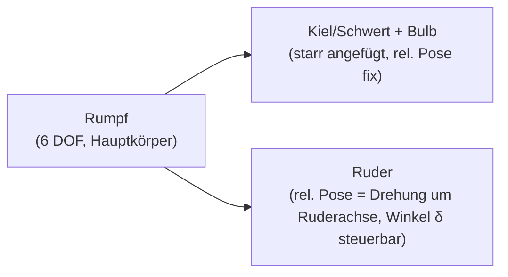

# Hydrodynamik in SegelPhysik
## Anleitung zur Implementierung der Strömungskräfte an Rumpf, Kiel/Schwert und Ruder

> Zielgruppe: Programmierer des Projekts SegelPhysik
> Stand: Oktober 2026 · bezieht sich auf `main` (134 Commits)
> Geltungsbereich: Verdrängungsfahrt (Priorität 1), Gleiten (Priorität 2)

---

## 0) Ausgangslage im Code

Was bereits existiert und unverändert genutzt wird:

| Baustein | Datei | Relevanz |
|---|---|---|
| Kraftmodell mit linearem/quadratischem Widerstand (je 6 Komponenten), Fluidgeschwindigkeit, Added Mass | `segelphysik/core/kraftmodell.py` | Andockpunkt für Hydrodynamik |
| Hydrostatik (Auftrieb $\rho g V_{tauch}$, Tauchung, Dämpfung) | `segelphysik/core/hydrostatik.py` | bleibt unverändert |
| 6-DOF-Integrator (Newton-Euler, dt = 4 ms, Added-Mass-Matrix) | `segelphysik/core/dynamik_6dof.py` | bleibt unverändert |
| Voxel-/Wasserschnitt-Logik | `segelphysik/core/voxelmodell.py` | für Benetzungstests je Teil |
| Körperverband mit `teile` + `rel_pose` (`setze_rel_pose`) | `segelphysik/core/koerper.py` | trägt die 3-Teil-Struktur |
| Einzelteile als OBJ (`rumpf`, `kiel`, `bulb`, `ruder`, …), `baue_teil()` | `segelphysik/core/boot_bau.py` | Mesh-Quelle je Teil |
| Konfiguration | `konfigurationen/physik.json` | neue Koeffizienten hier ablegen |

**Kernbefund:** Die Infrastruktur für Strömungskräfte ist vorhanden. Das `Kraftmodell`
nimmt bereits 6-Vektoren für linearen und quadratischen Widerstand entgegen und bildet
$\vec{v}_{rel} = \vec{v} - \vec{v}_{Fluid}$. Es fehlt nur die *physikalisch begründete*
Verknüpfung zwischen Rumpfform und diesen Koeffizienten – plus die Aufteilung auf die
drei Unterwasserteile.

---

## 1) Physikalischer Hintergrund

### 1.1 Kraftanteile

Ein Körper, der sich relativ zum Wasser bewegt, erfährt drei Anteile:

**a) Widerstand (Drag)** – wirkt entgegen der Relativgeschwindigkeit:

$$F_D = \tfrac{1}{2}\,\rho\, C_D\, A_{proj}\, v^2 \qquad \text{(Form-/Crossflow-Anteil)}$$

$$F_R = \tfrac{1}{2}\,\rho\, C_f\, A_w\, v^2 \qquad \text{(Reibungsanteil)}$$

mit dem ITTC-1957-Reibungsbeiwert

$$C_f = \frac{0{,}075}{(\log_{10} Re - 2)^2}, \qquad Re = \frac{v\,L}{\nu}, \quad \nu \approx 1{,}0\cdot10^{-6}\,\mathrm{m^2/s}$$

- $A_w$: benetzte Oberfläche (nasse Fläche)
- $A_{proj}$: Projektionsfläche senkrecht zur Anströmrichtung
- $L$: Rumpflänge (Bezugslänge für $Re$)

**b) Auftriebsartige Querkraft (Lift)** an Kiel/Schwert und Ruder:

$$F_L = \tfrac{1}{2}\,\rho\, v^2\, A_{ref}\, C_L(\alpha)$$

- Anstellwinkel $\alpha$: beim Kiel der Abdriftwinkel, am Ruder der Ruderwinkel $\delta$
  (plus Beitrag der lokalen Anströmung durch Gierdrehung, siehe 3.4).
- Lineare Profiltheorie mit endlicher Streckung genügt für Schulungszwecke:

$$C_L \approx 2\pi \cdot \frac{AR}{AR+2}\cdot\alpha, \qquad AR = \frac{s^2}{A_{ref}} = \frac{\text{Tiefe}^2}{\text{Profilfläche}}$$

- Ab Reißecke ($\alpha \gtrsim 15°$): $C_L$ sättigt, Crossflow-Drag übernimmt.
  Für die Simulation: weiche Sättigung, z. B. $C_L(\alpha) = C_{L,max}\cdot\tanh(2\pi k\,\alpha / C_{L,max})$.

**c) Added Mass** – das mitbeschleunigte Wasservolumen, wirkt als Trägheitszusatz
$-\lambda\,\ddot{x}$; im `Kraftmodell` bereits als Diagonale über 6 DOF vorhanden.

### 1.2 z-Richtung (Heave)

- Statisch: vollständig durch die implementierte Hydrostatik ($\rho g V_{tauch}$) abgedeckt.
- Dynamisch: Heave-Dämpfung (`daempfung_tauchung`) + Added-Mass-Heave genügen.
- Wellenschlag/Slamming: optional, später ergänzbar, kein Bestandteil dieser Anleitung.

### 1.3 Fahrzustände

| Zustand | Kriterium | Dominante Kräfte | Priorität |
|---|---|---|---|
| **Verdrängung** | Froude-Zahl $Fn = v/\sqrt{g\,L} \lesssim 0{,}4$ | $v^2$-Widerstand, hydrostatischer Auftrieb, Kiel-Lift gegen Abdriften | **1** |
| **Übergang** | $0{,}4 \lesssim Fn \lesssim 0{,}5$ | Blend der Koeffizientensätze | — |
| **Gleiten** | $Fn \gtrsim 0{,}5$ | dynamischer Auftrieb an der Rumpfsohle, sinkende Benetzung | 2 |

---

## 2) Möglichkeiten der simulativen Umsetzung

| # | Ansatz | Prinzip | Vorteile | Nachteile | Aufwand |
|---|---|---|---|---|---|
| A | Parametrische Dämpfung | Lineare/quadratische Koeffizienten je DOF, per Hand kalibriert | Extrem schnell, stabil, schon im Code | Kein Formbezug; „beliebige Formen" nur durch Handjustage | ~0 |
| **B** | **Koeffizientenmodell aus Geometrie** ⭐ | $A_w$, $A_{proj,x/y}$, $L$, $AR$ einmal pro Mesh vorrechnen; Kräfte aus ITTC-/Crossflow-/Lift-Formeln | Physisch begründet, beliebiges Mesh, Echtzeit, hoher Lehrwert | Genauigkeit ~10–20 %, teils empirische Koeffizienten | Mittel |
| C | Flächenintegration über Mesh | Druck-/Schubspannungen über nasse Dreiecke integrieren (Normals × $\tfrac12\rho v_n^2$) | Formtreu auch für exotische Körper | 10–100× teurer; Normals instabil bei rauhen Meshes; Kalibrierung trotzdem nötig | Hoch |
| D | Look-up-Tabellen (Polare) | Kräfte offline (CFD/Versuch) vorrechnen, zur Laufzeit interpolieren | Laufzeit fast gratis, sehr genau | Datenaufwand pro Körper; kein Lehr-Einblick | Hoch (offline) |
| E | Echte CFD / SPH | Navier-Stokes auflösen | Referenzgenauigkeit | Keine Echtzeit, neues Subsystem | Nicht praktikabel |

**Entscheidung: Ansatz B**, mit C als spätere Option für Spezialkörper.
B passt exakt zur Architektur: Das `Kraftmodell` erwartet ohnehin nur 6-Vektoren –
es muss nur besser befüllt werden, was bereits da ist.

---

## 3) Struktur: 3 starre Teile, kein FEM

### 3.1 Warum kein FEM

- Yachten sind für Schulungszwecke starr; Verformungen sind irrelevant.
- FEM-Zeitschritte wären um Größenordnungen teurer → Ziel „flüssige Darstellung" verfehlt.
- Die Kraftpfeil-Darstellung (`kraefte_bild`, `pfeilstil`) lebt von eindeutigen Kräften
  und Momenten je Teil – genau das liefert der Mehrkörpersatz didaktisch sauber.

### 3.2 Topologie



- **Rumpf**: 6 DOF über `Zustand6DOF` wie gehabt.
- **Kiel/Schwert (+ Bulb)**: starrer Anhang, Pose = Rumpf-Pose ⊗ `rel_pose`.
  Keine eigene Dynamik, nur eigene Kraftberechnung (Lift/Drag am Profil).
- **Ruder**: gleiche Logik, aber `rel_pose` enthält den steuerbaren Anstellwinkel δ
  (Rotation um die Ruderstock-Achse). δ ist **Eingabeparameter**, keine zusätzliche
  dynamische Gleichung → System bleibt deterministisch und einfach.
  Optional später: δ mit eigener Rate/Trägheit (kleiner 1-DOF-Integrator).

Die `Koerper`-Klasse unterstützt das bereits (`teile`, `setze_rel_pose`,
Massen-/Trägheitsaggregation in `_baue_verband`). `boot_bau.baue_teil("ruder")`
lädt das Ruder-Mesh schon einzeln – aktuell verschmilzt `baue_boot()` alles zu einem
Mesh, was für die Hydrostatik gut bleibt, aber Teilkräfte unsichtbar macht.

### 3.3 Neue Module

```
segelphysik/
└── core/
    ├── hydrodynamik.py        # NEU: Koeffizienten + Kräfte je Teil
    ├── kraftmodell.py         # ERWEITERT: Hook für Teilkräfte
    └── boot_bau.py            # ERWEITERT: baue_teile() -> (rumpf, kiel, ruder)
```

### 3.4 Schnittstellenentwurf `hydrodynamik.py`

Stil analog `auftrieb.py`: rein, zustandslos, SI-Einheiten.

```python
"""Hydrodynamische Kraefte an Rumpf, Kiel/Schwert und Ruder.

Ansatz B (Koeffizientenmodell aus Geometrie):
  - Geometriewerte werden EINMALIG vorberechnet (vorbereiten_teil).
  - Pro Schritt nur skalare Algebra (keine Mesh-Operationen im Hot Path).
SI-Einheiten. Alle Kraefte im Weltframe, Momente um den Rumpfschwerpunkt.
"""
import numpy as np

NU_WASSER = 1.0e-6          # kinematische Viskositaet [m^2/s], Suesswasser 20 degC
CD_PLATTE = 1.17            # Crossflow-Beiwert duenne Platte senkrecht zur Anstroemung


def vorbereiten_teil(punkte, dreiecke, wasserlinie_z=0.0):
    """Einmalig pro Teil: Geometriekennwerte berechnen.

    Rueckgabe: dict mit
      flaeche_benetzt   A_w   [m^2]  Dreiecksflaechen unterhalb wasserlinie_z
      a_proj_x          [m^2]  Projektion auf y-z-Ebene (Anstroemung aus +x)
      a_proj_y          [m^2]  Projektion auf x-z-Ebene (Anstroemung aus +y)
      laenge_bezug      L     [m]    max. Ausdehnung entlang x
      tiefgang_max      [m]
      profilflaeche     [m^2] Seitprojektion (fuer Kiel/Ruder: AR-Bezug)
      tiefe             [m]   Spannweite vertikal (fuer AR des Profils)
    """
    # Projektionsflaechen: einfache Summe der Dreiecksflaechen mal
    # |n·e| je Bezugsachse (Halbraum-Abschattung optional, s. Tests).


def cf_ittc(re):
    """ITTC-1957-Reibungsbeiwert."""
    return 0.075 / (np.log10(re) - 2.0) ** 2


def widerstand_rumpf(v_rel, geo, rho, cfg):
    """Surge/Sway/Heave-Widerstand des Rumpfs. -> Kraft (3,) im Weltframe."""
    geschw = np.linalg.norm(v_rel)
    if geschw < 1e-9:
        return np.zeros(3)
    re = max(geschw * geo["laenge_bezug"] / NU_WASSER, 1.0)
    # Reibung entlang x (benetzte Flaeche), Crossflow quer (a_proj_y >> a_proj_x)
    f_reib = 0.5 * rho * cf_ittc(re) * geo["flaeche_benetzt"] * geschw ** 2
    f_cross = 0.5 * rho * CD_PLATTE * geo["a_proj_y"] * v_rel[1] * abs(v_rel[1])
    kraft = np.zeros(3)
    kraft[0] = -f_reib * np.sign(v_rel[0])
    kraft[1] = -f_cross
    return kraft


def lift_profil(v_lokal, alpha, geo, rho, cfg):
    """Lift+Drag an Kiel oder Ruder im Teilframe.

    v_lokal : (3,) Anstroemung im Teilframe [m/s]
    alpha   : effektiver Anstellwinkel [rad]
              Kiel:  Abdriftwinkel
              Ruder: delta + Abdriftwinkel + atan2(giergeschw. * hebel, v)
    """
    geschw = np.linalg.norm(v_lokal[:2])          # horizontale Anstroemung
    if geschw < 1e-9:
        return np.zeros(3), np.zeros(3)
    ar = geo["tiefe"] ** 2 / geo["profilflaeche"]
    cl_max = cfg.get("cl_max", 1.2)
    cl = cl_max * np.tanh(2.0 * np.pi * ar / (ar + 2.0) * alpha / cl_max)
    cd_induziert = cl ** 2 / (np.pi * max(ar, 1e-3))
    q = 0.5 * rho * geschw ** 2 * geo["profilflaeche"]
    # Lift senkrecht zur Anstroemung, Drag entgegen (Crossflow-Anteil separat)
    ...
    return kraft, moment_hebel  # im Weltframe, inkl. Hebelarm r_i
```

### 3.5 Kraftzusammensetzung pro Schritt (Hot Path)

Für jedes Teil $i \in \{\text{Rumpf, Kiel, Ruder}\}$:

1. **Pose relativ zum Rumpf**: `R_i = R_rumpf @ R_rel_i(δ)`, `r_i = R_rumpf @ t_rel_i`
2. **Lokale Anströmung**: $\vec{v}_i = \vec{v}_{rumpf} + \vec{\omega} \times \vec{r}_i - \vec{v}_{Fluid}$
3. **Teilkraft** im Teilframe berechnen (Lift/Drag je nach Teil), zurückrotieren
4. **Gesamtmoment**: $\vec{M} += \vec{r}_i \times \vec{F}_i$

Das ist exakt das Muster von `Kraftmodell.fremdkraft_setzen()` (Kraft + Angriffspunkt
relativ zum Schwerpunkt) – drei solcher Beiträge statt einem.

**Ruder-Anstellwinkel effektiv:**

$$\alpha_{Ruder} = \delta + \beta + \arctan\!\left(\frac{\dot{\psi}\cdot l_{Ruder}}{v}\right)$$

mit $\beta$ = Abdriftwinkel, $l_{Ruder}$ = Abstand Rudersitz–Schwerpunkt,
$\dot{\psi}$ = Giergeschwindigkeit. Der letzte Term erzeugt das physikalisch wichtige
dämpfende Giermoment (Weathervane-Effekt) – für die Didaktik unverzichtbar.

### 3.6 Erweiterung `kraftmodell.py` (minimalinvasiv)

```python
class Kraftmodell:
    def __init__(self, ...):
        ...
        self.hydrodynamik_teile = []   # NEU: Liste von TeilHydro-Eintraegen

    def hydroteil_hinzufuegen(self, geo, rel_pose_funktion, art):
        """art in {'rumpf', 'kiel', 'ruder'}; rel_pose_funktion(delta) -> (R, t)."""
        ...

    def mit_hydrostatik(self, zustand, delta=0.0):
        # bestehende Hydrostatik + Widerstandsterm wie gehabt ...
        for teil in self.hydrodynamik_teile:
            R, t = teil.rel_pose_funktion(delta)
            r_i = self.orientierung @ t
            v_i = self.geschwindigkeit + np.cross(self.winkelgeschwindigkeit, r_i) \
                  - self.fluidgeschwindigkeit
            f_i = teil.kraft(v_i, zustand, self.rho)
            kraft = kraft + f_i
            moment = moment + np.cross(r_i, f_i)
        return kraft, moment
```

Alle bestehenden Tests bleiben unberührt (Hook ist optional, Default leer).

### 3.7 Konfiguration `physik.json` (Neuzweig)

```json
{
  "hydrodynamik": {
    "rho_wasser": 1000.0,
    "nu_wasser": 1.0e-6,
    "cd_platte": 1.17,
    "cl_max": 1.2,
    "fn_gleit_beginn": 0.4,
    "fn_gleit_ende": 0.6,
    "ruder": { "max_winkel_deg": 35.0, "rate_max_deg_s": 60.0 }
  }
}
```

### 3.8 Was sich NICHT ändert

- `dynamik_6dof.schritt()` bleibt ein einziger starrer Integrator – Teilkräfte werden vorher summiert.
- Added Mass weiterhin als Diagonale auf den Gesamtverband (Feinheit später).
- Hydrostatik bleibt auf dem **vereinigten** Mesh (Voxel/Union) – der Ruderwinkel ändert
  daran praktisch nichts (außer beim Schwert-Einfahren, dort `wasser_schnitt` je Teil).

---

## 4) Gleiten (Priorität 2)

- Umschaltung über die Froude-Zahl mit **sigmoidförmiger Blendfunktion** über die
  Koeffizientensätze – nichts hart umschalten, sonst springen die Kraftpfeile in der GUI:

$$w(Fn) = \frac{1}{1 + e^{-(Fn - Fn_{mitte})/s}}, \qquad c = (1-w)\,c_{verdraeng} + w\,c_{gleit}$$

- Im Gleitfall: $V_{tauch}$ und damit $A_w$ sinken (Benetzungsanteil über `wasser_schnitt`
  je Teil prüfen), Widerstandsbeiwert verschiebt sich.
- Kiel/Ruder tragen im Gleitfall kaum noch bei, da ihre Anströmfläche aus dem Wasser geht –
  ergibt sich automatisch aus dem Benetzungstest je Teil.

---

## 5) Performance („flüssige Darstellung")

1. Geometriewerte ($A_w$, $A_{proj}$, $L$, $AR$) **einmalig** beim Bauen des Körpers
   (`boot_bau` / `fabriken`) vorrechnen und cachen.
2. Hydrostatik-Cache-Intervall (`KraftmodellMitHydroCache`) beibehalten.
3. Hot Path enthält **nur skalare Algebra** – keine Mesh-Operationen, keine Obj-Ein-/Ausgabe.
4. Pfeildarstellung: Teilkräfte als separate Pfeile (`kraefte_bild`), nicht die Summe.

---

## 6) Tests (Muster: `tests/test_kraftmodell.py`)

| Test | Erwartung |
|---|---|
| `v = 0` | keine Kraft, kein Moment |
| Vorzeichen | Widerstand leistet nur negative Arbeit |
| Referenzkörper Quader senkrecht angeströmt | $C_D \approx 1{,}17$ (Platte) bzw. Known-Wert |
| Symmetrisches Profil, $\alpha = 0$ | keine Querkraft |
| Spiegelung am Mesh | nur Vorzeichenwechsel der y-Komponente |
| Ruder δ-Vorzeichen | Konvention festhalten (analog D11-Konvention), Test dagegen |
| Energiecheck: 10 s Integration ohne Antrieb | Geschwindigkeit fällt monoton |
| Ruder-Gierdämpfung: $\dot{\psi} \neq 0$, δ = 0 | rückstellendes Giermoment vorhanden |
| Gleit-Blend bei $Fn = 0{,}5$ | stetiger Übergang (kein Kraftsprung > Toleranz) |

---

## 7) Empfohlene Reihenfolge (Roadmap)

| Schritt | Inhalt | Aufwand |
|---|---|---|
| 1 | Hook in `Kraftmodell` + Testgerüst | 1 Tag |
| 2 | Geometrie-Vorberechnung $A_w$, $A_{proj}$, $L$, $AR$ je Teil + Tests | 1–2 Tage |
| 3 | `baue_teile()` in `boot_bau.py` (Rumpf/Kiel/Ruder getrennt) | 0,5 Tag |
| 4 | Surge/Sway-Widerstand (ITTC + Crossflow) verdrahten, an yacht1 sichtbar | 1 Tag |
| 5 | Kiel-Lift (Abdriftwinkel) + Ruder-Lift (δ, Gierterm) + Pfeile je Teil | 1–2 Tage |
| 6 | Heave-Dämpfung/Added Mass aus Geometrie statt Handwerte | kurz |
| 7 | Gleit-Blend über $Fn$ | später, Priorität 2 |

Mehraufwand des 3-Teil-Ansatzes gegenüber dem Ein-Körper-Plan: ca. 1–2 Tage.
Gewinn: Ruderwirkung, Giermoment und die Kiel-Seitenkraft gegen Abdriften werden
sichtbar – didaktisch der Kern der Sache.
