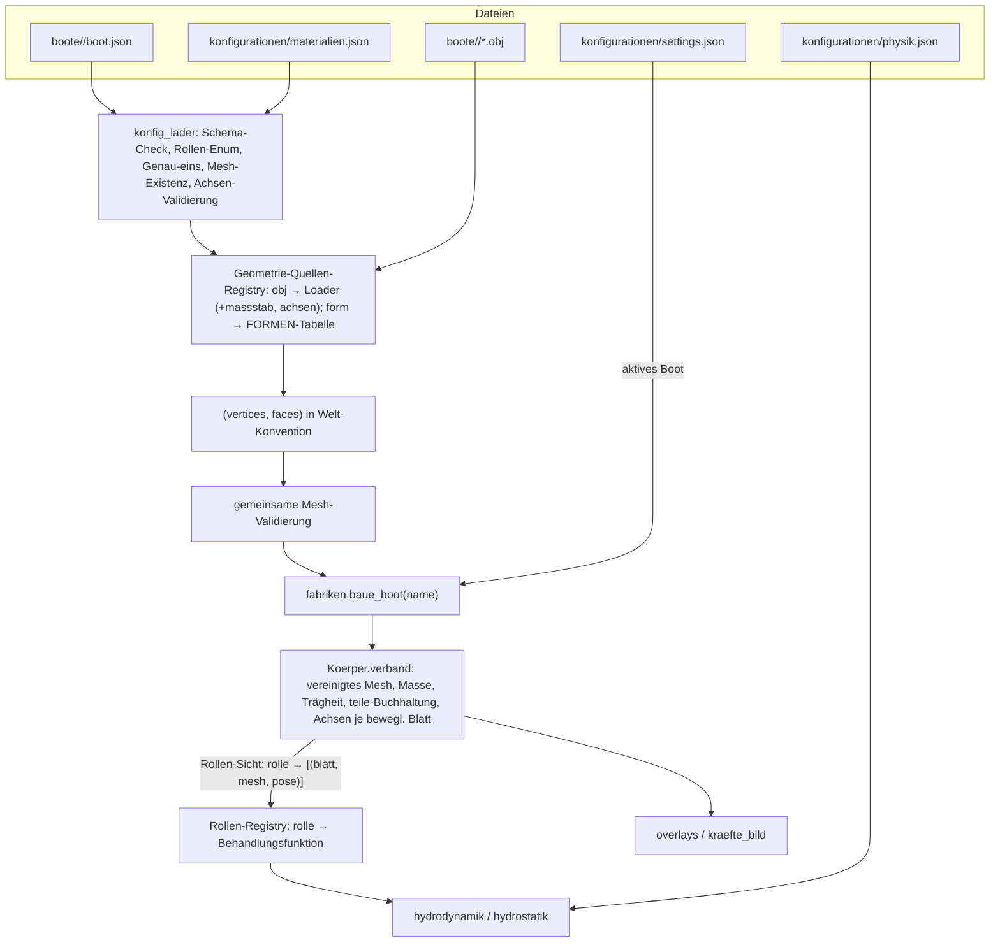
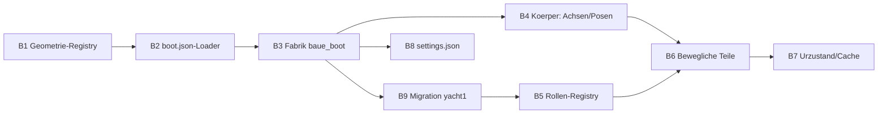

# Umbauanleitung Körper-/Boot-Struktur (SegelPhysik)

**Stand:** 16.10.2026 · **Zielgruppe:** Programmierer · **Umfang:** Kompletter Umbau der Bereitstellung von Körperformen inkl. beweglicher Teile und Physik-Adressierung

---

## 0) Kurzfassung

Der Umbau ersetzt die zentrale `koerper.json` durch **Bootsordner** (`boote/<name>/boot.json` + Meshes), vereinheitlicht Geometrie-Quellen (`form` und `mesh` → ein Feld `geometrie`), führt eine **Rollen-Enum** als Adresse für die Physik-Engine ein und macht **bewegliche Teile** (Ruder, Segel) mit getrennten Drehachsen für Physik und Darstellung deklarierbar. Die Hydrostatik rechnet auf einem definierten **Urzustand**.

---

## 1) Ausgangslage (Ist-Zustand)

### 1.1 Dateien

| Datei/Ort | Inhalt |
|---|---|
| `konfigurationen/koerper.json` | Top-Level nur `summenkoerper` und `darstellung`. Jeder Eintrag entweder einfacher Körper (`"form"`) oder Verband (`"teile"`, verschachtelt). Blätter tragen genau eine Masseangabe (`material` ODER `dichte_kg_pro_m3`+`farbe`+`farbe_unter_wasser`), optional `wanddicke_m`. |
| `konfigurationen/materialien.json` | Materialtabelle (dichte, farbe, farbe_unter_wasser, glanz) + Wassertypen. |
| `segelphysik/modelle/<name>/*.obj` | Meshes je Verband-Teil. **Namensvertrag:** Blatt-`name` = OBJ-Dateiname. Alle Teile im gemeinsamen Ursprung, Unity-Konvention (Y hoch, Länge entlang z), Wasserlinie y_unity = 0. |
| `doc/Vorlagen/*_vorlage.json` | Vorlagen bei Ladefehlern (kein stiller Fallback). |

### 1.2 Code

| Modul | Rolle | Kritische Punkte |
|---|---|---|
| `konfig_lader.py` | Liest beide JSONs, strenge rekursive Validierung (unbekannte Schlüssel abgelehnt, P3/P4-Regeln, Formparameter gegen FORMEN-Tabelle geprüft inkl. Probebau). | Kennt zentrale `koerper.json`. |
| `fabriken.py` | `baue_summenkoerper(konfig, name)`: Verzweigung `"form"` → `baue_form()` vs. `"teile"` → rekursiv Specs sammeln (OBJ laden, Material auflösen, `wanddicke_m` → Flächenmasse ρ·t) → `Koerper.verband(specs)`. Rückgabe `(koerper, r_modell)`. | **Sonderfall** einfach vs. zusammengesetzt. |
| `boot_bau.py` | OBJ-Loader (v/f-Zeilen, Fächerung >3-Eck-Polygone), Achsen-Swap (x,y,z)_unity → (z,x,y), `SKALA = 0.25` **hart codiert**. | Konventionen implizit. |
| `koerper_formen.py` | `FORMEN`-Tabelle: 8 Primitive (`cone, box, pyramid, sphere, cylinder, plate, hexprism, polyhedron`), rein geometrisch, erzeugt (vertices, faces), zentriert auf geometrischen Schwerpunkt. | Bleibt erhalten. |
| `koerper.py` | Alles im eigenen Schwerpunktframe. Einfach: Volumen per Dreiecksintegration, Trägheitstensor, Zentrierung. Verband (`_baue_verband`): Meshes verschmolzen, Massen summiert, Trägheit per Parallelachsentheorem; Kinder bleiben als `self.teile = [(kind, (R, t − r_s))]` erhalten. `_volumen = None` beim Verband (Hydrostatik arbeitet auf Blatt-Meshes). API unterstützt `rel_pose` (wird vom aktuellen Schema nicht genutzt). | Kernrechnungen bleiben unverändert. |
| `hydrostatik.py` / `voxelmodell.py` | Wasserschnitt/Volumen auf **Blatt-Meshes** (`auftrieb.als_bindung().blatt_meshes`); `KraftmodellMitHydroCache` rechnet nur alle N Schritte. | Kernrechnungen bleiben unverändert. |
| `overlays.py` | Laufzeit-Layer (Schwerpunkt, Kräfte…), globale Sichtbarkeits-Registry. Körper speichert keine Overlays (P5a: Koerper = Wahrheit, Renderer = Projektion). | Unverändert. |
| `formerkennung.py` | Nachträgliche Mesh-Klassifikation ohne Typwissen. | Unverändert. |

### 1.3 Probleme des Ist-Zustands (Motivation)

1. Neues Boot = Eintrag in zentraler JSON + Dateien an passender Stelle → kein „Ordner kopieren“.
2. Sonderfall „einfacher Körper“ neben Verbänden in Loader/Fabrik.
3. Teil-Positionierung implizit in OBJ-Koordinaten; `SKALA`/Achstausch hart codiert.
4. Keine Physik-Adressierung: Die Engine kann nicht wissen, was Rumpf/Kiel/Ruder/Segel ist.
5. Keine beweglichen Teile; Segel/Ruder fix.
6. `rel_pose` in der API ungenutzt.

---

## 2) Zielsystem

### 2.1 Verzeichnisbaum

```text
projekt/
├── konfigurationen/
│   ├── materialien.json          # Materialtabelle + Wassertypen (bleibt)
│   ├── physik.json               # Simulationsparameter (bleibt)
│   └── settings.json             # NEU: aktives Boot, Ansicht, Overlay-Sichtbarkeiten
├── boote/
│   ├── yacht1/
│   │   ├── boot.json             # Manifest
│   │   ├── rumpf.obj  kiel.obj  bulb.obj  ruder.obj
│   │   └── mast.obj   baum.obj  grosssegel.obj  fock.obj
│   ├── kegel/boot.json           # Testkörper: Primitive, keine OBJ nötig
│   ├── quader/boot.json
│   └── kielschwert_test/boot.json
├── segelphysik/                  # Code
└── tests/
```

### 2.2 boot.json – Schema

Boot-Ebene: `massstab` (float, explizit angeben), `achsen` (`"unity_y_up"` | `"welt_z_up"`), optional `_beschreibung`, optional `urzustand`.

Knoten (Gruppe ODER Blatt):

| Feld | Gruppe | Blatt | Bedeutung |
|---|---|---|---|
| `name` | ✔ frei, eindeutig im Baum | ✔ frei | Anzeige/GUI/Protokoll |
| `rolle` | ✔ aus Enum | optional (erbt Eltern-Rolle) | **Adresse der Physik-Engine** |
| `teile` | ✔ | ✖ | Kinder |
| `geometrie` | ✖ | ✔ genau eins | `{ "quelle": "obj", "datei": "..." }` oder `{ "quelle": "form", "typ": "...", ...Parameter }` |
| `beweglich` | ✖ | optional | `{ "achse_physik": {punkt, richtung}, "achse_darstellung": {punkt, richtung} }` – beide immer angeben |
| `darstellung_koppelt_an` | ✖ | optional | Name eines Geschwister-Blatts: übernimmt dessen *Darstellungs*winkel (rein optisch) |
| `material` ODER Direkt-Tripel | ✖ | ✔ genau eins (P3/P4) | Massebelegung |
| `wanddicke_m` | ✖ | optional | Schale: Masse = ρ·t·Oberfläche |

**Rollen-Enum:** `rumpf`, `kiel`, `ruder`, `rigg`, `segel`, `stehendes_gut`.
Kein Wort „Gruppe“ (keine Doppelungen): Rolle `kiel` enthält `flosse` + `bulb`; Rolle `ruder` enthält `blatt`; Rolle `rumpf` enthält `schale`.

### 2.3 Beispiel yacht1 (boot.json)

```json
{
  "_beschreibung": "Yacht 1, Skalenmodell",
  "massstab": 0.25,
  "achsen": "unity_y_up",
  "urzustand": {},
  "teile": [
    { "name": "rumpf", "rolle": "rumpf", "teile": [
        { "name": "schale", "geometrie": { "quelle": "obj", "datei": "rumpf.obj" },
          "material": "GfK", "wanddicke_m": 0.005 }
    ]},
    { "name": "kiel", "rolle": "kiel", "teile": [
        { "name": "flosse", "geometrie": { "quelle": "obj", "datei": "kiel.obj" }, "material": "Stahl" },
        { "name": "bulb",   "geometrie": { "quelle": "obj", "datei": "bulb.obj" }, "material": "Blei" }
    ]},
    { "name": "ruder", "rolle": "ruder", "steuerbar": true, "teile": [
        { "name": "blatt", "geometrie": { "quelle": "obj", "datei": "ruder.obj" },
          "material": "GfK", "wanddicke_m": 0.005,
          "beweglich": {
            "achse_physik":      { "punkt": [0.02, 0.0, 0.0], "richtung": [0, 0, 1] },
            "achse_darstellung": { "punkt": [0.02, 0.0, 0.0], "richtung": [0, 0, 1] }
          }}
    ]},
    { "name": "rigg", "rolle": "rigg", "teile": [
        { "name": "stehendes_gut", "rolle": "stehendes_gut", "teile": [
            { "name": "mast", "geometrie": { "quelle": "obj", "datei": "mast.obj" }, "material": "Aluminium", "wanddicke_m": 0.002 },
            { "name": "baum", "geometrie": { "quelle": "obj", "datei": "baum.obj" }, "material": "Aluminium", "wanddicke_m": 0.002,
              "darstellung_koppelt_an": "grosssegel" }
        ]},
        { "name": "segel", "rolle": "segel", "teile": [
            { "name": "grosssegel", "geometrie": { "quelle": "obj", "datei": "grosssegel.obj" },
              "material": "Segeltuch", "wanddicke_m": 0.0004,
              "beweglich": {
                "achse_physik":      { "punkt": [0.35, 0.0, 0.0], "richtung": [0, 0, 1] },
                "achse_darstellung": { "punkt": [0.35, 0.0, 0.0], "richtung": [0, 0, 1] }
              }},
            { "name": "fock", "geometrie": { "quelle": "obj", "datei": "fock.obj" },
              "material": "Segeltuch", "wanddicke_m": 0.0004,
              "beweglich": {
                "achse_physik":      { "punkt": [0.55, 0.0, 0.0], "richtung": [0, 0, 1] },
                "achse_darstellung": { "punkt": [0.70, 0.15, 0.0], "richtung": [0.28, 0.0, 0.96] }
              }}
        ]}
    ]}
  ]
}
```

**Wichtig zu den Achsen-Werten:** Die Zahlen oben sind **Platzhalter**. Die Achsen werden im **Blatt-Mesh-Koordinatensystem nach massstab- und achsen-Transformation** angegeben (also in Metern, Welt-Achsen). Vor dem Umbau an den realen Meshes vermessen! Die Fock-Darstellungsachse liegt entlang des Vorlieks (schräge Vorderkante) – Richtung = normierter Vektor entlang dieser Kante; die Physik-Achse ist eine virtuelle Senkrechte bei 1/3 der Fock-Länge von vorn.

### 2.4 Beispiel Testkörper (boote/kegel/boot.json)

```json
{
  "_beschreibung": "Einfacher Testkoerper",
  "teile": [
    { "name": "rumpf", "rolle": "rumpf", "teile": [
        { "name": "koerper",
          "geometrie": { "quelle": "form", "typ": "cone", "H_m": 2.0, "R_m": 1.0 },
          "material": "Holz" }
    ]}
  ]
}
```

Kein `massstab`/`achsen` nötig: Primitive sind bereits in Metern und Welt-Achsen definiert. Keine OBJ-Dateien im Ordner.

### 2.5 Kernregeln

1. **Masse nur auf Blättern** (P2.5/P3/P4 unverändert).
2. **Rollen-Enum strikt:** unbekannte Rolle = Ladefehler. Erweiterung = Registry-Eintrag + Behandlungsfunktion.
3. **Leere Rolle = Fehler; fehlende Rolle = kein Physik-Beitrag.** Keine „Empty"-Gruppen.
4. **Kein stiller Fallback:** strenge Validierung mit Pfadangabe im Fehler.
5. **Einfache Körper = Rumpf:** immer explizit als Baum mit Rolle `rumpf`, kein implizites Wrapping durch den Loader.
6. **Ein Verarbeitungspfad:** beide Geometrie-Quellen münden in (vertices, faces) in Welt-Konvention → gemeinsame Validierung → `Koerper.verband()`. Es gibt keinen „einfacher Körper"-Pfad mehr – nur Boote mit unterschiedlicher Blattzahl.
7. **Eine Steuerzahl δ pro beweglichem Blatt**, interpretiert je Achse: Physik dreht um `achse_physik`, Darstellung um `achse_darstellung`, beide mit demselben δ.
8. **Hydrostatik auf Urzustand** (alle δ = Referenzwert, default 0), einmalig berechnet und gecacht; Recompute nur ereignisgesteuert (z. B. späterer Schwert-Fall), nie pro Schritt.
9. **`darstellung_koppelt_an` ist rein optisch:** Der Baum folgt der Darstellungs-Pose des Großsegels, taucht in keiner Kraftberechnung auf.

### 2.6 Adresskette

**Boot-Ordner → boot.json → Rolle → Behandlung.** Die Engine kennt nur Rollen, niemals Namen oder Dateien:

| Rolle | Behandlung |
|---|---|
| `rumpf` | Rumpf-Hydro (Verdrängung, Drag, später Gleiten) |
| `kiel` | Finnen-Lift + Ballast |
| `ruder` | Lift mit Anstellwinkel δ |
| `segel`, `stehendes_gut` | vorerst inert (nur Masse) |
| `rigg` | rein hierarchischer Überbau, kein eigener Physik-Fall |

Neue Komponente hinzufügen = Mesh in den Boot-Ordner + ein Eintrag in boot.json. Engine und Loader ändern sich nicht.

### 2.7 Informationsfluss (Ziel)



---

## 3) Baustellen und Umsetzungsschritte

### B1 – Geometrie-Quellen-Registry (neu: `geometrie_quellen.py`)

**Ziel:** `form` und `obj` hinter einer Schnittstelle; neuer Import (STL/PLY) später = ein Registry-Eintrag.

1. Tabelle `GEOMETRIE_QUELLEN = {"obj": lade_obj_geometrie, "form": baue_form_geometrie}` anlegen.
2. Einheitliche Signatur: `resolve(spec, boot_kontext) -> (vertices, faces)`; `boot_kontext` enthält `massstab`, `achsen`, Boot-Ordnerpfad.
3. `obj`: bestehenden `boot_bau`-Loader nutzen. Reihenfolge: parsen → mit `massstab` multiplizieren → Achstausch gemäß `achsen` → zurückgeben.
4. `form`: `koerper_formen.baue_aus_form()` aufrufen; Parameter sind bereits Meter/Welt-Achsen – `massstab`/`achsen` **nicht anwenden**.
5. Gemeinsame Mesh-Validierung (geschlossen, konsistent orientiert, Flip bei Bedarf) an genau einer Stelle anschließen.

**Tests:** Kegel analytisch (V = (1/3)·π·R²·H), OBJ-Referenzfile, unbekannte Quelle → Fehler.

### B2 – boot.json-Loader (`konfig_lader.py`)

1. Neue Funktion `lade_boot(name) -> BootManifest`: liest `boote/<name>/boot.json`.
2. Validierung (rekursiver Baum-Lauf):
   - `name` eindeutig im ganzen Baum (nicht nur je Ebene),
   - `rolle` gegen Enum (Konstante `ROLLEN` aus der Rollen-Registry, B5),
   - Blatt: genau ein `geometrie`, genau eine Masseangabe; `beweglich` nur mit beiden Achsen, Richtung ≠ 0 (normalisieren),
   - Gruppe: `teile` nicht leer (**leere Rolle = Fehler**), keine Masseangabe erlaubt,
   - `darstellung_koppelt_an`: Ziel muss Geschwister-Blatt sein, existieren und `beweglich` sein,
   - `steuerbar` nur an Gruppen mit beweglichen Blättern (Entscheidung dokumentieren),
   - `urzustand`: Schlüssel müssen bewegliche Blattnamen sein.
3. Mesh-Existenzprüfung: `quelle: "obj"` → Datei muss existieren (Fehler beim Laden, nicht erst beim Bauen).
4. Alte `koerper.json`-Ladepfade entfernen (**kein Dual-Lesen**). `darstellung.standard_ansicht` wandert nach `settings.json`.

### B3 – Fabrik (`fabriken.py`)

1. `baue_boot(name) -> (koerper, r_modell, rollen_sicht)` ersetzt `baue_summenkoerper`.
2. Kein Form/Teile-Verzweigen mehr: immer Baum → `Koerper.verband(specs)`; ein Einzelblatt-Boot ist einfach ein Verband mit einem Kind.
3. Spec-Erzeugung pro Blatt: Geometrie über Registry (B1) auflösen, Material/Dichte/Farbe auflösen, `wanddicke_m` → `flaechenmasse = ρ·t`, `beweglich`-Achsen und `darstellung_koppelt_an` durchreichen.
4. Protokollzeilen je Blatt + 40-%-Massen-Warnung beibehalten.
5. **Rollen-Sicht** bauen: `rollen_sicht: dict[rolle, list[(blatt_name, mesh, rel_pose_basis)]]` – flache Liste je **vorhandener** Rolle; fehlende Rollen erscheinen nicht.
6. `settings.json` lesen: `aktives_boot`.

### B4 – Koerper erweitern (`koerper.py`)

1. `Koerper.verband(specs)` akzeptiert Spec-Felder `beweglich` (Achsen) und `koppelziel`; speichert je beweglichem Blatt `achse_physik`, `achse_darstellung` (Punkt + normalisierte Richtung).
2. Neue Funktionen:
   - `rel_pose_physik(name, delta) -> (R, t)`: Rotation um `achse_physik`,
   - `rel_pose_darstellung(name, delta) -> (R, t)`: Rotation um `achse_darstellung`,
   - `darstellungs_pose(name, delta)`: löst `darstellung_koppelt_an` auf (Baum folgt Großsegel-Anzeige).
3. Rotationsmatrix um beliebige Achse (Punkt p, Richtung r, Winkel δ): R = T(p)·R_r(δ)·T(−p); mit numpy implementieren, gegen Rodrigues-Formel testen.
4. Masse/Trägheit/Hydrostatik **unverändert auf Urzustand**. Nie Meshes neu generieren – Posen sind reine Matrizen (Echtzeit-tauglich).

### B5 – Rollen-Registry für die Physik (neu: `rollen_registry.py`)

1. `BEHANDLUNGEN = {"rumpf": rumpf_hydro, "kiel": finnen_lift, "ruder": ruder_lift, "segel": inert, "stehendes_gut": inert}` – analog zur FORMEN-Tabelle als **einziger Ort** der Rollendefinition (Enum + Behandlung in einer Datei).
2. Schnittstelle je Behandlung: `berechne(gruppe_blaetter, zustand, wasser, luft) -> list[(kraft, moment, angriffspunkt, blatt_name)]` – **je Blatt einzeln** zurückgeben (GUI-Pfeile), die Summation macht die Engine.
3. Iteration nur über **vorhandene** Rollen der Rollen-Sicht; fehlende Rolle = trivial kein Beitrag.
4. Anbindung an `Kraftmodell`: Beiträge je Rolle über `fremdkraft_setzen(...)` (existiert bereits, mit Angriffspunkt) einspeisen oder Hook in `mit_hydrostatik()` – Details siehe `hydrodynamik_anleitung.md`.

### B6 – Bewegliche Teile anbinden

1. Steuerzustand: `delta: dict[blatt_name, winkel]` im Szenario/Skript (Nutzer-Eingabe), Default aus `urzustand`.
2. Physik-Pfad pro Schritt: für jedes bewegliche Blatt `rel_pose_physik(δ)` → effektiver Anstellwinkel + Hebelarm → Behandlungsaufruf (B5).
3. Renderer-Pfad: `rel_pose_darstellung(δ)` bzw. `darstellungs_pose` für gekoppelte Teile (Baum). Nur Pose-Matrizen, keine Mesh-Operationen.
4. Optional (später): δ-Rate-Begrenzung (Ruderzeit) – nicht im ersten Schritt.

### B7 – Urzustand & Hydrostatik-Cache

1. `urzustand` aus Manifest → initiales δ-Dictionary.
2. Hydrostatik (Voxel/Wasserschnitt, Trägheit, Masse) **einmalig** auf Urzustand berechnen; Ergebnis cachen (bestehender `KraftmodellMitHydroCache`).
3. Invalidierungsquelle vorbereiten: `hydrostatik_invalidieren(grund)` – für den späteren Schwert-Fall (ereignisgesteuert, NICHT pro Schritt).
4. Dokumentieren: „Auftrieb basiert auf dem Boot im Urzustand" (didaktisch wichtig).

**Begründung Urzustand statt Live-Mitrechnen:** Voxel-Hydrostatik ist die teuerste Operation (deshalb existiert ja schon der Cache). Segel-Trim ändert das Verdrängungsvolumen nicht (über Wasser); Ruderdrehung um eine Senkrechte ändert das Unterwasservolumen praktisch nicht. Der Fehler ist weit unter Messbarkeit – Urzustand ist physikalisch ausreichend und deterministisch erklärbar. Einzig ein ein-/ausfahrbares Schwert ändert Verdrängung/Schwerpunkt substanziell → dann ereignisgesteuerter Recompute über den Invalidierungs-Hook.

### B8 – settings.json

1. Felder: `aktives_boot`, `standard_ansicht` (aus alter `darstellung`), Overlay-Sichtbarkeiten.
2. Loader analog zum bestehenden Stil (strenge Validierung, Vorlage in `doc/`).

### B9 – Migration

1. Skript `werkzeuge/migriere_koerper.py`:
   - liest alte `koerper.json` + `modelle/<name>/*.obj`,
   - erzeugt `boote/<name>/boot.json` (Baum 1:1 übernehmen, Rollen zuordnen: `kielsystem` → `kiel`, `rigg` → `rigg`, …),
   - kopiert Meshes, setzt `"massstab": 0.25`, `"achsen": "unity_y_up"`,
   - trägt `beweglich`-Achsen zunächst als Platzhalter ein (identische Achsen am Ruder, Mast-Achse fürs Großsegel) – **Werte an realen Meshes prüfen!**
2. Einmalig ausführen, danach alte Pfade entfernen (kein Dual-Lesen).

### B10 – Tests

| Test | Erwartung |
|---|---|
| Kegel-Boot (`form`) | Volumen analytisch (1/3)·π·R²·H, Masse = ρ·V |
| OBJ-Boot (`obj`) | Volumen vs. Voxel-Referenz; Achstausch korrekt (Wasserlinie z = 0) |
| massstab | Faktor 2 im Manifest → Faktor 8 im Volumen |
| Rollen | unbekannte Rolle → Fehler; leere Rolle → Fehler; fehlende Rolle → kein Beitrag |
| δ = 0 | Posen identisch Urzustand; Hydrostatik-Werte unverändert |
| Fock δ ≠ 0 | Physik-Pose dreht um virtuelle Senkrechte; Darstellungs-Pose um Vorliek (schräg) – beide aus derselben δ |
| Baum | folgt Darstellungs-Pose des Großsegels; trägt keine Kraft |
| Energiecheck | 10 s Drift ohne Antrieb → Geschwindigkeit monoton fallend |
| Migration | yacht1 alt vs. neu: gleiche Masse, gleicher Schwerpunkt, gleiches Volumen |

---

## 4) Reihenfolge der Baustellen



**Empfohlene Reihenfolge mit Begründung:**

1. **B1** zuerst – Basis, alles andere konsumiert (vertices, faces).
2. **B2** – Loader, damit B3 Daten bekommt.
3. **B3** – Fabrik; ab hier kann yacht1 im neuen Layout gebaut werden.
4. **B9** direkt danach – Migration liefert sofort ein reales Testobjekt statt nur Synthetik.
5. **B8** – klein, jederzeit einschiebbar.
6. **B5** – Rollen-Registry; Voraussetzung für sinnvolle bewegliche Physik.
7. **B4 → B6** – Achsen/Posen erst, wenn Rollen stehen (δ braucht ein Ziel).
8. **B7** zuletzt – Urzustand/Invalidierung greift erst, wenn bewegliche Teile existieren.
9. **B10** begleitet jede Stufe (nie am Ende gesammelt!).

**Jede Stufe endet mit:** grüne Tests + yacht1 lädt und zeigt sich unverändert (Regressionssicherung vor dem nächsten Schritt).

---

## 5) Softwarestruktur nach dem Umbau

```text
segelphysik/
├── core/
│   ├── koerper_formen.py      # FORMEN-Tabelle (unverändert, liegt hinter Registry)
│   ├── geometrie_quellen.py   # NEU (B1): Registry obj/form
│   ├── boot_bau.py            # OBJ-Loader (SKALA/Achsen jetzt Parameter)
│   ├── koerper.py             # + Achsen, Posen-Funktionen (B4)
│   ├── konfig_lader.py        # + lade_boot, settings (B2, B8)
│   ├── fabriken.py            # baue_boot + Rollen-Sicht (B3)
│   ├── rollen_registry.py     # NEU (B5): ROLLEN + BEHANDLUNGEN
│   ├── hydrostatik.py         # + Urzustand-Cache-Invalidierung (B7)
│   ├── kraftmodell.py         # unverändert / minimaler Hook (siehe Hydrodynamik-Anleitung)
│   └── dynamik_6dof.py        # unverändert
├── werkzeuge/
│   └── migriere_koerper.py    # NEU (B9), einmalig
```

**Prinzipien, die gelten bleiben:** SI-Einheiten, deutsche Bezeichner, reine zustandslose Kernfunktionen, deklarieren statt ableiten, keine stillen Fallbacks, eine Quelle je Definition (FORMEN-Tabelle, Rollen-Registry, Materialtabelle).

---

## 6) Modellimportanleitung (neues Boot anlegen)

### Schritt 1 – Ordner anlegen

`boote/<bootname>/` – `<bootname>` = Verzeichnisname = Boot-ID (Kleinschreibung, keine Leerzeichen/Umlaute).

### Schritt 2 – Meshes vorbereiten (CAD/3D-Programm)

1. **Je Teil genau eine OBJ-Datei** (Normalfall; mehrere Dateien je Teil nur als dokumentierte Ausnahme).
2. **Einheiten:** beliebig, aber notiere die Größe – du brauchst sie für `massstab`. Empfehlung: in Metern modellieren und `massstab: 1.0` setzen.
3. **Achsen:** Entscheide die Export-Konvention:
   - `unity_y_up`: oben = +Y, Bootslänge entlang z, Wasserlinie bei y = 0 (wie yacht1),
   - `welt_z_up`: oben = +Z, Bootslänge entlang x, Wasserlinie bei z = 0 (direkt richtig, keine Transformation).
4. **Wasserlinie:** Modell so legen, dass die Wasserlinie exakt auf 0 liegt – die Hydrostatik setzt das voraus.
5. **Gemeinsamer Ursprung:** Alle Teile in denselben Modellkoordinaten exportieren (Positionierung steckt in den Koordinaten, nicht im Manifest).
6. **Mesh-Qualität:** geschlossen (watertight), konsistent orientierte Normalen, keine doppelten Flächen. Der Loader flippt falsche Orientierung automatisch, aber Geschlossenheit ist Pflicht für Volumen/Masse.
7. Export als Wavefront-OBJ mit Dreiecken oder konvexen Polygonen (Polygone > 3 Ecken werden gefächert).

### Schritt 3 – boot.json schreiben

Boot-Vorlage kopieren (bei Fertigstellung unter
`doc/Vorlagen/boot_vorlage.json`) und ausfüllen:

- `massstab`: Modellgröße ÷ Zielgröße. Beispiel: Modell 16,9 Längen, Ziel 4,2 m → `0.25`.
- `achsen`: wie in Schritt 2 gewählt.
- `teile`: Baum aus Rollen. Mindestumfang für ein schwimmfähiges Boot: Rolle `rumpf` mit einem Blatt. Weitere Rollen nach Bedarf – **fehlende Rollen sind ok, leere Rollen sind Fehler.**
- Je Blatt: `geometrie` (obj → Dateiname, form → Primitive), Massebelegung (`material` aus materialien.json ODER Direkt-Tripel Dichte/Farben), ggf. `wanddicke_m` für Schalen (Rumpf, Mast, Segel).
- Bewegliche Teile: `beweglich` mit **beiden** Achsen (Punkt + Richtung im Mesh-Koordinatensystem nach Transformation):
  - **Ruder:** senkrechte Achse nahe der Vorderkante, Physik = Darstellung.
  - **Großsegel:** Achse im Mastzentrum (außerhalb des Objekts!), Physik = Darstellung.
  - **Fock:** Physik = virtuelle Senkrechte bei 1/3 von vorn; Darstellung = entlang des Vorlieks (schräge Vorderkante – Richtung = normierter Vektor entlang dieser Kante).
  - **Baum:** kein `beweglich`, sondern `darstellung_koppelt_an: "grosssegel"`.
- Optional `urzustand`: `{ "blattname": winkel_rad }` für Startstellung der beweglichen Teile.

### Schritt 4 – Eintragen & starten

1. `konfigurationen/settings.json`: `"aktives_boot": "<bootname>"`.
2. Programm starten – der Loader validiert beim Laden: fehlende Mesh-Datei, unbekannte Rolle, leere Rolle, fehlende Masse, defektes Mesh → **Fehler mit Pfadangabe**, nichts wird still gerettet.
3. Kontrolle: Boot schwimmt auf der Wasserlinie? Schwerpunkt-Overlay plausibel? Massen-Protokoll beachten (40-%-Warnung – meist fehlte `wanddicke_m`).

### Schritt 5 – Häufige Fehler

| Symptom | Ursache |
|---|---|
| Boot steht kopfüber/quer | falsche `achsen`-Angabe |
| Boot riesig/winzig, sinkt/schwebt falsch | `massstab` falsch (Volumen skaliert mit dritter Potenz!) |
| Masse viel zu klein | `wanddicke_m` vergessen (Schale statt Vollkörper) |
| Segel dreht um falschen Punkt | Achsen-Punkt im Mesh-Frame falsch angegeben |
| „Rolle leer" | Gruppe ohne `teile` |
| Mesh-Fehler beim Laden | nicht geschlossen / doppelte Flächen – im CAD-Programm reparieren |

---

## 7) Offene Punkte (bewusst vertagt / zu entscheiden)

1. `rel_pose` im Manifest (Teile einzeln um eigenen Ursprung statt gemeinsamem Ursprung) – API vorhanden, Schema später erweiterbar.
2. STL/PLY-Import – Registry vorbereitet (B1), Implementierung später.
3. δ-Rate-Begrenzung (Ruderzeit) – später.
4. Ereignisgesteuerter Hydrostatik-Recompute für Schwert-Stellung – Invalidierungs-Hook in B7 vorbereitet.
5. Mehrere Mesh-Dateien je Blatt – Schema-Ausnahme, nur bei Bedarf.
6. Achsen-Werte für Ruder/Segel in der Migrations-Vorlage sind Platzhalter – an realen Meshes vermessen.

---

## 8) Verwandte Dokumente

- `hydrodynamik_anleitung.md` – Kräfte durch Strömung (Rumpf-/Kiel-/Ruder-Behandlungen, die die Rollen-Registry adressiert).
