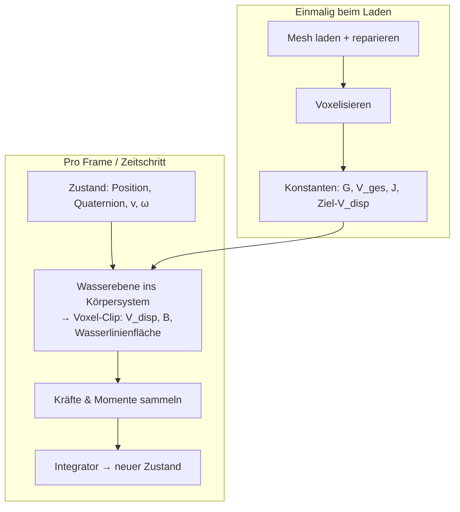
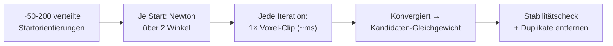

# Lehrbuch: Schwimm-Lagesimulation eines starren Körpers
## Ein praxisorientierter Leitfaden für Programmierer

> **Ziel dieses Dokuments:** Du baust eine Simulation, in der ein beliebiger, starrer Körper mit homogener Masseverteilung teilweise in Wasser eintaucht. Die Simulation berechnet die statische Gleichgewichtslage und kann dynamisch weiterlaufen. Alles soll **interaktiv flüssig** laufen (< 1 s pro statischer Abfrage, tausende Zeitschritte pro Sekunde), aber **physikalisch hinreichend genau** sein.
>
> **Grundprinzip der Architektur:** Einmal vorberechnen, was konstant ist. Pro Abfrage nur billige Operationen ausführen. Physik und Grafik teilen sich dieselbe Geometrie-Basis, nutzen aber jeweils die dafür optimale Repräsentation.

---

# Teil 0 – Systemarchitektur (lies das zuerst)

## 0.1 Die zwei Repräsentationen

| Repräsentation | Wofür | Warum |
|---|---|---|
| **Oberflächen-Mesh** (Dreiecksnetz) | Grafik/Rendering | GPUs rendern nativ Dreiecke; glatte Silhouetten, Beleuchtung, Materialien |
| **Voxel-Grid** (3D-Raster) | Physik | Clipping an der Wasserebene = simpler Array-Sweep, robust, GPU-parallelisierbar |

Beide beschreiben denselben Körper. Der Körper ist **starr**: Er verformt sich nie, wird nur rotiert und verschoben. Das ist die entscheidende Voraussetzung dafür, dass die Voxelisierung **einmalig** erfolgen darf.

## 0.2 Der zentrale Trick: Die Wasserebene bewegt sich, nicht das Grid

Halte das Voxel-Grid im **körpereigenen Koordinatensystem** fest. Transformiere nicht das Grid mit dem Körper, sondern die **Wasserebene ins Körpersystem**:

- Wasserebene im Weltkoordinatensystem: $\vec n_{Welt} \cdot \vec x = d$
- Rücktransformiert ins Körpersystem: $\vec n_{Körper} = R^{-1}\,\vec n_{Welt}$ und entsprechend $d_{Körper}$

($R$ = Rotationsmatrix des Körpers, aus der Orientierungs-Quaternion abgeleitet.)

Damit bleibt das Grid regelmäßig und muss **nie wieder neu erzeugt werden**, egal wie der Körper kippt. Nur der Massenschwerpunkt $G$ wird pro Frame mit $R$ in Weltkoordinaten gedreht – eine Matrixmultiplikation.

## 0.3 Datenfluss in einem Satz

Mesh → (voxelisieren) → Grid → (pro Schritt clippen) → Volumen/Schwerpunkt unter Wasser → Kräfte → Integrator → neuer Zustand → Rendering aus dem Mesh.

---

# Teil 1 – Aufgabe: Geometrie laden und prüfen

## 1.1 Ziel
Ein wasserdichtes (geschlossenes) Oberflächen-Mesh als Ausgangspunkt. Ohne diese Voraussetzung ist alles Folgende wertlos.

## 1.2 Mathematischer Hintergrund
Ein Mesh ist wasserdicht, wenn jede Kante von genau zwei Dreiecken geteilt wird (manifold) und keine Löcher existieren. Nur dann ist das Innere eindeutig definiert und die Volumenberechnung über den Divergenzsatz korrekt.

## 1.3 Vorgehen
1. Mesh laden (STL/OBJ/PLY).
2. Prüfen: Kanten-Manifoldheit, Komponentenanzahl, Selbstüberschneidungen.
3. Falls defekt: reparieren (z. B. MeshFix, Blender 3D-Print-Toolbox, trimesh-Reparaturfunktionen).
4. Konsistenz der Normalen prüfen (alle nach außen zeigend).

## 1.4 Alternativen

| Ansatz | Vorteile | Nachteile |
|---|---|---|
| Mesh direkt verwenden | exakt, wenig Speicher | scheitert bei Löchern/doppelten Flächen |
| Mesh vorab reparieren | robuster Gesamtprozess | Reparatur kann Geometrie leicht verändern |
| Voxel-Grid als alleinige Quelle | extrem robust | Näherung, Treppenstufen, Speicherhunger |

**Empfehlung:** Immer reparieren, auch wenn das Mesh „gut aussieht". Fehler fallen erst später auf und sind dann schwer zuzuordnen.

## 1.5 Problem- und Randfälle
- **Nicht-manifold-Kanten** (3+ Dreiecke an einer Kante): Volumenberechnung liefert Unsinn ohne Warnung.
- **Inseln/Hohlräume:** Ein Körper mit innerer Luftkammer braucht eine Vorzeichenlogik (Hohlräume subtrahieren) – oder du behandelst sie explizit als luftgefüllt.
- **Doppelte Flächen** (zwei Schichten): Ray-Casting-Zählung (ungerade/gerade) bricht.
- **Skalenlosigkeit:** STL hat oft keine Einheiten. Kläre die Einheit einmalig (mm vs. m verfälscht Volumina um Faktor $10^9$).

## 1.6 Tests
- **Torus-Test:** Ein Torus hat ein Loch. Wenn dein Pipeline-Durchlauf ein Volumen $V \approx \pi^2 R r^2$ liefert, ist die Topologie-Behandlung korrekt.
- **Kugel-Test:** Analytisch bekannt ($V = \frac43 \pi r^3$); prüft Genauigkeit und Einheiten.
- **Loch-Injektion:** Absichtlich ein Loch ins Test-Mesh schneiden und verifizieren, dass die Prüfroutine es meldet.

---

# Teil 2 – Aufgabe: Voxelisierung

## 2.1 Ziel
Aus dem Oberflächen-Mesh ein binäres 3D-Raster erzeugen: für jedes Voxel „innen" oder „außen".

## 2.2 Mathematischer Hintergrund
Punkt-in-Körper-Test. Für ein Voxelzentrum $\vec p$ entscheidet die **Generalized Winding Number** oder die **Even-Odd-Regel** (Strahl von $\vec p$, zähle Schnittpunkte mit dem Mesh: ungerade = innen).

Fehlerabschätzung: Bei $n$ Voxeln pro Achse skaliert der Volumenfehler typischerweise mit $\sim 1/n$ (Treppenstufen an schrägen Oberflächen).

## 2.3 Vorgehen
1. Bounding-Box des Meshes bestimmen, Grid mit Rand darauf legen.
2. Auflösung wählen (Start: 128³ bis 256³; 256³ ≈ 16 Mio. Voxel ≈ 16 MB binär).
3. Innen/Außen klassifizieren – Methoden siehe unten.
4. Optional: Grenzvoxel anteilig werten (über ein signiertes Distanzfeld interpolieren) für genauere Volumina.

## 2.4 Alternativen

| Methode | Vorteile | Nachteile |
|---|---|---|
| **Ray Casting** pro Voxel | einfach zu implementieren | langsam auf CPU; Strahl-trifft-Kante-Randfälle |
| **Scanline/Sweep** | deutlich schneller, exakt an Abtastpunkten | aufwendiger zu implementieren |
| **Signiertes Distanzfeld (SDF)** | sehr robust; Nebenprodukt (Abstandsfeld) nützlich | teurer; meist über Octree/BVH |
| **GPU-Rasterisierung (konservativ)** | extrem schnell (ms–s für Mio. Dreiecke) | GPU-Code nötig; konservativ überschätzt Volumen leicht |

**Empfehlung:** Für den Einstieg Scanline oder Ray Casting mit BVH-Beschleunigung; für Interaktivität später GPU-Voxelisierung.

## 2.5 Wichtige Konventionen (dokumentiere deine Wahl!)
- **Zentrumskonvention:** Voxel ist innen, wenn sein Zentrum innen liegt → unvoreingenommene Näherung.
- **Konservative Konvention:** Voxel gilt als innen, wenn das Dreieck es auch nur berührt → überschätzt Volumen systematisch, aber keine dünnen Wände, die „durchgestochen" werden.

## 2.6 Problem- und Randfälle
- **Dünne Wände** (Dicke < Voxelgröße): können verschwinden oder durchbrochen sein → konservative Rasterisierung oder feineres Grid.
- **Auflösung vs. Speicher:** $1024^3$ ≈ 1 GB → Sparse-Strukturen (OpenVDB) erwägen.
- **Achsen-Ausrichtung:** Wähle die Voxelachse, entlang der du später sweepst, so, dass sie zur typischen Wasserlinie quer steht – dann ist der Clip-Sweep am effizientesten.

## 2.7 Tests
- **Kalibrierung gegen exakte Werte:** Berechne $V_{ges}$ und $G$ einmalig **exakt** per Tetraeder-Divergenzsatz aus dem Mesh und vergleiche mit den Voxel-Näherungen. Die Abweichung ist deine dokumentierte Genauigkeitsgrenze für alle späteren $V_{disp}$- und $B$-Werte.
- **Konvergenztest:** Verdopple die Auflösung; der Fehler sollte etwa halbieren. Tut er das nicht, ist ein Bug im Klassifikator.
- **Symmetrietest:** Voxelisiere einen symmetrischen Körper; Schwerpunkt muss auf der Symmetrieachse liegen (numerisch: Abweichung < Voxelgröße).

---

# Teil 3 – Aufgabe: Massenschwerpunkt $G$ und Trägheitstensor $\mathbf{J}$

## 3.1 Ziel
Einmalige Berechnung der konstanten Körpereigenschaften: Volumen $V_{ges}$, Massenschwerpunkt $\vec r_G$ (im Körpersystem!), Trägheitstensor $\mathbf{J}$ (bezogen auf $G$, im Körpersystem).

## 3.2 Physikalischer Hintergrund
Bei **homogener Dichte** $\rho_K$ ist der Massenschwerpunkt identisch mit dem Volumenschwerpunkt:

$$\vec r_G = \frac{1}{V_{ges}} \int_V \vec r \, dV$$

Der Trägheitstensor bezüglich $G$:

$$J_{ij} = \rho_K \int_V \left( \|\vec r\|^2 \delta_{ij} - r_i r_j \right) dV$$

Er ist im Körpersystem **konstant** – er ändert sich nie, egal wie der Körper schwimmt. In der Euler-Gleichung brauchst du ihn nur im Körpersystem.

## 3.3 Vorgehen (exakt, aus dem Mesh)
Zerlege den Körper in signierte Tetraeder (jedes Dreieck + Ursprung):

$$V_{ges} = \sum_i V_i, \qquad \vec r_G = \frac{\sum_i V_i \,\vec r_{G,i}}{\sum_i V_i}, \qquad \vec r_{G,i} = \frac{1}{4}\sum_{k=1}^{4} \vec v_k$$

Den Trägheitstensor erhältst du analog per Summation über die Tetraeder-Beiträge (Standardformeln, z. B. nach Blow & Binstock oder in jeder Mesh-Processing-Referenz) mit anschließendem Parallelaxissatz zum Verschieben nach $G$.

## 3.4 Alternativen

| Methode | Vorteile | Nachteile |
|---|---|---|
| Tetraeder-Divergenzsatz (exakt) | exakt, schnell, einmalig | setzt wasserdichtes Mesh voraus |
| Aus dem Voxel-Grid | konsistent mit der Physik-Repräsentation | Näherung; Trägheitstensor aus Voxeln ist grob |
| CAD-System auslesen | bequem | Importpfad, oft gerundete Werte |

**Empfehlung:** Exakt aus dem Mesh rechnen und **zusätzlich** aus dem Voxel-Grid als Gegenprobe (siehe Tests).

## 3.5 Problem- und Randfälle
- **Heterogene Dichte:** Nur bei Homogenität gilt $G$ = Volumenschwerpunkt. Sonst ersetze $V_i$ durch $m_i = \rho_i V_i$ in allen Summen – architektonisch solltest du das von Anfang an über eine Dichtefunktion abstrahieren, auch wenn sie zunächst konstant ist.
- **Ursprung weit weg:** Signierte Tetraeder mit weit entferntem Ursprung verschlechtern die numerische Genauigkeit → Ursprung nahe am Körper wählen.
- **Sehr schlankes Mesh** (lange dünne Dreiecke): Tetraeder-Summen bleiben korrekt, aber prüfe die Ergebnisse trotzdem gegen die Voxel-Näherung.

## 3.6 Tests
- **Analytische Körper:** Quader, Kugel, Zylinder – $G$, $V$, $\mathbf{J}$ analytisch bekannt; Abweichung < 0,1 % erwarten.
- **Konsistenz Mesh ↔ Voxel:** Voxel-basiertes $G$ muss innerhalb ~1 Voxelgröße am exakten $G$ liegen.
- **Parallelaxissatz-Gegenprobe:** $\mathbf{J}$ bezüglich eines anderen Punkts $P$: $\mathbf{J}_P = \mathbf{J}_G + m\,(|\vec d|^2 \mathbf{1} - \vec d \vec d^{\,T})$ mit $\vec d = \vec r_P - \vec r_G$. Beide Wege müssen übereinstimmen.

---

# Teil 4 – Aufgabe: Eintauchvolumen und Auftriebsschwerpunkt $B$ (der Voxel-Clip)

## 4.1 Ziel
Die **Kernroutine**: Gegeben Orientierung des Körpers und Wasserebene → berechne verdrängtes Volumen $V_{disp}$, Auftriebsschwerpunkt $\vec r_B$ und (gratis) die Wasserlinienfläche inklusive Flächenträgheitstensor $\mathbf{I}_{WL}$.

## 4.2 Physikalischer Hintergrund

**Auftriebsschwerpunkt** = **Volumenschwerpunkt des verdrängten Wasservolumens** (nicht Flächenschwerpunkt, nicht Gesamtkörper!):

$$\vec r_B = \frac{1}{V_{disp}} \int_{V_{sub}} \vec r \, dV$$

**Auftriebskraft** (Archimedes):

$$\vec F_A = +\,\rho_W \, g \, V_{disp} \,\hat z \quad \text{(Angriffspunkt } B\text{, immer senkrecht nach oben)}$$

**Gewicht:**

$$\vec F_G = -\,\rho_K V_{ges}\, g\, \hat z \quad \text{(Angriffspunkt } G\text{, immer senkrecht nach unten)}$$

Beide Richtungen sind **unabhängig von der Körperneigung** – die Druckkräfte der Flüssigkeit summieren sich integral immer zu einer vertikalen Resultierenden.

**Wichtig zur Abgrenzung:** Der Flächenschwerpunkt der **Wasserlinienfläche** (Schnittfläche Körper/Wasserebene) ist *nicht* $B$. Er liefert aber $\mathbf{I}_{WL}$, aus dem die Stabilitätssteifigkeit kommt (Teil 5).

## 4.3 Vorgehen (der Sweep)
Da die Wasserebene im Körpersystem liegt, sei ihre Normale $\vec n_{Körper}$. Effizienteste Variante:

1. Rotiere das Grid-Koordinatensystem gedanklich so, dass $\vec n_{Körper}$ entlang einer Grid-Hauptachse liegt – oder (einfacher) sweep entlang der Achse mit der größten Normalkomponente.
2. Pro Voxel-Schicht entlang dieser Achse: Tiefe $h = $ signed distance der Schicht zur Ebene. Voxel der Schicht, die unter Wasser liegen, zählen/gewichten.
3. Akkumuliere: $V_{disp} = \sum V_{voxel}$, $\vec r_B = \frac{\sum V_{voxel} \vec r_{voxel}}{V_{disp}}$.
4. Wasserlinienfläche: die Schnittfläche liegt zwischen zwei benachbarten Schichten; deren Voxel-Maske ergibt Fläche und $\mathbf{I}_{WL}$ (2×2-Tensor in der Ebenenebene).

**Kosten:** Ein Sweep über $256^3$ Voxel ist ein linearer Array-Durchlauf – wenige Millisekunden auf CPU, deutlich schneller auf GPU.

## 4.4 Alternativen

| Methode | Vorteile | Nachteile |
|---|---|---|
| **Voxel-Sweep** (empfohlen) | schnell, robust, kann nicht an degenerierter Geometrie scheitern | Näherung ($\sim 1/n$) |
| **Tetraeder-Clipping** (Mesh exakt an Ebene schneiden) | exakt | Schnittlogik mit vielen Sonderfällen; langsamer; Mesh muss wasserdicht bleiben |
| **Divergenzsatz über geclippte Oberfläche** | exakt | aufwendige Schnittpolygon-Verfolgung |

**Empfehlung:** Voxel-Sweep für die laufende Simulation; Tetraeder-Clipping als Referenzimplementierung für Tests. Beide teilen dieselbe Schnittstelle („gegebene Ebene → V_disp, B, I_WL").

## 4.5 Problem- und Randfälle
- **Körper berührt Wasserebene tangential** ($V_{disp} \approx 0$ oder $\approx V_{ges}$): Division durch $V_{disp}$ bei $\vec r_B$ absichern (Schwellwert, definiertes Verhalten).
- **Mehrere getrennte Eintauchbereiche** (z. B. Gabelform): Der Sweep behandelt das automatisch korrekt – $B$ ist der gemeinsame Volumenschwerpunkt. Kein Sonderfall nötig, aber teste es.
- **Sprunghaftes $V_{disp}$** bei kleinen Lageänderungen (Voxel springt über die Wasserlinie): physikalisches Rauschen; bei Dynamik ggf. Zeitschritt verkleinern oder Grenzvoxel anteilig werten.
- **Ebene fast parallel zur Sweep-Achse:** Normalkomponente klein → Sweep-Achse dynamisch nach größter Normalkomponente wählen (drei vorbereitete Sweeps oder Index-Permutation).

## 4.6 Tests
- **Halbkugel senkrecht eingetaucht:** $V_{disp}$, $B$ analytisch bekannt.
- **Quader in verschiedenen Winkeln:** Vergleich Voxel-Sweep gegen Tetraeder-Clipping; Abweichung muss der Kalibrierung aus Teil 2 entsprechen.
- **Grenzfall komplett eingetaucht:** $V_{disp} = V_{ges}$, $B = G$ (bei Homogenität).
- **Monotonietest:** Tiefgang schrittweise erhöhen → $V_{disp}$ darf niemals abnehmen.

---

# Teil 5 – Aufgabe: Statische Schwimmlage finden

## 5.1 Ziel
Zu gegebenem Körper und Gewicht die Ruhe-Lage(n) finden – in **< 1 s**.

## 5.2 Physikalischer Hintergrund
Gleichgewicht heißt:

1. **Auftrieb = Gewicht:** $\rho_W V_{disp} = \rho_K V_{ges}$ → legt den Tiefgang fest, denn $V_{disp}^{Ziel} = m/\rho_W$ ist bekannt.
2. **Kein Drehmoment:** $G$ und $B$ liegen auf einer gemeinsamen Vertikalen.

Das reduziert das Problem auf **2 Unbekannte** (zwei Neigungswinkel): Bei jedem Winkelpaar stellt man die Wasserebene im Körpersystem so, dass Bedingung 1 erfüllt ist (1D-Suche über die Ebenenverschiebung $d$), und prüft dann das horizontale Versatz-Residuum $\vec r_B - \vec r_G$ (2 Komponenten).

Die Lage um die Vertikale (Gieren) ist irrelevant – das Gravitationsfeld ist rotationsinvariant um die Vertikale.

## 5.3 Vorgehen (Multi-Start + Newton)

- **Residuum:** horizontale Komponenten von $\vec r_B - \vec r_G$ (im Weltkoordinatensystem).
- **Jacobian:** per finiter Differenzen (2 zusätzliche Clips) oder analytisch über die Wasserlinienfläche.
- **Inneres Problem:** Für gegebenen Winkel die Ebenenverschiebung $d$ so suchen, dass $V_{disp} = V_{disp}^{Ziel}$ – das ist monoton in $d$, also ideal für Sekanten-/Bisektionsverfahren (5–10 Iterationen).
- **Budget:** 100 Starts × 10 äußere × 10 innere Iterationen × ~1 ms ≈ 1 s CPU, ~10 ms GPU. Mit Heuristik („große flache Bereiche zeigen bevorzugt nach unten") reduziert sich der Startbedarf meist drastisch.

## 5.4 Stabilität und die stabile Achse

An jedem gefundenen Gleichgewicht: kleine Kippung $\delta\theta$ um jede horizontale Achse → rückstellendes Moment?

$$M(\delta\theta) \approx -c\,\delta\theta, \qquad c > 0 \Rightarrow \text{stabil}$$

**Die stabile Achse über den Wasserlinien-Trägheitstensor:** Für kleine Neigungen bestimmt die Wasserlinienfläche die Steifigkeit (Schiffstheorie: Metazentrum, $GM = BM - BG$ mit $BM = I_{WL}/V_{disp}$). Konkret:

1. $\mathbf{I}_{WL}$ (2×2-Flächenträgheitstensor der Wasserlinienfläche) hast du aus dem letzten Clip gratis.
2. **Eigenzerlegung** → zwei Hauptstabilitätsachsen.
3. Großer Eigenwert = steif/stabil um diese Achse; klein/negativ = weich/instabil.

Damit kannst du pro Gleichgewicht sagen: stabil kippen um Achse A, instabil um Achse B.

## 5.5 Körper ohne stabile Lage
- Alle Multi-Starts divergieren oder landen nur auf Sattelpunkten/Maxima → **keine stabile Schwimmlage vorhanden**. Dann gibt es auch keine sinnvolle statische Antwort; die Bewegung muss dynamisch verfolgt werden (Teil 6).
- **Neutrale Stabilität** (Kugel, bestimmte Zylinder): $c \approx 0$, Newton konvergiert langsam überall hin → als „indifferent" melden, nicht als „stabil".
- **Warnung:** Ob jeder konvexe homogene Körper mindestens eine stabile Schwimmlage besitzt, ist mathematisch offen (verwandt mit Ulams schwimmendem-Körper-Problem). Verlass dich nicht auf „findet schon" – prüfe explizit und melde Misserfolg.

## 5.6 Alternativen

| Methode | Vorteile | Nachteile |
|---|---|---|
| Multi-Start + Newton | schnell, lokal sehr genau | braucht gute Starts; lokale Konvergenz |
| Energie-Minimierung über Orientierungs-Quaternion (Gradientenabstieg) | globaler Charakter | langsamer; Quaternion-Topologie (doppelte Überdeckung) beachten |
| Sampling der Energie-Landschaft + Verfeinerung | findet mehrere Minima zuverlässig | mehr Evaluierungen |

**Empfehlung:** Multi-Start + Newton; falls Zeitbudget übrig, die besten Kandidaten zusätzlich per Energie-Abstieg verfeinern.

## 5.7 Problem- und Randfälle
- **Mehrere Gleichgewichte:** Quader hat mehrere (flach, kantig, auf Spitze). Alle finden, alle mit Stabilität melden – der User will die Liste, nicht nur eine Lösung.
- **Fast-neutrale Fälle:** Konvergenzkriterium zu streng → Endlosschleife. Iterationslimit setzen.
- **Symmetrien:** Duplikate (gleiche Lage modulo Symmetrie) erkennen und zusammenfassen.

## 5.8 Tests
- **Quader analytisch:** Schwimmlage und Stabilität handrechenbar (Auftrieb = Gewicht; stabile Lage flach, wenn $GM > 0$).
- **Kugel:** Jede Lage Gleichgewicht, neutral – Solver muss „indifferent" liefern, nicht abstürzen.
- **Energie-Check:** An jedem gefundenen Gleichgewicht die potentielle Energie in der Nachbarschaft abtasten: Minimum (stabil), Maximum (instabil), Sattelpunkt. Muss mit dem Stabilitätscheck übereinstimmen.

---

# Teil 6 – Aufgabe: Dynamische Simulation

## 6.1 Ziel
Zeitliche Bewegung des Körpers von einer Anfangslage aus – zunächst **ohne** Dämpfung, aber architektonisch so vorbereitet, dass Dämpfungsmodule später ohne Umbau eingehängt werden.

## 6.2 Physikalischer Hintergrund
Starrkörper-Bewegungsgleichung, 6 Freiheitsgrade (Position + Quaternion):

$$m\,\dot{\vec v} = \vec F_{ges}, \qquad \mathbf{J}\,\dot{\vec\omega} + \vec\omega \times (\mathbf{J}\vec\omega) = \vec M_{ges}$$

(Euler-Gleichung im **Körpersystem**, deshalb $\mathbf{J}$ dort konstant.)

Kräfte im ungedämpften Fall:

$$\vec F_{ges} = \underbrace{\vec F_G}_{\text{konstant}} + \underbrace{\vec F_A(\text{Zustand})}_{\text{Voxel-Clip}} + \underbrace{\sum_k \vec F_k(\text{Zustand}, \boldsymbol\theta_k)}_{\text{Dämpfungs-/Zusatzmodule, zunächst leer}}$$

Momente: $\vec M = \vec r_G \times \vec F_G + \vec r_B \times \vec F_A$ – beide im Weltkoordinatensystem auswerten, dann ins Körpersystem drehen.

**Energie-Erhaltung:** Ohne Dämpfung sind Gewicht und Auftrieb konservativ; die mechanische Energie

$$E = \tfrac12 m v^2 + \tfrac12 \vec\omega^T \mathbf{J} \vec\omega + E_{pot}$$

muss erhalten bleiben. Das ist dein wichtigster Korrektheitscheck.

## 6.3 Vorgehen pro Zeitschritt
1. Wasserebene ins Körpersystem transformieren.
2. Voxel-Clip → $V_{disp}$, $B$, $\mathbf{I}_{WL}$.
3. Kraftmodule aufrufen (Liste, siehe Teil 7).
4. Semi-impliziter Euler: Geschwindigkeiten aktualisieren, dann Position/Orientierung (Quaternion-Integration + **Normierung** gegen Drift).
5. Energie loggen.

## 6.4 Alternativen beim Integrator

| Integrator | Vorteile | Nachteile |
|---|---|---|
| Semi-implizites Euler | billig, robust, Standard für Echtzeit | Energie-Drift (gedämpft wirkend) |
| RK4 | genauer, gut für den ungedämpften Energie-Test | 4× Kraftauswertungen |
| Symplektische Integratoren | langzeit-stabile Energie | aufwendiger bei Starrkörper-Rotation |

**Empfehlung:** Semi-implizites Euler für das interaktive Erlebnis; RK4 für Validierungsläufe. Beide über dieselbe Kraftschnittstelle.

## 6.5 Zeitschritt-Strategie
- **Feste Schrittweite** (1–5 ms) statt adaptiv: Bei Starrkörper-Wasser-Interaktion kann die Auftriebskraft sprungartig ändern (Voxel wechselt die Seite der Wasserlinie).
- **Unterteilung bei Bedarf:** Wenn $|\Delta F_A|$ zwischen zwei Schritten groß ist, Zwischenschritte einlegen.
- **Kosten:** Ein Schritt ≈ 1 ms (Clip) + Kräfte + Integration → tausende Schritte/s auf CPU. Eine 10-s-Simulation läuft in unter einer Sekunde Rechenzeit.

## 6.6 Problem- und Randfälle
- **Energie-Drift im ungedämpften Lauf:** Zeitschritt verkleinern oder RK4 nehmen. Persistenter Drift = Bug (häufigster: Auftrieb am falschen Punkt, oder Welt-/Körpersystem vermischt).
- **Quaternion-Normalisierung vergessen:** Orientierung degeneriert schleichend – Pflicht nach jedem Schritt.
- **Durchschlagen bei starker Eintauchänderung:** Kraftsprünge → Unterteilung oder anteilige Grenzvoxel.
- **Körper verlässt Wasser komplett:** $V_{disp} = 0$ → $B$ undefiniert; Kraftmodule müssen mit „kein Kontakt" umgehen können.
- **Kollisionskontakt** (Grund, Wand): außerhalb dieses Dokuments, aber die Architektur sollte ein weiteres Kraftmodul „Kontakt" zulassen.

## 6.7 Tests
- **Energie-Erhaltung:** Ungedämpfter Lauf über lange Zeit; $E$ konstant (RK4) bzw. beschränkt driftend (semi-implizit Euler). **Vor** Einführung von Dämpfung bestehen!
- **Dämpfungs-Monotonie:** Sobald Dämpfung aktiv: $E$ monoton fallend. Erkennbar nur, wenn vorher konstant.
- **Statischer Grenzfall:** Dynamik mit Dämpfung starten → muss in eine der statischen Gleichgewichtslagen aus Teil 5 einmünden (und zwar in eine **stabile**).
- **Impuls-/Drehimpuls-Bilanz:** Ohne äußere Kräfte (Körper komplett außerhalb Wasser, keine Dämpfung) müssen Impuls und Drehimpuls konstant bleiben – fängt Rotationsintegrator-Bugs.
- **Reine Translation / reine Rotation:** Symmetrische Anfangsbedingungen dürfen keine gekoppelten Anteile erzeugen.

---

# Teil 7 – Aufgabe: Kraftmodule und Parameteraustausch (Dämpfung etc.)

## 7.1 Ziel
Luft- und Wasserwiderstand, added mass etc. **später** hinzufügen, indem nur Konfigurationswerte und Modulinstanzen ausgetauscht werden – Integrator, Clip und Kernphysik bleiben unangetastet.

## 7.2 Das Plugin-Prinzip
Definiere eine Kraftschnittstelle: Jedes Modul bekommt den vollen Zustand (Position, Orientierung, $\vec v$, $\vec\omega$) plus die Clip-Ergebnisse ($V_{disp}$, $B$, Wasserlinienfläche) und seinen **Parametersatz $\boldsymbol\theta$** – und liefert Kraft + Moment zurück.

Alle Koeffizienten leben in einer **Konfigurationsstruktur**, die an die Simulationsroutine übergeben wird – nie hart im Code. „Parameter durch reale Werte ersetzen" = Konfiguration ändern.

## 7.3 Typische Module (Reihenfolge steigender Komplexität)

| Modul | Form (schematisch) | Parameter $\boldsymbol\theta$ | Bemerkung |
|---|---|---|---|
| Linearer Widerstand | $\vec F_D = -c_1 \vec v_{rel}$ | $c_1$, Dreh-Anteil $c_2$ | am einfachsten, gut zum Testen |
| Quadratischer Widerstand | $\vec F_D = -\tfrac12 \rho C_d A\, \|\vec v_{rel}\|\, \vec v_{rel}$ | $C_d$ (pro Achse!), Referenzfläche $A$ | längs/quer unterschiedlich |
| Added mass | Zusatztensor $\mathbf{M}_A$ neben $m$ und $\mathbf{J}$ | Tensor-Einträge | Wasser muss mitschleppen werden; für realistisches Kippverhalten wichtig |
| Wellen-/Heave-Dämpfung, Roll-Damping | Koeffizientensätze | diverse | später, mit realen Messwerten füllbar |

**Relative Geschwindigkeit:** Widerstand wirkt auf $\vec v_{rel} = \vec v - \vec v_{Fluid}$ – halte die Fluidgeschwindigkeit als Parameter (zunächst null), dann kannst du später Strömung/Wellen anschließen, ohne die Module umzubauen.

## 7.4 Physikalische Hinweise
- **Added mass** formalisiert die Tatsache, dass der Körper beim Beschleunigen Wasser mitbewegt → effektive Masse größer. Für erste Simulationen vernachlässigbar, für realistisches Ein-/Austauchen und Kippverhalten wichtig.
- **Getrennte Koeffizienten für Wasser und Luft:** Der Körper taucht teilweise ein – Module sollten den eingetauchten Anteil (aus $V_{disp}/V_{ges}$ bzw. der Wasserlinienfläche) gewichten. Das ist der Grund, warum Module die Clip-Ergebnisse mitbekommen.
- **Reihenfolge im Entwicklungsprozess:** Erst Energie-Tests ohne Dämpfung bestehen, dann linear, dann quadratisch, dann added mass. Jede Stufe einzeln validieren.

## 7.5 Tests
- **Terminalgeschwindigkeit:** Körper fällt mit konstantem $C_d$ ins Wasser – Endgeschwindigkeit analytisch abschätzbar und gegen Simulation prüfen.
- **Symmetrie:** Kugel mit isotroper Dämpfung darf nie seitlich driften.
- **Parameter-Sensitivity:** $C_d$ halbieren → Dämpfungsverhalten muss qualitativ erwartbar reagieren (keine Struktur-Abhängigkeit von Parametern!).

---

# Teil 8 – Performance-Leitplanken (Zusammenfassung)

| Schritt | Wann | Kosten |
|---|---|---|
| Mesh reparieren, voxelisieren, $G$, $V_{ges}$, $\mathbf{J}$ | **einmalig vorab** | Sekunden |
| Ziel-$V_{disp}$ aus Gewicht | einmalig | trivial |
| Voxel-Clip | pro Evaluierung | ~1 ms CPU, deutlich weniger GPU |
| Statische Lage (Multi-Start + Newton) | pro Abfrage | ~10 ms (GPU) bis ~1 s (CPU) |
| Stabilitätscheck + Hauptachsen | pro Gleichgewicht | ~ms (Tensor aus letztem Clip) |
| Dynamischer Zeitschritt | pro Schritt | ~1 ms → tausende Schritte/s |

**Die drei Geschwindigkeitsregeln:**
1. Alles Konstante einmalig vorab (Voxelisierung, $G$, $\mathbf{J}$, Zielvolumen).
2. Pro Evaluierung nur lineare Array-Sweeps, keine Geometrie-Schnittpunktsuchen.
3. Wasserebene im Körpersystem clippen, nie das Grid transformieren.

---

# Teil 9 – Checkliste für den Gesamt-Test

- [ ] Torus/Kugel/Quader: Volumen, $G$, $\mathbf{J}$ gegen analytische Werte
- [ ] Voxel-Konvergenz: Fehler halbiert sich bei Verdopplung der Auflösung
- [ ] Kalibrierung: Voxel-$V_{ges}$ vs. exaktes Mesh-$V_{ges}$ dokumentiert
- [ ] Clip: Monotonie von $V_{disp}$ über Tiefgang; Grenzfälle 0 und $V_{ges}$
- [ ] Statisch: Quader-Lage analytisch; Kugel „indifferent"; Energie-Nachbarschaftsabtastung bestätigt Stabilitätsklassen
- [ ] Dynamisch ungedämpft: Energie konstant; Impuls-/Drehimpuls-Bilanz
- [ ] Dynamisch gedämpft: Energie monoton fallend; Einmünden in stabile statische Lage
- [ ] Randfälle: kein Kontakt, voller Kontakt, dünne Wände, Hohlräume, mehrere Eintauchbereiche
- [ ] Parameteraustausch: Dämpfungsparameter ändern → Verhalten ändert sich, Codepfad nicht
- [ ] Komposit: Zwei-Kugel-Test für $G$ und $\mathbf J_G$; Überlappungs-Union korrekt; Dreiecksungleichung des Trägheitstensors
- [ ] Komposit: Hohlkörper verdrängt gleich viel, wiegt weniger; Material-ID-Konvention dokumentiert

---

---

# Teil 10 – Aufgabe: Zusammengesetzte Körper (mehrere homogene Teile, ein starrer Körper)

## 10.1 Ziel
Der Körper besteht aus **mehreren Teilen**, jedes für sich homogen (eigene Dichte $\rho_i$), aber alle Teile sind **starr miteinander verbunden** und wirken nach außen als **ein** Körper. Die Simulation soll dafür nichts Grundsätzliches ändern – nur die einmaligen Vorab-Berechnungen und die Voxel-Konvention passen sich an.

## 10.2 Physikalischer Hintergrund
Starre Verbindung bedeutet: Zwischen den Teilen wirken nur innere Kräfte, die sich paarweise aufheben. Für die Newton-Euler-Gleichungen aus Teil 6 zählt daher ausschließlich das **Gesamtsystem**:

$$m = \sum_i m_i, \qquad m_i = \rho_i V_i$$

**Gesamt-Massenschwerpunkt** (massengewichtet, nicht volumengewichtet!):

$$\vec r_G = \frac{1}{m}\sum_i m_i\,\vec r_{G,i}$$

**Gesamt-Trägheitstensor** bezüglich $G$ – jeder Teilbeitrag wird mit dem **Parallelaxissatz** vom eigenen Schwerpunkt $G_i$ nach $G$ verschoben:

$$\mathbf J_G = \sum_i \left( \mathbf J_i + m_i\left(\|\vec d_i\|^2\,\mathbf 1 - \vec d_i\,\vec d_i^{\,T}\right) \right), \qquad \vec d_i = \vec r_{G,i} - \vec r_G$$

**Wichtig:** Alles Weitere ($V_{disp}$, $B$, Wasserlinienfläche, Gleichgewicht, Dynamik) funktioniert **unverändert** wie in Teil 4–7 – denn der Auftrieb hängt nur von der *Geometrie* ab, und die Gesamtmasse tritt nur über $m$, $G$ und $\mathbf J_G$ in die Bewegungsgleichung ein. Nur das **Ziel-Volumen** ändert sich sinngemäß: $V_{disp}^{Ziel} = m/\rho_W$.

## 10.3 Vorgehen

**Einmalig vorab:**
1. Jedes Teil einzeln laden, prüfen (Teil 1) und seine Konstanten berechnen: $V_i$, $G_i$, $\mathbf J_i$ (exakt per Tetraeder-Divergenzsatz, Teil 3).
2. Dichten $\rho_i$ zuweisen (aus der Konfigurationsstruktur, nicht hart kodiert!).
3. Gesamtwerte nach 10.2 zusammenführen.
4. **Ein gemeinsames Voxel-Grid** über alle Teile erzeugen – nicht pro Teil eines. Dabei pro Voxel eine **Material-ID** (bzw. Dichte) speichern statt nur innen/außen: Array `uint8` mit Teil-Index, plus Dichte-Lookup-Tabelle.

**Im laufenden Betrieb:** identisch zu Teil 4–7. Der Voxel-Sweep gewichtet nun mit der Voxel-Dichte, wo Masse einfließt; die Geometrie-Auswertung ($V_{disp}$, $B$) bleibt rein binär.

## 10.4 Das Überlappungsproblem (der wichtigste Randfall)

Wenn sich Teile geometrisch durchdringen (typisch: zusammengefügte CAD-Bauteile mit Übergang):

| Behandlung | Vorteile | Nachteile |
|---|---|---|
| **Voxel-Union** (jedes Voxel genau einmal, Material-ID nach Priorität) | automatisch überlappungsfrei; robust; eine Quelle der Wahrheit für die Physik | Bei Überlappung ist die Dichte des Voxels mehrdeutig → Konvention nötig (z. B. das dichtere Teil gewinnt) |
| Exakte Summe der Teilvolumina | exakt für getrennte Teile | **Doppelzählung** bei Überlappung – Volumen und Masse zu groß, ohne Warnung |
| Boolesche Union der Meshes vorab (CAD-Kernel) | saubere Geometrie auch fürs Rendering | aufwendig; Mesh-Booleans sind fehleranfällig |

**Empfehlung:** Voxel-Union mit dokumentierter Prioritätskonvention als Physik-Quelle; die exakten Einzelteile-Werte dienen als Gegenprobe (siehe Tests). Für die Grafik darf das Render-Mesh sichtbar überlappen – optisch unsichtbar, physikalisch irrelevant.

## 10.5 Alternativen

| Ansatz | Vorteile | Nachteile |
|---|---|---|
| **Vorab zu EINEM Starrkörper zusammenfassen** (dieses Kapitel) | Runtime unverändert billig; alle Teile 6–7 gelten direkt | Verbund muss wirklich starr sein |
| Teile als separate Starrkörper mit Zwangsbedingungen (Constraints) simulieren | erlaubt Gelenke/Beweglichkeit | vielfacher Aufwand: Constraint-Solver, Kollisionspaare; für starre Verbindung unnötig |

**Empfehlung:** Solange die Teile fest verbunden sind, immer Zusammenfassen. Erst wenn Teile beweglich sein sollen (Scharnier, Losrad), braucht man Constraints – das ist eine andere Architekturstufe.

## 10.6 Problem- und Randfälle
- **Massengewichtung vs. Volumengewichtung:** Der häufigste Fehler. $G$ der Komposition ist $\sum m_i G_i / m$, niemals $\sum V_i G_i / V$ – außer alle Dichten sind gleich.
- **Leere Teile / Luftkammern:** Ein „Teil" mit $\rho \approx 0$ (verschlossene Luftkammer) ist erlaubt und einfach ein Teil mit verschwindender Masse – es trägt aber trotzdem zur **verdrängten Wassermenge** bei! Genau das macht Schwimmkörper mit Hohlräumen schwimmfähig. Die Trennung „Masse aus Dichten, Verdrängung aus Geometrie" muss deshalb sauber durchgehalten werden.
- **Überlappung mit unterschiedlichen Dichten:** siehe 10.4; Konvention dokumentieren und konsistent halten.
- **Trägheitstensor-Sanity:** Beim Parallelaxissatz Vorzeichen von $\vec d_i$ prüfen; ein falsches Vorzeichen zeigt sich als nicht-symmetrischer oder nicht-positiv-definiter $\mathbf J_G$.
- **Plausibilitätsprüfung:** $\mathbf J_G$ muss positiv definit sein und die Dreiecksungleichung der Hauptträgheitsmomente erfüllen ($I_1 + I_2 \ge I_3$ usw.). Automatisch beim Zusammenführen testen.

## 10.7 Tests
- **Zwei-Kugel-Test:** Zwei Kugeln mit bekannten Dichten, analytischer Gesamt-$G$ und $\mathbf J_G$ (Parallelaxissatz von Hand) – Abweichung < 0,1 %.
- **Punktmasse-Grenzfall:** Eine sehr kleine, sehr dichte Kugel verschiebt $G$ erwartbar; Extremwerte der Dichte dürfen keine numerischen Ausreißer erzeugen.
- **Überlappungs-Test:** Zwei teilweise durchdringende Kugeln: Gesamtmasse muss **kleiner** als die Summe der Einzelheiten sein (Union!), und zwar um das überlappende Voxelvolumen.
- **Konsistenz Geometrie/Masse:** Hohlkörper-Test – ein dünnwandiger Behälter mit Luft drin muss bei gleicher Außenform dasselbe $V_{disp}$ liefern wie ein Vollkörper, aber weniger Masse haben und ein tiefer liegendes $G$ (stabilere Schwimmlage).
- **Dreiecksungleichung** und Positivität von $\mathbf J_G$ als automatischer Assert nach jeder Zusammenführung.

---

*Dieses Dokument begleitet die Implementierung. Ergänze pro Aufgabe deine konkreten Messwerte (Kalibrierzahlen, Testergebnisse) direkt in den jeweiligen Abschnitten.*
