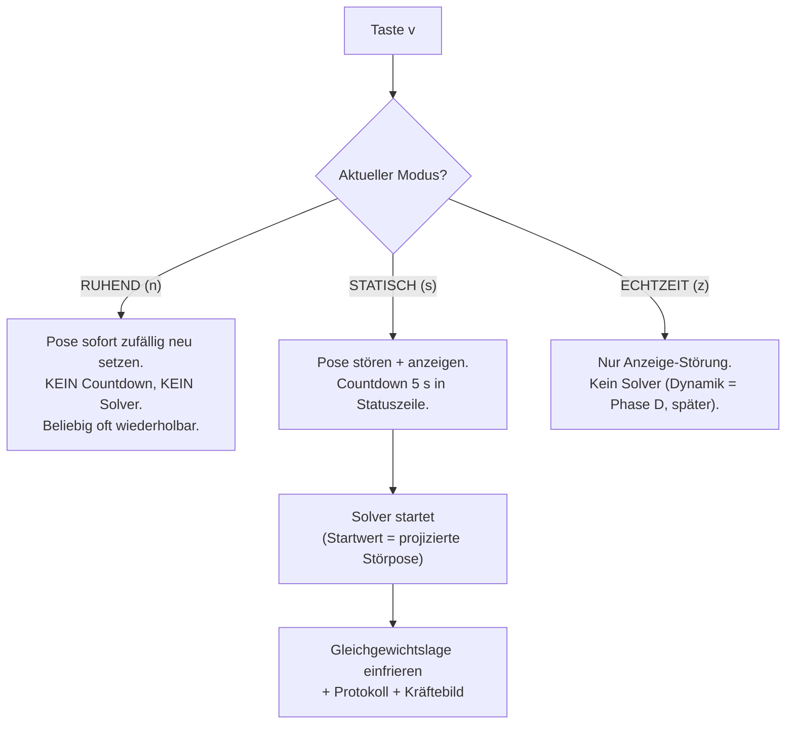

# Spezifikation: Stör-Taste (zufällige Platzierung) & Solver-Zielbild
**Datei:** `doc/Spezifikation_StoerUndSolver_v1.md`
**Stand:** 12.10.2026 · **Status:** Entwurf zur Freigabe
**Einordnung:** Phase B2-Erweiterung (nach Umsetzungsplan V5 rev 9 §7, vorgezogen durch Commit `319f92d`)
**Vorgänger:** Spezifikation_v4 (P1–P7), Umsetzungsplan_v5 rev 9 (Phasen A–E), Testfaelle_v4 (Blöcke A–H)

---

## 1. Zweck

Der statische Solver (Phase B, `core/statisch.py`) ist verdrahtet (Commit `319f92d`), aber
sein Startwert ist bisher die Ausgangslage. Diese Spezifikation definiert:

1. eine **Stör-Taste**, mit der das aktive Objekt per Tastendruck zufällig in eine neue
   Lage versetzt wird (Translation **≤ 2 m** in beliebiger Richtung, Rotation **jeder der
   3 Achsen um bis zu ± 180°**),
2. das **Verhalten je Anzeigemodus** (RUHEND / STATISCH / ECHTZEIT),
3. das **Zielbild** (Abnahmekriterien), das erfüllt sein muss, bevor wir weitergehen:

> **Kernsatz des Auftraggebers (12.10.2026):**
> *„Einzig in Ruhend bleibt der Körper. Man kann den dann beliebig oft zufällig platzieren.
> Erst wenn das sauber läuft – jeder Körper aus beliebigen Lagen sauber auf der
> Wasseroberfläche positioniert, Kraftpfeile und Momentenpfeile (ggf. Drehpfeile) sauber
> dargestellt – gehen wir weiter."*

---

## 2. Bedienelement

| Element | Wert | Begründung |
|---|---|---|
| Taste | **`v`** (Verschieben/Stören) | Wunschtaste `Z` ist **belegt** (ECHTZEIT-Umschaltung, neben `r`/`s`). Belegt sind außerdem: `Space`, `n`, `o`, `q`, `s`, `z`, `r`, `1/2/3`, `4`, `a`, `5`, `6`, `7`, `F1–F4`. `v` ist frei. |
| Entprellung | 0,15 s | Lektion aus Phase-C-Fix 1: keine Doppelbedienung über Key-Event **und** Polling. Nur **ein** Abfragepfad. |
| Wirksam auf | das aktuell aktive Objekt (Einzelobjekt; bei `a`/Mehrkoerper: alle aktiven Objekte gleichzeitig, gleiche Störung pro Objekt unabhängig gezogen) | |

**St-1 (Entscheidung):** Taste `v`, Entprellung 0,15 s, ein Abfragepfad.

---

## 3. Störung (mathematische Definition)

Gegeben: aktuelle Pose des Objekts (Position $\mathbf{p} \in \mathbb{R}^3$, Orientierung $R \in SO(3)$).

Neue Pose:

$$\mathbf{p}' = \mathbf{p} + \Delta\mathbf{p}, \qquad R' = R_x(\alpha)\,R_y(\beta)\,R_z(\gamma)\,R$$

mit unabhängigen, gleichverteilten Zufallsgrößen:

| Größe | Verteilung | Schranken |
|---|---|---|
| $\Delta p_x, \Delta p_y$ | gleichverteilt | $[-2{,}0\,\text{m},\ +2{,}0\,\text{m}]$ |
| $\Delta p_z$ | gleichverteilt | $[-2{,}0\,\text{m},\ +2{,}0\,\text{m}]$ |
| $\alpha, \beta, \gamma$ | gleichverteilt | $[-180°,\ +180°]$ |

**St-2:** Alle drei Translationskomponenten und alle drei Drehwinkel werden **unabhängig** gezogen;
die Drehung wird als feste Weltachsen-Folge $x \to y \to z$ angewendet (Reihenfolge dokumentiert,
damit Tests reproduzierbar sind).

**St-3 (Determinismus):** Die Störung wird in einem **reinen Modul** `core/stoerung.py`
erzeugt, das einen injizierbaren Zufallszahlsgenerator nimmt (Standard: `numpy.random.default_rng`).
In der Demo: echter Zufall (Seed aus der Uhr). In den Tests: fester Seed → gleiche Pose.
Damit bleibt die bestehende Testkultur (deterministische Blöcke) erhalten.

**St-4 (Randfälle, bewusst eingeschlossen):**
- $\Delta p_z = +2$ m kann das Objekt **komplett aus dem Wasser** heben ($V_{tauch} = 0 \Rightarrow F_A = 0$).
- $\Delta p_z = -2$ m kann es **komplett untertauchen**.
- Winkel nahe ±180° ergeben **kopfüber-/Seitenlagen**.
Beide Grenzfälle müssen von der Kraftfunktion und dem Solver **sauber** durchlaufen werden
(siehe Zielbild Z5) – sie sind Teil der Abnahme, kein Ausschlusskriterium.

---

## 4. Verhalten je Anzeigemodus

### 4.1 RUHEND (`n`)
- Taste `v` setzt die Pose **sofort** neu (ohne Countdown).
- Der Körper **bleibt** in der verstörten Lage stehen – nichts zieht ihn zurück.
- `v` ist **beliebig oft** wiederholbar; jede Betätigung erzeugt eine neue Zufallslage.
- Zweck: visuelles Durchproben von Startlagen, ohne Solver-Zeit zu verbrauchen
  (relevant wegen der bekannten Solver-Performance: ~0,26 s pro Kraftfunktions-Aufruf).

### 4.2 STATISCH (`s`)
- Taste `v` stört die Pose und **zeigt die Störpose an**; die Statuszeile zählt
  **5 Sekunden** herunter („Störung aktiv, Solver startet in 5 … 4 … 3 …").
- Nach Ablauf startet der Solver mit der **projizierten** Störpose als Startwert (siehe §5).
- Während des Countdowns und des Solvers bleibt die Szene eingefroren (keine Animationsuhr –
  Fix 2 vom 12.10. bleibt gültig).
- Ergebnis wie gehabt: Gleichgewichtslage wird eingefroren (`statische_pose_setzen`),
  Konsolen-Protokoll, Statuszeile.

### 4.3 ECHTZEIT (`z`)
- Taste `v` stört nur die **angezeigte** Pose. Kein Solver, kein Countdown.
- Das dynamische Verhalten (freies Einsinken/Schwingen aus der Störpose) ist **Phase D**
  (`dynamik.py`, Block Q) und wird hier **bewusst nicht** spezifiziert – darüber reden wir,
  wenn Phase D beginnt.

**St-5:** Der Modus wird durch `v` **nicht** verändert. `v` wirkt nur auf die Pose.

---

## 5. Trim-Projektion (Anzeige vs. Solver)

Eine Störung um alle drei Achsen erzeugt fast immer **Trim θ ≠ 0**. Die Kraftfunktion hat
jedoch die θ-Wache (D6/F3: Rechnung nur bei θ = 0), und der Solver arbeitet nur auf den
Freiheitsgraden $(z, \varphi)$.

**St-6 (Option A, vom Auftraggeber freigegeben):**
- **Anzeige:** die volle 3-achsige Störpose wird dargestellt (der Körper liegt sichtbar verdreht im Becken).
- **Solver:** aus der Störpose werden nur die solverfähigen Freiheitsgrade übernommen:
  - $z_{start}$ = Welt-z des Schwerpunkts in der Störpose,
  - $\varphi_{start}$ = Rollwinkel (Extraktion aus $R'$, äquivalent zur Rückrotation auf die x-Rollachse),
  - Trim θ wird **verworfen** (die θ-Wache bleibt intakt; keine Spec-Änderung an D6/F3).
- Die Projektion ist eine **reine Funktion** in `core/stoerung.py` (`projektiere_pose`) und
  wird separat getestet (Block S).

---

## 6. Momenten-/Drehpfeile (NEU, Teil des Zielbilds)

Bisher zeigt das Kräftebild (Taste 7, Phase C) drei Elemente: $F_G$-Pfeil, $F_A$-Pfeil,
Hebelarm. Das Zielbild verlangt zusätzlich **Momentenpfeile (ggf. Drehpfeile)**.

**St-7:** Neues Element im Layer `kraefte`:
- Ein **Drehmoment-Pfeil** um die Rollachse (x, D11) am Schwerpunkt: kreisförmiger
  Bogenpfeil (Tube entlang eines Kreisbogens um die x-Achse durch r_S, Pfeilspitze am Ende),
- **Richtung** zeigt die Vorzeichenkonvention des Moments ($M_x > 0$ ⇒ gegen den Uhrzeigersinn
  um +x, Blick entgegen +x),
- **Länge/Radius** skaliert mit $|M_x|$ über die **gemeinsame fixe Skala D1** (gleiche Skalen-
  logik wie die Kraftpfeile; Nullmoment ⇒ kein Bogen),
- Umsetzung nach dem bewährten P5a-Muster: die Demo setzt die Daten (`moment_daten_setzen`),
  die Brücke projiziert pro Frame.
- Im **Gleichgewicht** ($|M_x| <$ Toleranz) verschwindet der Bogen – das ist das gewünschte
  Bild: „Pfeile im Gleichgewicht zeigen nur noch G und F_A auf einer Linie".

Erweiterung `kraefte_bild.py` um `moment_bogen(erg, r_s, skala)` (rein, testbar), plus
Actor-Bau in `grafik_bruecke.py` (Tube mit Fallback-Linie, wie K4).

---

## 7. Zielbild (Abnahmekriterien)

Das ist der Maßstab, **bevor** wir weitergehen (Auftraggeber, 12.10.2026). Jedes Kriterium
ist eine Sichtprobe am Bildschirm + ein automatisierter Test, wo möglich.

### Z1 – Jeder Körper aus jeder Lage findet die Wasseroberfläche
Für **jeden** der vier Körper (Kegel, Quader, Pyramide, **Boot**):
- 20 zufällige Störungen (Seed-Reihe festgehalten), je Körper,
- in jedem Fall konvergiert der Solver **oder** meldet sauber `SolverFehler` (Z5),
- bei Konvergenz: Endlage ist eine **stabile Gleichgewichtslage auf der Wasseroberfläche** –
  Wasserlinie exakt am Schnitt (Verfahren B), Restkraft/Restmoment unter Toleranz,
  Stabilitätskriterium D9 erfüllt ($\partial M/\partial\varphi < 0$).

### Z2 – Kraftpfeile sauber dargestellt
In der Endlage zeigt das Kräftebild (Taste 7):
- $F_G$-Pfeil senkrecht nach unten ab Schwerpunkt,
- $F_A$-Pfeil senkrecht nach oben ab Auftriebsangriffspunkt,
- Hebelarm zwischen beiden Angriffspunkten,
- gemeinsame fixe Skala D1 (kein Größensprung beim Umschalten zwischen Objekten),
- Pfeile folgen der eingefrorenen Endlage korrekt (Projektion pro Frame).

### Z3 – Momenten-/Drehpfeile sauber dargestellt
- Während der Annäherung bzw. bei instabilen Zwischenlagen: Drehmoment-Bogen um die
  Rollachse sichtbar und richtig herum (§6).
- In der stabilen Endlage: Bogen verschwindet (Restmoment ≈ 0) – G und F_A stehen
  fluchtig über dem Auftriebsschwerpunkt.
- Kein Flackern, keine Actor-Reste beim Abschalten des Layers oder Objektwechsels
  (gleiche Sauberkeit wie Phase-C-Fix 1).

### Z4 – Wiederholbarkeit in RUHEND
- In `n` beliebig oft `v`: jede Betätigung liefert eine **neue, plausibel verteilte**
  Zufallslage (nicht immer dieselbe), Anzeige aktualisiert sich sofort und sauber
  (Wasserlinie, Kontur, Overlays folgen der neuen Pose).
- Kein Actor-Leak über viele Wiederholungen (Actor-Zahl im Plotter bleibt konstant).

### Z5 – Randfälle und Fehlerbild
- Komplett aus dem Wasser / komplett untertaucht (St-4): keine Exception, keine Hängung;
  der Solver findet daraus die Oberfläche (Auftrieb 0 bzw. voll tauchend sind zulässige
  Zwischenzustände der Kraftfunktion).
- Kopfüber-/Seitenlagen nahe ±180°: Wenn der Störleiter (D9: 5→15→30→44°) erschöpft ist,
  erscheint eine **saubere Meldung** in Statuszeile + Konsole (`SolverFehler`), die Szene
  bleibt bedienbar. Das ist ein **Befund, kein Bug** (vgl. Voxel-Treppen-Notiz im LIESMICH).
- Abbruch zu jedem Zeitpunkt (Taste `r`, Moduswechsel, Objektwechsel) hinterlässt keinen
  halben Zustand: Countdown abbrechen = Störpose bleibt liegen (wie RUHEND), laufender
  Solver-Status wird sauber gemeldet.

### Z6 – Determinismus & Nachvollziehbarkeit
- Mit festem Seed erzeugt `stoerung.py` die identische Pose (Unit-Test).
- Jede Solver-Anfrage protokolliert Startpose (projiziert), Iterationen, Restarts, GM
  (F18) wie bisher in der Konsole.

### Sichtproben-Checkliste (Abnahme)
1. `n` → 10× `v`: Körper bleibt jeweils stehen, Darstellung sauber. ✅/❌
2. `s` → `v`: Countdown läuft 5 s, dann Solver; Endlage + Protokoll korrekt. ✅/❌
3. Alle 4 Körper je 20 Störungen (Seed-Reihe): Z1 erfüllt. ✅/❌
4. Taste 7 in der Endlage: Z2 + Z3 erfüllt. ✅/❌
5. Extremfälle +2 m/−2 m/kopfüber: Z5 erfüllt. ✅/❌
6. Objektwechsel/Layerwechsel während Countdown und nach Solve: keine Actor-Reste. ✅/❌

---

## 8. Umfang der Implementierung

| Nr. | Artefakt | Inhalt |
|---|---|---|
| 1 | `core/stoerung.py` (NEU, rein) | `ziehe_stoerung(rng)` → $(\Delta\mathbf{p}, \alpha, \beta, \gamma)$; `stoerpose(p, R, stoerung)` → $(\mathbf{p}', R')$; `projektiere_pose(R')` → $(z, \varphi)$-Anteil (St-6) |
| 2 | `core/sim_modus.py` (ERWEITERT) | Zustand STÖRUNG mit 5-s-Countdown (nur im Pfad STATISCH); vollvermascht testbar wie Schritt 1 |
| 3 | `core/kraefte_bild.py` (ERWEITERT) | `moment_bogen(erg, r_s, skala)` (St-7) |
| 4 | `grafik_bruecke.py` (ERWEITERT) | Stör-Pose anwenden (analog `statische_pose_setzen`, aber freie 3-achsige Rotation), Moment-Bogen-Actor, Countdown-Statuszeile |
| 5 | `demo_app.py` (ERWEITERT) | Taste `v` je Modus (§4), Entprellung, Verdrahtung Countdown → Solver |
| 6 | `tests/test_stoerung.py` (NEU, **Block S**) | Schranken, Seed-Determinismus, Projektion, Modus-Automat, Countdown, Randfälle St-4, Actor-Sauberkeit (soweit headless prüfbar) |
| 7 | `LIESMICH_Stoer_Taste.txt` | Bedienung, Entscheidungen St-1…St-7, bekannte Grenzen |

**Bewusst NICHT Teil dieser Spec:** Dynamik aus der Störpose (Phase D, Block Q), Dämpfung,
Konfigurator P6, Mehrfach-Solver für alle Objekte gleichzeitig.

---

## 9. Bekannte Risiken (aus dem Ist-Stand)

1. **Solver-Performance:** ~0,26 s pro Kraftfunktions-Aufruf am Boot ⇒ ein Solve kann mehrere
   Sekunden dauern und blockiert die Demo. Die 5-s-Wartezeit ist bewusst auch eine
   Erwartungssteuerung; die Statuszeile meldet vorher, dass gerechnet wird.
2. **V_tauch stückweise konstant (Voxel-Treppen):** Konvergiert Newton an der echten
   Rumpfform nicht, gilt das als sauberer Befund (Z5), nicht als Bug – am echten Boot
   noch nicht verifiziert (Block P lief auf Ponton/Quadern).
3. **Störleiter-Grenze:** Aus Lagen jenseits ~44° Störung kann die stabile Lage unerreichbar
   sein ⇒ saubere `SolverFehler`-Meldung ist das akzeptierte Verhalten.

---

*Ende der Spezifikation. Freigabe durch Auftraggeber erforderlich, bevor die Implementierung (§8) beginnt.*
