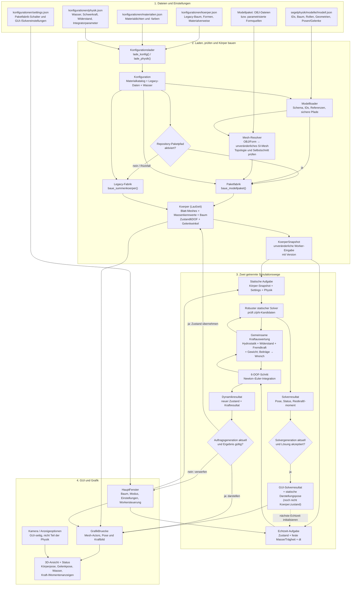

# Datenfluss: Körperdatei bis Simulation und Darstellung

Die Grafik zeigt den aktuellen Ablauf inklusive des Repository-Paketpfads und
des auswählbaren Legacy-Rückfalls. Die Bezeichnungen `koerper.json` und
`materialien.json` meinen den bisherigen Konfigurationsvertrag.

## Was die Pfeile bedeuten

1. Der Konfigurationslader liest Legacy-Modelldaten, Materialien und
   Physikparameter. Für Repository-Modelle sind Manifest und Paketdateien die
   maßgebliche Geometrie- und Baumquelle; Legacy-Konfigurationen bleiben
   Rückfall- und Kompatibilitätspfad.
2. Der Modellloader prüft das Manifest und löst Quellen in kanonische
   SI-Meshes auf. Die Fabrik übernimmt Geometrie, Rolle, Verdrängungsflag,
   Masse und Pose in den Laufzeitkörper. Aggregierte Masse,
   Gesamtschwerpunkt und Trägheit stammen aus der Initialpose.
3. Der statische Solver untersucht Kandidaten auf einer unveränderten
   Snapshot-Eingabe. Eine akzeptierte statische Lösung wird aktuell als
   Solverresultat und Darstellungspose in der GUI gehalten, aber nicht direkt
   in `Koerper.zustand` geschrieben. Beim Start der Echtzeit wird sie in einen
   `Zustand6DOF` umgewandelt. Die dynamische Engine integriert danach Zustand
   für Zustand; beide Pfade nutzen dieselbe Kraftauswertung.
4. Worker liefern versionierte Ergebnisse. Veraltete Ergebnisse werden
   verworfen. Gültige dynamische Ergebnisse aktualisieren den Körperzustand;
   gültige statische Ergebnisse aktualisieren Solverresultat und Darstellung.
   Die Grafikbrücke stellt die jeweilige freigegebene Pose und Kraftdiagnose dar.
5. Die Kamera und Darstellungsoptionen leben im GUI-/Rendererpfad. Eine
   Gelenkwinkeländerung wirkt aktuell auf Zustand und Darstellung, nicht auf
   Masse, Schwerpunkt, Trägheit oder Auftrieb aus der Teilbewegung.

## Noch nicht enthalten

- Neue empirische Hydrodynamik oder Aerodynamik für Rumpf, Kiel, Ruder oder
  Segel; Phase 12 ist vertagt.
- Vollständige Mehrkörperdynamik oder winkelabhängige Masseneigenschaften.
- Vollständige Phase-11-Abnahme mit realen externen Paketbeständen und
  systematischem Alt-/Neu-GUI-/Physikvergleich.
