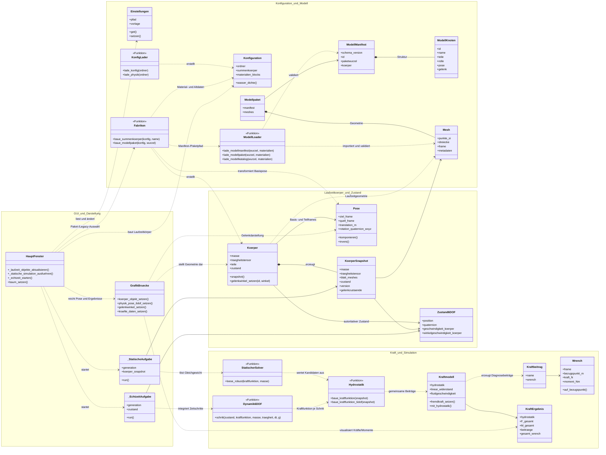

# Klassendiagramm der aktuellen Lösung

Das Diagramm bildet vorhandene konkrete Codebausteine ab, nicht das noch
nicht implementierte Zielmodell. `<<Funktion>>` kennzeichnet zustandslose
Funktionen oder Fabriken; gestrichelte Pfeile zeigen Nutzung/Erzeugung statt
Vererbung.

## Einordnung

- `koerper.json` und `materialien.json` werden vom Legacy-Konfigurationslader
  eingelesen. Für die Repository-Paketmodelle liefert die Konfiguration
  weiterhin Material- und Umgebungseigenschaften; das Modellmanifest liefert
  die kanonische Baumstruktur und Geometriequellen.
- `Koerper` vereint ein einzelnes Geometrieblatt oder einen strukturierten
  Verband. Der Root hält den aktuellen 6-DOF-Zustand; Teilknoten halten ihre
  Definitionen und optionalen Gelenkwinkel.
- Statische und dynamische Berechnung sind getrennte Abläufe. Sie teilen sich
  Kraftmodell und Darstellung, aber nicht ihren Solver-/Integrationsalgorithmus.
- Ein Ergebnis kehrt nur nach Generations-/Zustandsprüfung in die GUI zurück.
  Kamera- und Anzeigeeinstellungen sind keine physikalischen Zustände.
- Das akzeptierte statische Solverresultat wird aktuell als Ergebnis und
  Darstellungspose gehalten. Erst beim Start der Echtzeit wird daraus ein
  `Zustand6DOF` erstellt und in `Koerper.zustand` gesetzt; die statische
  Übernahme in den autoritativen Körperzustand ist noch nicht abgeschlossen.
- Neue Hydrodynamik-/Aerodynamikklassen sind absichtlich nicht eingezeichnet:
  solche Behandlungen sind noch nicht implementiert.
