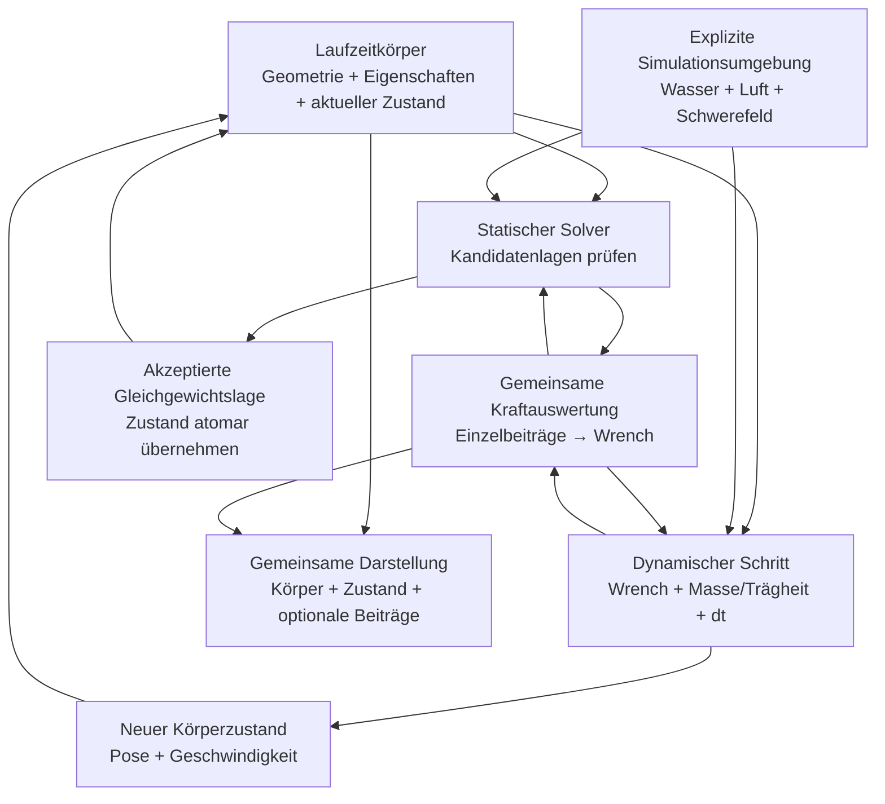
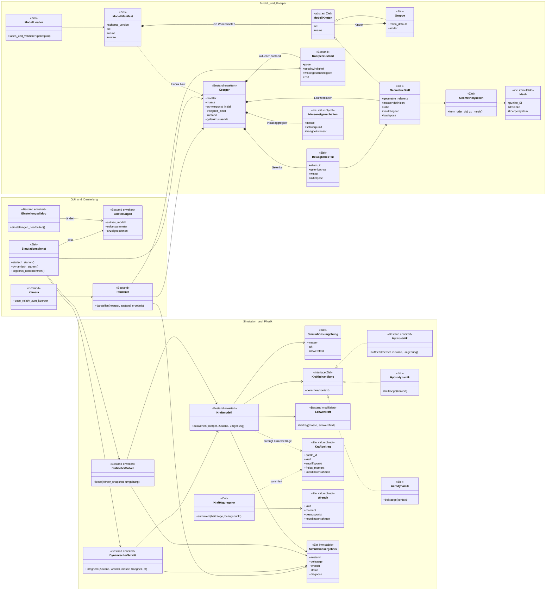

# Spezifikation v0.5: Einheitliche Körperstruktur und Simulation

**Stand:** 16.10.2026
**Status:** Ziel- und Migrationsspezifikation; Umsetzung erfolgt phasenweise
**Geltungsbereich:** Modellpakete, Körper-/Teilstruktur, Bezugssysteme, statische
und dynamische Simulation, Kraftbeiträge, Darstellung und Einstellungen.

## 1. Ziel und Leitidee

Jeder Körper soll einheitlich importiert, aufgebaut, simuliert und dargestellt
werden. Ein neues Modell soll als eigenständiges Paket aus Manifest und
Geometriedateien hinzufügbar sein. Der Laufzeitkörper hält seine physikalischen
Eigenschaften und den aktuellen Simulationszustand, den der nächste dynamische
Zeitschritt benötigt.

Statische und dynamische Simulation sind unterschiedliche Rechenverfahren:

- **Statisch:** sucht eine Gleichgewichtslage; Zwischenversuche sind keine
  Änderungen des aktiven Körperzustands.
- **Dynamisch:** wertet den aktuellen Zustand aus, summiert Kraft- und
  Momentenbeiträge und berechnet den nächsten Zustand.
- **Gemeinsam:** Körpermodell, Kraftauswertung, Beitragsvertrag und
  Darstellung. Die Darstellung zeigt jeweils den vom aktiven Verfahren
  freigegebenen Körperzustand.

Die Spezifikation beschreibt ein Zielmodell, keine Pflicht, für jedes
Diagrammelement eine eigene Python-Klasse anzulegen. Zustandslose Berechnungen
bleiben Funktionen, wo dies die klarere Lösung ist.

### 1.1 Markierungen in den Anforderungen

- **Übernommen:** Grundidee bleibt inhaltlich bestehen.
- **Modifiziert:** Ziel bleibt erhalten, aber die Regel wird präzisiert oder
  korrigiert.
- **Neu:** zusätzliche Festlegung für Sicherheit, Konsistenz oder
  Wartbarkeit.

## 2. Begriffe und Bezugssysteme

| Begriff | Verbindliche Bedeutung |
|---|---|
| **Körpersystem** | Am Körper befestigtes, rechtshändiges System: x voraus, y backbord, z oben. Sein Ursprung liegt beim für die Simulation festgelegten Körperbezugspunkt, zunächst beim Gesamtschwerpunkt in der initialen Konfiguration. Es bewegt und dreht sich mit dem Körper. Ein Gelenkwinkel verschiebt diesen Ursprung nicht. |
| **Teilsystem** | Lokales System eines Unterkörpers, relativ zum Elternteil oder Körper definiert. Teil-, Körper- und Simulationspose werden zentral zusammengesetzt. |
| **Kamerasystem** | Ansichtssystem relativ zum Körper. Kameraänderungen beeinflussen ausschließlich Darstellung, nie Physik, Masse oder Simulation. |
| **Weltsystem (Navigation)** | Späteres virtuelles System für nautische Größen wie Kompasskurs, Abdrift, Kurs durchs Wasser (KdW) und Kurs über Grund (KüG). Achsen und Winkelkonventionen sind noch offen; es ist nicht Bestandteil dieser Ausbaustufe. |
| **Simulations-/Rechenframe** | Technischer Frame, in dem die vorhandene Physik Positionen, Kräfte oder Schwerkraft ausdrückt. Er ist nicht automatisch das künftige nautische Weltsystem. Die Wasserreferenz liegt in den bestehenden Hydrostatikrechnungen bei z=0. |
| **Pose** | Position und Orientierung eines Körpers oder Teils in einem ausdrücklich benannten Zielsystem. |
| **Wrench** | Zusammengehörige resultierende Kraft und Moment, bezogen auf denselben Bezugspunkt und Koordinatenrahmen. |

Alle Vektor- und Poseumrechnungen benennen Quell- und Zielrahmen. Eine zentrale
Transformationsroutine vermeidet separat implementierte, voneinander
abweichende Konvertierungen in Physik, GUI und Renderer.

**Referenzfälle für Implementierungstests:**

| Fall | Eingabe | Erwartetes Ergebnis |
|---|---|---|
| Unity-OBJ-Abbildung | `s=0.25`, `C=[[0,0,1],[1,0,0],[0,1,0]]`, `p_obj=(4,2,3)` | `p_blatt=(0.75,1,0.5)` |
| Achsenbasis | Dieselbe Matrix auf die OBJ-Basisvektoren | `e_x→e_y`, `e_y→e_z`, `e_z→e_x`; Determinante `+1` |
| Quaternion und Translation | `q=(√0.5,0,0,√0.5)`, `t=(1,2,3)`, `p_knoten=(1,0,0)` | `p_eltern=(1,3,3)` |
| Schwerpunktzentrierung | `p=(2,0,0)`, `c=(1,0,0)`, Identitätsrotation, `t=(0,0,0)` | `p_zentriert=(1,0,0)`, `t'=(1,0,0)`; Modellpunkt bleibt `(2,0,0)` |
| Inverse und Komposition | Beliebige gültige Pose sowie zwei verschachtelte Posen | Vorwärts-/Rücktransformation reproduziert den Punkt; verkettete Transformation entspricht schrittweiser Anwendung |

Für jeden Geometrieknoten ist die lokale Pose relativ zum direkten Elternteil
definiert; bei der Wurzel ist sie relativ zum Modellframe. OBJ-Vertices liegen
im OBJ-Quellframe. Die Paketmetadaten definieren die Skalierung `s` von OBJ-
Einheiten nach Meter und die orthogonale Achsenabbildung `C_obj→blatt` vom OBJ-
Frame in den lokalen Geometrieframe des Blattes. Diese Achsenabbildung wird
nicht direkt ins globale Körpersystem vorgenommen. Für einen nicht zentrierten
OBJ-Punkt gilt zunächst
`p_blatt = C_obj→blatt · (s · p_obj)`. Formquellen liefern `p_blatt` bereits
direkt in Metern und wenden weder `s` noch `C_obj→blatt` an.

Jeder Knoten hat eine Translation und Rotation `T_eltern←knoten`, wobei die
Translation im Elternframe liegt und die Rotation um den lokalen Knotenursprung
wirkt. Elternposen werden von der Wurzel zum Blatt komponiert. Für einen Punkt
im Blattframe gilt damit
`p_modell = T_modell←wurzel · ... · T_eltern←blatt · p_blatt`.
Die serialisierte Pose verwendet `translation_m` und eine normierte
`rotation_quaternion_wxyz` (Skalaranteil zuerst); es gilt
`p_eltern = R(q) · p_knoten + translation_m`. Rotation wird nicht als
impliziter Eulerwinkel interpretiert.

Eine Geometrie darf für Masseneigenschaften um ihren Schwerpunkt zentriert
werden, wenn der dabei entfernte Versatz als explizite Transformation erhalten
wird. Die Aggregation in den initialen Gesamtschwerpunkt muss denselben
Versatzvertrag einhalten. Der Ursprung des Körpersystems liegt beim initialen
Gesamtschwerpunkt; die Rücktransformation vom Mesh-/Knotenframe in dieses
Körpersystem bleibt für Physik und Darstellung identisch. Import darf weder
Quelldatenursprung noch Montageabstände stillschweigend verwerfen. Für einen
Blatt-Schwerpunkt `c_blatt` im unzentrierten lokalen Frame werden die
Meshpunkte als `p_zentriert = p_blatt - c_blatt` gespeichert und die
Blatttranslation zu
`t'_eltern←blatt = t_eltern←blatt + R_eltern←blatt · c_blatt` angepasst. Das
erhält jeden Modellpunkt, denn
`R · p_blatt + t = R · p_zentriert + t'`. Nach Blatt- und Elternkomposition
wird der Gesamtschwerpunkt `c_modell` im Modellframe berechnet. Der
körperfeste Meshframe erhält `p_koerper = p_modell - c_modell`; alle
Körperpunkte und Teilposen werden um denselben Versatz transformiert.
`c_modell` bleibt als expliziter Modell-zu-Körper-Versatz für die initiale
Platzierung erhalten. Rendering, Hydrostatik, Kraftangriffspunkte und
Massenintegration verwenden dieselbe Transformationskette; kein Schritt darf
einen Schwerpunktversatz ein zweites Mal anwenden.

## 3. Zielarchitektur

### 3.1 Verantwortlichkeiten

| Baustein | Hält / tut | Hält ausdrücklich nicht |
|---|---|---|
| Modellmanifest und Loader | Stabile Modell-/Teil-IDs, Struktur, Geometriequellen, Material- und Rollenreferenzen; Schema- und Pfadvalidierung | Laufzeitzustand, GUI-Widgets, Solverzustand |
| Laufzeitkörper | Kanonische Blätter/Meshes, Masse, Schwerpunkt, Trägheit, Verdrängungskennzeichen, Gelenkdefinitionen und -winkel sowie aktuellen Körperzustand | Kameraansicht, benutzerspezifische GUI-Auswahl, nautische Navigation (bis zu deren Ausbaustufe) |
| Simulationsumgebung | Für eine Berechnung explizit übergebene Wasser-, Luft- und Schwerefeldparameter | Versteckte globale Parameter oder Körpergeometrie |
| Statischer Solver | Prüft Kandidatenlagen und sucht Gleichgewicht; liefert Pose, Status, Restkräfte und Diagnose | Mutationen des aktiven Körpers während der Suche |
| Dynamischer Rechenschritt | Wertet Zustand und Umgebung aus; summiert Beiträge; liefert Kraftresultat und nächsten Zustand | Eigenständige GUI- oder Kamerasteuerung |
| Kraftauswertung/Aggregator | Berechnet Einzelbeiträge und daraus genau eine Gesamt-Wrench am vereinbarten Bezugspunkt | Zeitintegration oder Darstellung |
| Renderer/Ansicht | Liest Geometrie, freigegebenen Körperzustand und Kraftresultate | Änderungen an physikalischen Werten |
| Einstellungsmodell | Persistente benutzerbezogene Auswahl und Darstellungs-/Solverparameter | Modellphysik, Masse-/Materialdefinitionen |
| Einstellungsdialog/GUI | Bearbeitet Einstellungen und zeigt Status/Ergebnisse | Eigene zweite Quelle physikalischer Wahrheit |

Ein einzelner Laufzeitkörper kann intern unveränderliche Körperdefinitionen,
physikalische Eigenschaften, bewegliche Teile und aktuellen Zustand klar
trennen. Das ist eine innere Struktur des Körpermodells, nicht die Forderung,
alles als flache, veränderliche Felder in eine Klasse zu schreiben.

### 3.2 Getrennte statische und dynamische Abläufe



Der statische Solver wertet Kandidaten gegen ein unverändertes Modell aus. Nur
ein akzeptiertes Ergebnis wird als neuer aktiver Körperzustand gesetzt. Bei
Solverfehler, Abbruch oder nicht akzeptierter Näherung bleibt die zuletzt
akzeptierte Pose samt Ergebnis aktiv; Fehlerdiagnosen und gegebenenfalls
Kandidatenwerte werden separat angezeigt und dürfen die aktive Pose nicht
überschreiben. Erst ein später akzeptiertes Ergebnis ersetzt sie atomar. Der
dynamische Pfad wertet einmal pro Zeitschritt die für diesen Zustand geltenden
Kräfte aus und schreibt den daraus berechneten Folgezustand atomar zurück.
Beide Pfade liefern Zustands-/Kraftergebnisse an dieselbe Darstellung.

### 3.3 Zielklassendiagramm

`<<Ziel>>` kennzeichnet neue oder wesentlich erweiterte Verantwortlichkeiten,
`<<Bestand>>` vorhandene Bausteine. Das Diagramm ist logisch: Funktionen dürfen
Klassen ersetzen, wenn dadurch kein Zustand oder austauschbarer Vertrag
verloren geht.



**Leseregeln:**

- Das Manifest beschreibt das Modell; `Koerper` ist der erzeugte Laufzeitkörper.
- `Koerper` hält den aktuellen `KoerperZustand`. Die Physik-Engine muss für den
  nächsten Schritt keinen parallelen, versteckten Zustand führen.
- Die initialen Masseneigenschaften werden aus den anfänglichen Teilposen
  aggregiert und während dieser Starrkörper-Simulation konstant gehalten.
- Statische und dynamische Verfahren benutzen das gemeinsame Kraftmodell,
  bleiben aber verschiedene Solver/Integrationspfade.
- Der statische Solver arbeitet mit einem Snapshot/Kandidatenzustand und
  übernimmt nur eine akzeptierte Lösung.
- Die Kamera liegt relativ zum Körper und außerhalb der Physik. Das künftige
  nautische Weltsystem ist nicht Bestandteil dieses Diagramms.
- Der Kraftaggregator liefert Einzelbeiträge für Diagnose und Darstellung
  sowie genau eine Gesamt-Wrench zur Gleichgewichtsprüfung oder Integration.

## 4. Modellpaket und Geometrie

### 4.1 Paket, Manifest und Baum

Ein Modellpaket liegt unter `segelphysik/modelle/<modell-id>/`; der
repositoryweite Paketkatalog ist damit relativ zur Python-Paketwurzel stabil
und unabhängig vom Arbeitsverzeichnis. Es besteht aus Manifest und lokalen
Geometriedateien, beispielsweise:

```text
segelphysik/modelle/
└── yacht1/
    ├── modell.json
    └── mesh/
        ├── rumpf.obj
        └── kiel.obj
```

Das Manifest enthält eine unterstützte `schema_version`, eine stabile
maschinenlesbare Modell-ID und einen benutzerfreundlichen Namen. IDs sind
sichere Slugs und eindeutig im Paket; Namen sind Anzeige und dürfen Umlaute
oder Leerzeichen enthalten.

Ein Modell hat genau eine Wurzel. Jeder Knoten ist entweder:

- eine Gruppe mit Kindern, Rollen-Defaults und keiner eigenen Masse; oder
- ein Geometrieblatt mit Geometriequelle, Massendefinition, effektiver Rolle,
  optionaler lokaler Pose und Verdrängungskennzeichen.

Jede Knoten-ID ist im Modell eindeutig. Namen werden nicht als technische
Referenzen verwendet. Gruppen können Rollen-Defaults vererben; ein Blattwert
überschreibt den geerbten Wert. Gruppen selbst erzeugen keine Kräfte.

Ein optionales `gelenk` an einem Nicht-Wurzelknoten beschreibt ein
Drehgelenk relativ zum direkten Elternknoten:

```json
{
  "gelenk": {
    "eltern_id": "rigg",
    "achse_eltern": [0, 1, 0],
    "winkel_rad": 0.0
  }
}
```

`eltern_id` muss die ID des direkten Struktur-Elternteils sein.
`achse_eltern` ist eine endliche, von null verschiedene Achse im Elternframe
und wird beim Laden normiert. `pose` beschreibt die Nullwinkel-Transformation;
`winkel_rad` ist der initiale Gelenkwinkel um den Ursprung des Knotens. Der
Laufzeitkörper hält den aktuellen Winkel separat. Gelenke an Gruppen bewegen
deren gesamte Teilstruktur. Die Wurzel darf kein Gelenk tragen.

### 4.2 Quellen, Koordinaten und Validierung

Die erste einheitliche Geometrieschnittstelle unterstützt `form` und `obj`.
Beide liefern validierte Meshes `(punkte, dreiecke)` in SI und Blattframe.
Formparameter mit `_m` sind bereits Meterwerte; OBJ-Einheiten-/Achsentransform
gilt nur für OBJ. Transformationsreihenfolge: OBJ-Skalierung,
OBJ-zu-Blatt-Achsenabbildung, Blattzentrierung mit erhaltener Translation,
Eltern-/Knotenpose und einmalige Modell-zu-Körper-Zentrierung. Für `form`
entfallen Skalierung und OBJ-Achsenabbildung.

OBJ-Pfade sind relativ zum Paket. Absolute Pfade, `..`-Traversal und
Dateien außerhalb des Paketordners sind unzulässig. Vertices/Faces mit
positiven und negativen OBJ-Indizes werden unterstützt. Textur-/Normalenindizes
dürfen vorhanden sein. Nicht unterstützte oder fehlerhafte Polygone werden
klar abgelehnt; blindes Fächer-Triangulieren konkaver oder nicht-planarer
Polygone ist unzulässig.

Gemeinsame Netzvalidierung prüft Dreiecke, Orientierung und die zur
Massendefinition erforderliche Geschlossenheit. Geschlossene Volumen können
Volumenmasse tragen; offene Schalen benötigen Flächenmasse. Fehler, Löcher,
Selbstüberschneidungen oder entartete Dreiecke werden nicht still repariert.
Eine durchgehend invertierte Orientierung wird durch Umkehren der
Dreiecksreihenfolge normalisiert; lokale Orientierungsfehler werden abgelehnt.
Fehlermeldungen
nennen Modell-ID und Knotenpfad.

### 4.3 Masse, Material und Rollen

- Masse liegt nur auf Blättern. Materialdaten stammen aus dem zentralen
  Materialkatalog; Material und direkte Massendaten dürfen sich nicht
  widersprechen.
- `wanddicke_m` wählt Flächenmasse statt Volumenmasse. Bei offenen Schalen ist
  sie erforderlich; bei geschlossenen Meshes kann sie für dünnwandige Körper
  ausdrücklich gewählt werden.
- Änderungen an Material, Dichte oder Wanddicke bauen Masse, Schwerpunkt und
  Trägheit konsistent neu auf.
- Rollen sind semantische Kennzeichnungen, unabhängig von Dateiname und
  geometrischer Formerkennung. Anfangsrollen: `rumpf`, `kiel`, `ruder`,
  `segel`, `stehendes_gut` sowie `allgemein` für Blätter ohne spezialisierte
  physikalische Behandlung. `allgemein` aktiviert selbst keine Kraftbehandlung.
  `rigg` strukturiert den Baum, ist aber selbst keine Kraftbehandlung.
- Geometrische Analyse darf Formmerkmale ableiten, aber keine fachliche Rolle
  erraten. Unbekannte Rollen/Quellen sind sichtbare Validierungsfehler, keine
  Auslöser für Ersatzkörper.

### 4.4 Normativer Manifestvertrag

Das folgende Beispiel legt die Feldnamen und deren Bedeutung für Schema
Version `1.0` fest. Die maschinenlesbare Vorlage liegt in
[`doc/Vorlagen/modell_vorlage.json`](../../../Vorlagen/modell_vorlage.json).
Der Loader prüft den Vertrag streng und lehnt unbekannte Felder ab.

- `modell.id` ist ein sicherer Slug; `modell.name` ist Anzeigeinhalt.
- `modell.id` muss mit dem Paketordnernamen übereinstimmen. Modell- und
  Knotenschlüssel verwenden den Slug `^[a-z0-9][a-z0-9_-]*$`; Anzeigenamen
  bleiben frei. Unbekannte Felder werden abgelehnt. Eine optionale
  Modellbeschreibung heißt `modell.beschreibung`; beliebige Zusatzfelder mit
  Unterstrich sind keine Erweiterungsschnittstelle.
- `koerper` ist genau ein Wurzelknoten. Seine `id` gehört wie alle
  untergeordneten Knoten-IDs zu einem modellweit eindeutigen Namensraum.
- Ein Gruppenknoten wird durch `teile` mit mindestens einem Kind definiert und
  hat keine Massendefinition oder Geometrie. `rolle_default` wird an Kinder
  vererbt; ein Blatt-`rolle` überschreibt sie. Ein Blatt hat `geometrie` und
  kein `teile`.
- Ein Geometrieblatt hat `geometrie`, eine effektive Rolle, eine explizite
  boolesche Eigenschaft `verdrängend` sowie genau eine Massendefinition:
  entweder `material` oder `dichte_kg_pro_m3`, nicht beides. Eine optionale
  positive `wanddicke_m` kennzeichnet Flächenmasse statt Volumenmasse; sie ist
  bei offenen Schalen erforderlich und kann bei geschlossenen, dünnwandigen
  Körpern ausdrücklich gewählt werden. Ohne Wanddicke ist ein geschlossenes
  Volumen erforderlich. Bei direkter Dichte dürfen optionale `farbe` und
  `farbe_unter_wasser` die Materialdarstellung ersetzen.
- `pose` ist optional; fehlt sie, gilt Identität (Translation null,
  Quaternion `[1, 0, 0, 0]`). Eine gesetzte Pose hat `translation_m` und
  normiertes `rotation_quaternion_wxyz`.
- `geometrie_einheiten.obj_zu_m` ist endlich und positiv.
  `obj_achsenmatrix_zu_blatt` ist eine rechtshändige orthogonale 3×3-Matrix
  mit Determinante `+1`; sie bildet OBJ-Koordinaten ausschließlich ins lokale
  Blattframe ab und wird auf `form` nicht angewendet.
- `geometrie.datei` ist bei OBJ-Paketen ein relativer, paketinterner Pfad.
  Ein Formblatt verwendet stattdessen `geometrie.parameter`.
- `rolle`/`rolle_default` ist eine der registrierten Rollen
  `rumpf`, `kiel`, `ruder`, `segel`, `stehendes_gut` oder `allgemein`.
  `allgemein` kennzeichnet neutrale Formen ohne spezialisierte Behandlung;
  es darf keine Kraftbehandlung aktivieren. Nicht implementierte Behandlungen
  bleiben deaktiviert und werden diagnostiziert; ein unbekannter Rollenwert
  ist ein Validierungsfehler.

```json
{
  "schema_version": "1.0",
  "modell": {
    "id": "yacht1",
    "name": "Yacht 1"
  },
  "geometrie_einheiten": {
    "obj_zu_m": 0.25,
    "obj_achsenmatrix_zu_blatt": [
      [0, 0, 1],
      [1, 0, 0],
      [0, 1, 0]
    ]
  },
  "koerper": {
    "id": "root",
    "name": "Yacht 1",
    "teile": [
      {
        "id": "rumpf",
        "name": "Rumpf",
        "rolle_default": "rumpf",
        "teile": [
          {
            "id": "rumpfschale",
            "name": "Rumpfschale",
            "rolle": "rumpf",
            "geometrie": {
              "quelle": "obj",
              "datei": "mesh/rumpf.obj"
            },
            "material": "GfK",
            "wanddicke_m": 0.005,
            "verdrängend": true
          }
        ]
      }
    ]
  }
}
```

## 5. Körperzustand und bewegliche Teile

### 5.1 Körperzustand

Der Laufzeitkörper hält mindestens den aktuellen Zustand, den die
Starrkörper-Engine benötigt:

- Position und Orientierung des Körpers;
- lineare und Winkelgeschwindigkeit;
- bei Bedarf Simulationszeit und zusätzliche validierte Zustandsgrößen.

Kraft-/Momentenbeiträge, Beschleunigungen, Solverstatus und Diagnose sind
Ergebnisse einer Auswertung. Sie können als letztes `Simulationsergebnis` für
Anzeige/Diagnose verfügbar sein, dürfen aber nicht als veraltete
Eingangsgrößen ausgegeben oder ungeprüft in den nächsten Schritt
wiederverwendet werden.

### 5.2 Modellannahme für bewegliche Teile

Bewegliche Teile sind nicht Teil des ersten Import-Meilensteins. Für ihre
spätere Unterstützung gilt folgende bewusste Ein-Körper-Näherung:

1. Die Teilmassen werden bei der Initialisierung aus ihrer anfänglichen Pose
   aggregiert. Gesamtmasse, anfänglicher Gesamtschwerpunkt, Trägheitstensor
   und Körperbezugspunkt werden danach für die Laufzeit festgehalten.
2. Eine Änderung des Gelenkwinkels ändert diese Massenwerte und den
   Körperbezugspunkt nicht. Es findet keine Winkel-abhängige
   Schwerpunkt-/Trägheitsaktualisierung und keine vollständige
   Mehrkörperdynamik statt.
3. Gelenkwinkel beeinflussen die vorgesehene Hydro- und Aerodynamik.
4. Für den Auftrieb bleibt die Geometrie beweglicher Teile in der initialen
   Teilpose. Die Pose des Gesamtkörpers relativ zur Wasserreferenz wirkt
   weiterhin auf den Auftrieb.
5. Darstellung und hydrodynamische/aerodynamische Berechnung verwenden dieselbe
   aktuelle Gelenkpose. Eine rein optische Abweichung ist nur als ausdrücklich
   nichtphysikalischer Anzeigeeffekt zulässig.

Abnahmetest: Änderung eines Gelenkwinkels verändert die aktivierten
Hydro-/Aerodynamikbeiträge, aber nicht Masse, verwendeten
Schwerpunkt-/Trägheitswerte oder den Auftrieb allein aufgrund der Gelenkbewegung.
Eine Änderung der Gesamtkörperpose relativ zum Wasser aktualisiert den
Auftrieb.

## 6. Kraftbeiträge und Simulationsverfahren

### 6.1 Einheitlicher Kraftvertrag

Jede Kraftquelle liefert null oder mehrere benannte Beiträge. Ein Beitrag
enthält mindestens Quellen-/Blatt-ID, Kraft, Angriffspunkt und expliziten
Koordinatenrahmen; ein freies Moment ist optional und getrennt vom
Hebelarmmoment. Kraft- und Momentbezug sind eindeutig.

Der Aggregator transformiert Beiträge genau einmal auf einen dokumentierten
Bezugspunkt (standardmäßig den Gesamtschwerpunkt) und liefert:

1. die unveränderten Einzelbeiträge für Diagnose, Protokoll und Kraftpfeile;
2. eine Gesamt-Wrench aus Kraft und Moment für Gleichgewichtsprüfung oder
   Integration.

Momentenumrechnung folgt:

`M_ref = M_punkt + (r_punkt - r_ref) × F`

Auftrieb wird aus der Vereinigung der als verdrängend markierten Volumina
berechnet, nicht nur aus der Rolle `rumpf`. Sein Angriffspunkt liegt im
Verdrängungsschwerpunkt. Das Schwerefeld ist ein Vektor `g_vec` im explizit
benannten Simulationsframe; bei der aktuellen Achsenkonvention und positiv
angegebener Fallbeschleunigung gilt `g_vec = (0, 0, -g)`. Gewicht ist der
benannte Beitrag `F_G = m · g_vec` am Gesamtschwerpunkt. Der Integrator darf
Gewicht nicht ein zweites Mal addieren. Bis diese Migration im Code
abgeschlossen ist, darf nicht gleichzeitig ein neuer Schwerkraftbeitrag aktiv
sein.

Hydro-/Aerodynamik behandeln Rollen über eine Registry; unbekannte oder nicht
implementierte aktive Behandlungen werden diagnostiziert und nicht als
erfolgreich berechnet verschleiert. Anzeigeoptionen verändern keine
Physikrechnung.

### 6.2 Statische Simulation

Der statische Solver variiert die für Gleichgewicht relevanten Freiheitsgrade,
wertet pro Kandidat dieselbe Körperdefinition und Kraftauswertung aus und
minimiert das dokumentierte Kraft-/Momentenresiduum. Er erhält einen
unveränderten Körper-/Umgebungssnapshot. Nur eine akzeptierte Lage wird
atomar als aktueller Körperzustand übernommen. Bei Fehler, Abbruch oder
nicht akzeptiertem Kandidaten bleibt die letzte akzeptierte Pose samt Ergebnis
aktiv; Kandidatenwerte werden nur diagnostisch angezeigt und nie in die
aktive Pose übernommen. Ausgabe: gefundene Pose, Status, Restkraft/-moment
und Diagnose.

### 6.3 Dynamische Simulation

Pro dynamischem Zeitschritt liest die Engine Körpermerkmale, aktuellen
Körperzustand, Umgebung und Steuerung. Sie wertet die Beiträge aus, aggregiert
eine Wrench, berechnet Beschleunigung und Folgezustand und gibt ein
Simulationsergebnis zurück. Das Ergebnis wird erst nach erfolgreicher
Validierung als aktueller Zustand übernommen. Die Darstellung zeigt diesen
Zustand; sie integriert nicht selbst.

### 6.4 Umgebungs- und Cache-Regeln

Wasser, Luft und Schwerefeld sind explizite Eingaben pro Rechenauftrag, keine
versteckten globalen Variablen und kein Bestandteil der Geometrie. Ein
Auftrag verwendet einen konsistenten Umgebungssnapshot.

Unveränderliche Meshableitungen dürfen geometriebasiert gecacht werden.
Numerische Hydrostatik hängt mindestens von Gesamtkörperpose,
Wasserreferenz/-zustand, Verdrängungsgeometrie und verwendeten Parametern ab.
Der fachliche Standard ist eine exakte Hydrostatik je angefragter Pose. Ein
Cache darf Ergebnisse nur bei identischer vollständiger Abhängigkeit
wiederverwenden; ein Cachetreffer ist numerisch gleich einer Neuberechnung.
Intervallbasierte Wiederverwendung trotz geänderter Pose ist eine ausdrücklich
approximative Betriebsart, kein exakter Cache: Sie muss vom Aufrufer explizit
aktiviert, mit Intervall und Fehlermaß ausgewiesen und separat gegen den
exakten Pfad validiert werden. Sie ist standardmäßig deaktiviert und darf
nicht unbemerkt als exakter Cachehit oder für exakte Abnahmewerte behandelt
werden. Gemäß der Gelenk-Näherung wird die initiale Teilpose verdrängender
beweglicher Teile verwendet; die Gesamtkörperpose wird weiterhin
berücksichtigt.

## 7. GUI, Einstellungen und Darstellung

Das versionierte `konfigurationen/settings.json` bleibt die Quelle für
benutzerspezifische Auswahl und Anzeigeoptionen. Neue Felder (z. B. aktives
Modell oder Standardansicht) werden additiv und schema-versioniert ergänzt.
Modellphysik, Geometrie und Material gehören ins Modellpaket bzw. in den
Materialkatalog, nicht in GUI-Einstellungen.

Der GUI-Baum spiegelt Manifestgruppen und Blätter wider. Das Manifest enthält
keinen veränderlichen Aktivierungs- oder Sichtbarkeitszustand. Aktivierung
bestimmt, ob ein Blatt in den Laufzeitkörper und damit in Masse,
Trägheit und Physik eingeht; ein inaktives Blatt kann ohne Änderung des
Manifests wieder aktiviert werden. Sichtbarkeit ist ausschließlich
Darstellungszustand und darf die physikalische Auswahl nicht ändern.
Modell-ID, Blatt-ID, Aktivierung, Sichtbarkeit und Physikrolle sind getrennte
Konzepte. Aktivierungszustände referenzieren stabile IDs, nicht Anzeigenamen;
Umbenennen eines Knotens darf technische Referenzen nicht brechen.

GUI und Worker konsumieren validierte Snapshots. Worker ändern keine Widgets
oder gemeinsam genutzten Manifeste. Ergebnisse sind unveränderlich; veraltete
Generationen werden verworfen. Der Laufzeitkörper ist die einzige
autoritative Quelle des zuletzt freigegebenen Simulationszustands. Worker
erhalten unveränderliche, versionierte Zustandssnapshots und liefern
unveränderliche Ergebnisse mit derselben Auftragsgeneration zurück; nur die
Anwendungsschicht übernimmt ein gültiges Ergebnis atomar in den Laufzeitkörper.
GUI- und Worker-Felder dürfen Zustände puffern, aber keinen eigenständigen,
abweichenden Zustand besitzen. Die gemeinsame Darstellung liest Körper,
freigegebenen Zustand und optionale Einzelbeiträge. Ein-/Ausblenden eines
Kraftpfeils ändert kein Solverresultat. Kameraeinstellungen sind
darstellerisch und relativ zum Körper.

## 8. Anforderungen und Abnahmekriterien

| ID | Bereich | Markierung | Verbindliche Festlegung | Abnahme |
|---|---|---|---|---|
| K-01 | Modellpaket | Modifiziert | Generisches `modelle/<id>/` mit Manifest und lokalen Dateien; Datenwurzel explizit, nie vom Arbeitsverzeichnis abhängig. | Paket wird durch Hinzufügen verfügbar; doppelte ID/fehlende Datei ergibt Pfadfehler. |
| K-02 | Identität | Neu | Versioniertes Schema, stabile sichere ID, Anzeigename unabhängig von ID. | Doppelte/ungültige ID und nicht unterstützte Major-Version werden abgelehnt. |
| K-03 | Hierarchie | Modifiziert | Genau eine Wurzel; Gruppe oder Geometrieblatt; IDs modellweit eindeutig; Gruppen massefrei. | Tests decken doppelte IDs, leere Gruppen und ungültige Knoten ab. |
| K-04 | Quellen | Übernommen | `form` und `obj` liefern dasselbe Meshformat; unbekannte Quellen sind Fehler. | Beide Quellentypen bauen über dieselbe Fabrik. |
| K-05 | Koordinaten | Modifiziert | SI, rechtshändiges Körpersystem x voraus/y backbord/z oben; Frames getrennt; OBJ- und Eltern-/Kind-Transformationen einschließlich Ursprungserhalt festgelegt. | Testpunkte, Teilversätze, Volumen und Wasserreferenz stimmen; keine impliziten Kamera-/Navigationskonventionen. |
| K-06 | OBJ und Pfade | Neu | Nur relative Paketpfade; positive/negative Indizes; robuste Triangulierung oder klare Ablehnung. | Tests für Traversal, fehlende Dateien, Index- und Polygonfälle. |
| K-07 | Meshvalidierung | Übernommen | Geschlossenheit/Orientierung passend zur Masse; keine stille Reparatur von Netzfehlern. | Gültige Referenzmeshes bestehen, ungültige werden mit Knotenpfad abgelehnt. |
| K-08 | Material/Masse | Übernommen | Keine widersprüchlichen Massendefinitionen; Material zentral; Änderungen bauen Kennwerte konsistent neu. | Analytische Masse-/Trägheitstests und Laufzeitänderung. |
| K-09 | Fabrik | Modifiziert | Eine Fabrik baut stets einen Verband; Alt-APIs zunächst über Adapter. | Parität der bisherigen Yacht und parametrischer Körper. |
| K-10 | Rollen | Modifiziert | Semantische Blattrollen, Vererbung/Überschreibung; Gruppen erzeugen keine Kräfte. | Auflösung unabhängig von Namen; keine künstlichen Beiträge. |
| K-11 | Formerkennung | Neu | Geometrische Klasse ist unabhängig von Physikrolle. | Umbenennen ändert Rolle nicht; Rollenwechsel ändert Meshklassifikation nicht. |
| K-12 | Kraftbeitrag | Modifiziert | Einzelbeiträge mit Quelle, Kraft, Angriffspunkt/freiem Moment und Frames; zentrale Aggregation. | Mehrere Beiträge und äquivalente Angriffspunkt-/Momentdarstellung stimmen. |
| K-13 | Kraftmodell | Modifiziert | Alte Fremdkraft-API kompatibel; kein Einzelkraftfeld als Sammelcontainer. | Altaufruf bleibt gültig; aktive Quellen überschreiben einander nicht. |
| K-14 | Posen | Neu | Blattpose relativ zum Elternteil; Körpersystem bleibt körperfest; Kamera unabhängig. | Verschachtelte Transformation stimmt in Physik und Darstellung; Kamera ändert keine Physik. |
| K-15 | Gelenkphysik | Modifiziert | Gelenkwinkel beeinflusst Hydro-/Aerodynamik, nicht Auftrieb oder Schwerpunkt. | Winkeltest ändert nur vorgesehene Beiträge. |
| K-16 | Gelenkmasse | Modifiziert | Anfangsposen bestimmen initiale Masse/Schwerpunkt/Trägheit; Werte bleiben während Starrkörpersimulation konstant. | Winkel ändert keine Massenkennwerte; dynamische Regression bleibt korrekt. |
| K-17 | Hydrostatikcache | Modifiziert | Auftriebsgeometrie beweglicher Teile bleibt initial; Gesamtkörperpose/Wasserzustand werden berücksichtigt. Exakte Poseauswertung ist Standard; intervallbasierte Wiederverwendung ist eine gesondert freizugebende Approximation. | Gelenkwinkel invalidiert keine Gelenk-Auftriebsberechnung; Gesamtkörperlage aktualisiert exakte Hydrostatik; Approximation weist ihren Fehler separat nach. |
| K-18 | Settings | Modifiziert | Bestehende versionierte Settings erweitern; keine zweite Settingsquelle. | Alte Settings ladbar, ungültige Modell-ID sichtbar gemeldet. |
| K-19 | GUI-Baum | Übernommen | Manifeststruktur, stabile IDs; Sichtbarkeit/Aktivierung/Rolle getrennt. | Umbenennen bricht Referenzen nicht; Aktivierung wirkt konsistent. |
| K-20 | Migration | Modifiziert | Vorschau, Validierung, keine Überschreibung; Altloader erst nach Parität/Regression entfernen. | Wiederholbare Migration und Vergleichswerte innerhalb Toleranz. |
| K-21 | Import-UX | Neu | Eigenständiges Paket genügt; klare relative Pfadfehler, kein Fallbackkörper. | Beispielpaket ohne Codeänderung ladbar. |
| K-22 | Schema/Doku | Neu | Versionierte Vorlage und Importanleitung, in CI ladbar und linkprüfbar; Dokumentpfade stimmen mit der aktuellen Ordnerstruktur überein. | CI prüft Schema, Dateien und interne Links; Tests laden Vorlagen aus ihren kanonischen Ablagen. |
| K-23 | Schichten | Neu | Datei-/Import-, Domänen-, Physik-, Anwendung- und GUI-Schicht entkoppeln; `core` bleibt GUI-frei. | Kernmodule importierbar ohne Qt; Physiktests ohne GUI. |
| K-24 | Klassenumfang | Neu | Diagramm erzwingt keine Klasse pro Komponente; Funktionen für zustandslose Logik. | Keine leeren Wrapperklassen. |
| K-25 | Manifest/Laufzeit | Modifiziert | Validierte Definition getrennt vom Laufzeitkörper; Neuaufbau atomar. | Kein gemischter alter/neuer Masse-/Trägheitszustand. |
| K-26 | Blatt/Verband | Neu | Blätter sind Geometrie-/Masseneigentümer; Verband ist einzige Aggregationsquelle. | Aggregation folgt Parallelachsen-Theorem; keine widersprüchlichen Kopien. |
| K-27 | Meshvertrag | Neu | Kanonisches, unveränderliches SI-Mesh; Frame, Quellmetadaten und beim Zentrieren/Komponieren erhaltener Ursprung/Versatz explizit. | Dasselbe Mesh und dieselben Montageversätze werden sicher von Physik und Renderer gelesen. |
| K-28 | Beitragssemantik | Neu | Freies Moment ist vom Hebelarmmoment getrennt; Bezugspunkt explizit. | Momenteninvarianz gemäß Formel in Abschnitt 6.1. |
| K-29 | Aggregation | Modifiziert | Beiträge einmalig auf gemeinsamen Punkt/Frame transformieren. | Handrechenfälle für Rotation, Hebelarme und freie Momente bestehen. |
| K-30 | Gewicht | Modifiziert | Schwerkraft ist `F_G = m · g_vec` im benannten Simulationsframe; bei positivem `g` gilt aktuell `g_vec=(0,0,-g)`. Beitrag greift am Gesamtschwerpunkt an; Integrator addiert ihn nicht erneut. | Kein doppeltes Gewicht; Richtung, statisches Gleichgewicht und dynamischer freier Fall stimmen mit der Frame-Konvention überein. |
| K-31 | Auftrieb | Modifiziert | Union aller verdrängenden Volumina; nicht allein Rolle `rumpf`. | Überlappende Volumina doppelt zählen nicht; nicht verdrängende Teile tragen nicht bei. |
| K-32 | Behandlungsregistry | Modifiziert | Rollen werden auf Behandlungen aufgelöst; Passivität/fehlende Implementierung diagnostiziert. | Tests für unbekannte Rolle, passive Rolle und mehrere Beiträge. |
| K-33 | Umgebung | Neu | Wasser, Luft und g als expliziter konsistenter Snapshot pro Auswertung. | Änderung eines Umgebungsparameters aktualisiert betroffene Beiträge. |
| K-34 | Cache | Modifiziert | Meshcache getrennt von numerischer Hydrostatik; exakte Hydrostatik-Caches verwenden vollständige Abhängigkeitsschlüssel. Intervallbasierte Näherung ist separat, explizit opt-in und kein exakter Cache. | Exakte Treffer entsprechen der Neuberechnung; jede Abhängigkeitsänderung verfehlt den exakten Cache; Approximation wird nur nach festgelegtem Fehlerbudget freigegeben. |
| K-35 | Aufträge | Neu | Worker nutzen validierte, versionierte Zustandssnapshots und unveränderliche Ergebnisse; keine Widgetmanipulation oder zweite autoritative Zustandshaltung. | GUI bleibt bedienbar; alte Resultatgenerationen werden verworfen; Fehler/Abbruch lassen den zuletzt akzeptierten Zustand unverändert. |
| K-36 | Ergebnis/Darstellung | Neu | Einzelbeiträge plus Gesamt-Wrench; Darstellung ändert keine Simulation. | Summe der sichtbaren Beiträge entspricht Wrench; Ausblenden ändert Lösung nicht. |
| K-37 | Kompatibilität | Neu | Alt-APIs bleiben dünne Adapter bis Aufrufersuche und Paritätstests abgeschlossen. | Bestehende Tests/Demo funktionieren bis zur gezielten Abschaltung. |
| K-38 | Gelenk-Näherung | Neu | Initiale Teilpose legt Starrkörpermasse und Auftriebsgeometrie fest; Winkel wirkt hydro-/aerodynamisch, nicht auf Schwerpunkt/Auftrieb. | Gelenk- und Gesamtkörperpose zeigen die in K-15–K-17 festgelegte Trennung. |

## 9. Migration und Reihenfolge

| Phase | Ergebnis | Freigabekriterium |
|---|---|---|
| P0 – Verträge | IDs, Paketwurzel, Schema, Koordinatenbegriffe, Rollen, Massen- und Gelenkannahmen festgelegt. | Diese Spezifikation ist Referenz; keine Implementierung startet mit offenen Datenverträgen. |
| P1 – Loader | Manifest-, Baum-, Pfad-, Quellen- und Meshvalidierung; `form`/OBJ vereinheitlicht. | Loader-/Netztests grün, keine GUI-Abhängigkeit. |
| P2 – Laufzeitkörper und GUI | Gemeinsame Fabrik, Laufzeitkörper inkl. Zustand, Baum-/Ansichtintegration; Alt-APIs als Adapter. | Masse-/Schwerpunkt-/Trägheits-, Ursprung-/Versatz- und Darstellungsparität; Kamera bleibt physikunabhängig. |
| P3 – Migration/Import-UX | Alle unterstützten Bestandsmodelle inventarisieren und verlustfrei ins Paketformat überführen; Vorlagen, Importhilfe und Fehlerdialoge bereitstellen. Der Altpfad bleibt bis zum nachgewiesenen Umschalten als Adapter verfügbar. | Jedes unterstützte Bestandsmodell hat vor Kraft-/Solverumbauten ein validiertes Paket mit gematchten Golden-Daten; Migration und Produktionsumschaltung sind getrennte Entscheidungen. |
| P4 – Kraftvertrag und Simulationsadapter | Kraftbeiträge/Wrench, Auftrieb und Gewicht im gemeinsamen Vertrag zuerst einführen; statischen Solver und Integrator anschließend darauf umstellen. | Gleichgewichts-, Momenten- und 6-DOF-Regressionen; Gewicht genau einmal; kein paralleler doppelter Zustand. |
| P5 – Bewegliche Teile | Gelenkposes für Darstellung und Hydro-/Aerodynamik; die hier festgelegte konstante Massen-/Auftriebsnäherung. | Poseparität, Gelenkwinkeltests, Invarianztests für Schwerpunkt/Trägheit/Auftrieb. |
| P6 – Wasser-/Luftphysik | Getrennte Hydrodynamik und Aerodynamik über Rollen und gemeinsame Beiträge. | Unabhängige physikalische Referenz- und Echtzeittests. |
| P7 – Navigation | Nautisches Weltsystem mit Kompasskurs, Abdrift, KdW, KüG und expliziten Achsen-/Winkelregeln. | Eigene freizugebende Spezifikation; keine stillschweigende Änderung am Körpersystem. |

Jede Phase bleibt separat testbar. Kein Big-Bang-Umbau an Loader, GUI, Dynamik
und Physik. Alt-Adapter enthalten keine konkurrierende Berechnungslogik und
werden erst nach Aufrufersuche, Parität und Regression entfernt.

## 10. Gesamtabnahme der ersten nutzbaren Stufe (P1–P3)

1. Yacht, Kegel, Quader, Pyramide, Kugel, Rolle, Platte, Bleistift und
   Polyeder sind aus Modellpaketen ladbar.
2. Ein weiteres gültiges OBJ-Modell lässt sich per Paketkopie hinzufügen und
   in der GUI auswählen, ohne Python-Code zu ändern.
3. SI-/Achstransformationen sind anhand bekannter Testpunkte prüfbar; die
   Wasserreferenz ist im technischen Hydrostatikframe z=0.
4. Masse, Schwerpunkt, Trägheit und Verdrängungsverhalten der Bestandsmodelle
   bleiben innerhalb vorab dokumentierter Toleranzen.
5. Änderungen an Material/Dichte erneuern abhängige Werte und lösen keine
   veralteten Solverergebnisse aus.
6. Unsichere Pfade, fehlende Dateien, ungültige Meshes und unbekannte
   Schema-/Quellenwerte führen zu konkreten Fehlern, nie zu Ersatzkörpern.
7. Bestehende Tests sowie Loader-, GUI- und Migrations-Regressionstests sind
   erfolgreich.

## 11. Nicht Bestandteil der ersten Stufe

- Empirisch nicht abgesicherte Rumpf-, Kiel-, Ruder- und Segelkräfte;
- CFD, Panelmethoden, Segelpolaren und Gleiten;
- vollständige Mehrkörperdynamik oder winkelabhängige Trägheit;
- nautisches Navigationsweltsystem und daraus abgeleitete Kurse;
- STL/PLY, beliebige Netzreparatur, FEM oder strukturelle Verformung;
- autonome Kamera- oder Steuerungslogik.

Diese Ausbaustufen setzen das validierte Modellpaket, klare Bezugssysteme,
stabile Rollen und den Kraftbeitragsvertrag voraus.
