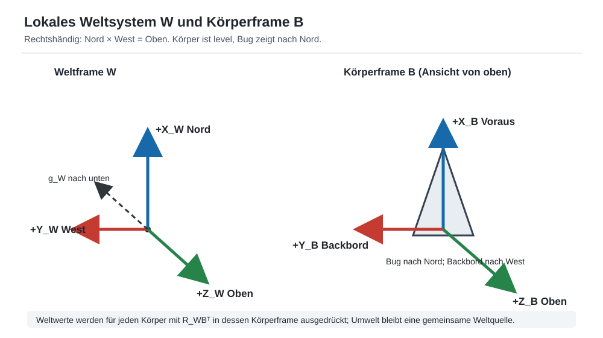
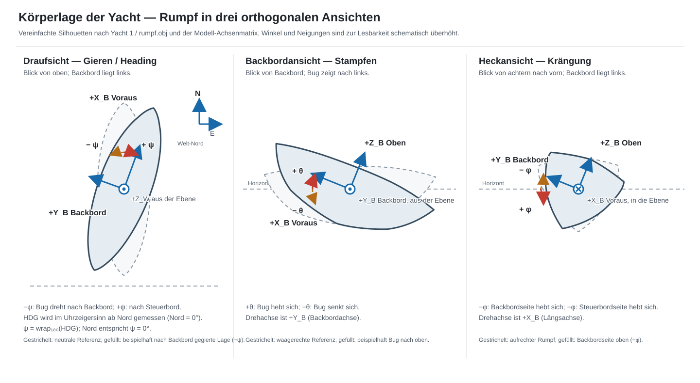
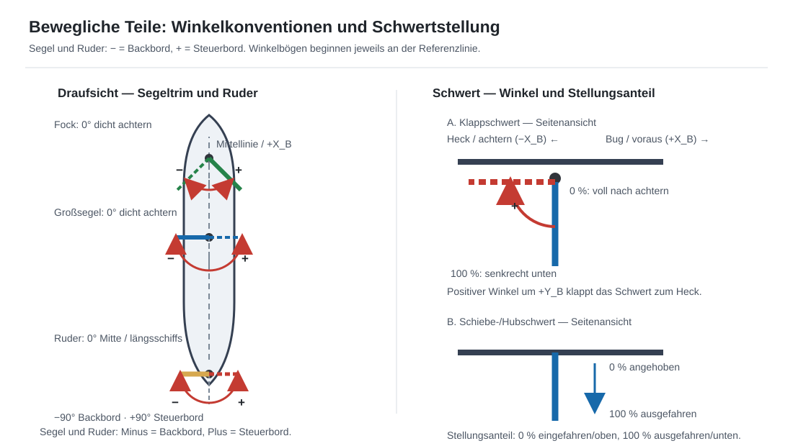

# Spezifikation: Weltsystem, Umwelt und Körperbewegung v0.7

**Stand:** 17.10.2026<br>
**Status:** Fachliche Spezifikation; keine Implementierungs- oder
Produktivfreigabe<br>
**Geltungsbereich:** Lokales Erd-/Weltsystem, Körper- und Teilframes,
Umweltbewegungen, daraus abgeleitete Anzeigegrößen sowie Segel-, Ruder- und
Schwertstellwerte.

## Kennzeichnungs- und Änderungsverfahren

### Spec000 — Dauerhafte Spezifikationskennungen

Jeder normative Punkt hat eine eindeutige `SpecNNNN`-Kennung. Kennungen
werden bei Aktualisierungen beibehalten und nie wiederverwendet. Neue Punkte
erhalten neue Nummern an der logisch passenden Stelle; bestehende Punkte
werden nicht umnummeriert. Entfallene oder verworfene Punkte werden aus dem
aktiven Teil entfernt und am Dokumentende unter der bisherigen Kennung als
„Nicht umsetzen“ oder „So nicht umsetzen“ mit Begründung dokumentiert.
Dieses Dokument setzt die projektweite Nummerierung nach `Spec0066` fort.

## 1. Zweck, Umfang und Grenzen

### Spec0067 — Gemeinsame Bezugsgrundlage

Alle Welt-, Körper- und Teilgrößen müssen sich auf explizit benannte
Koordinatenrahmen, Einheiten und Vorzeichen beziehen. Eine Zahl ohne
Bezugsrahmen oder Einheit darf nicht als physikalischer Zustand interpretiert
werden. Winkelzustände werden intern in rad geführt; GUI-Winkelangaben in den
Tabellen sind Grad. Mathematische trigonometrische Funktionen wie `atan2`
liefern rad; die Anzeige muss diese für Gradwerte umrechnen. Für alle
vorzeichenbehafteten seitlichen Bedien- und Anzeigewinkel gilt einheitlich:
Backbord ist negativ, Steuerbord positiv. Diese Darstellungsregel ändert
weder die rechtshändigen Körper-/Weltachsen noch rohe Vektor- und
Winkelgeschwindigkeitskomponenten. Nicht seitliche Winkel wie Stampfen
behalten ihre eigene explizite Vorzeichenbedeutung.

### Spec0068 — Kein globales Erdmodell

Die Simulation verwendet ein lokales, ebenes Weltsystem mit einer
festgelegten Nordrichtung. Erdkrümmung, geografische Koordinaten,
missweisender oder Kompasskurs, Erdrotation, Magnetfeld und ortsabhängige
Schwere gehören nicht zu dieser Spezifikation. „Nord“ ist die horizontale
Referenzrichtung der simulierten Welt und kein modellierter geografischer
Nordpol.

### Spec0069 — Getrennte Umwelt-, Körper- und Gelenkzustände

Umweltfelder, Körperzustände und Gelenkstellwerte müssen fachlich getrennt
bleiben. Diese Spezifikation legt Datenbedeutung und Berechnungsbeziehungen
fest, aber keine zwingende Python-Klassenstruktur oder konkrete GUI-Anordnung.
Bestehende Hydrostatik und Dynamik dürfen nicht ohne gesonderte
Umsetzungsfreigabe ersetzt werden.

## 2. Koordinatenrahmen, Achsen und Transformationen

### Spec0070 — Rechtshändiger Weltframe

Der lokale Weltframe `W` ist rechtshändig und lautet:

| Achse | Positive Richtung |
|---|---|
| `+X_W` | Nord |
| `+Y_W` | West |
| `+Z_W` | Oben |

Damit gilt `X_W × Y_W = Z_W` (Nord × West = Oben). Die positiven Richtungen
entsprechen `(1,0,0)` für Nord, `(0,1,0)` für West und `(0,0,1)` für Oben.
Ost ist daher `−Y_W`, Süd `−X_W` und unten `−Z_W`. Der Weltursprung ist ein
frei gewählter, konstanter Simulationsbezugspunkt. Die Welt-Schwerkraft zeigt
im Standardfall nach unten, also `g_W = (0, 0, -g)`.

### Spec0071 — Rechtshändiger Körperframe

Der körperfeste Frame `B` ist rechtshändig und lautet:

| Achse | Positive Richtung |
|---|---|
| `+X_B` | Voraus, zum Bug |
| `+Y_B` | Backbord |
| `+Z_B` | Oben durch den Rumpf |

Damit gilt `X_B × Y_B = Z_B`. Ein level liegender Körper mit Bug nach Nord
ist achsenparallel zum Weltframe: `+X_B = +X_W` nach Nord, `+Y_B = +Y_W`
nach Backbord/West und `+Z_B = +Z_W` nach oben.

### Spec0072 — Teil- und Gelenkframes

Jedes bewegliche Teil muss einen stabil benannten lokalen Frame `J` besitzen.
Seine Ursprungsposition, Ausgangsorientierung und Gelenkachsen werden relativ
zum Elternframe angegeben. Teilframes erben die Elternbewegung; ihre
Relativbewegung entsteht ausschließlich aus den expliziten Gelenkkoordinaten.
Die positive Richtung jeder Gelenkachse folgt der Rechte-Hand-Regel.

### Spec0073 — Frame- und Vektortransformation

`R_WB` bezeichnet die Rotationsmatrix, die Körpervektoren in den Weltframe
abbildet. Für einen freien Vektor gilt:

```text
v_W = R_WB · v_B
v_B = R_WBᵀ · v_W
```

Translation wird nur auf Punkte, nicht auf freie Vektoren angewendet. Für
Punkte muss zusätzlich die Frameposition berücksichtigt werden.

### Spec0074 — SI-Einheiten und Winkel

Alle intern gespeicherten Längen, Geschwindigkeiten, Beschleunigungen,
Winkelgeschwindigkeiten, Kräfte und Momente verwenden SI-Einheiten:
`m`, `m/s`, `m/s²`, `rad/s`, `N` und `N·m`. Winkel werden intern in
Radiant gespeichert. GUI-Winkel dürfen in Grad angezeigt werden und müssen
als solche beschriftet sein.

### Spec0075 — Schwerkraft und lokaler Horizont

Die Welt-Schwerkraft ist ein Vektor. Die lokale Vertikale nach oben ist
`u_W = -g_W / |g_W|`; die lokale Horizontale ist die Ebene senkrecht zu
`u_W`. Nord und West werden auf diese Ebene projiziert und normiert, bevor
Horizontwinkel berechnet werden. Bei nicht parallelen Projektionen ist
`West = u_W × Nord` und `Ost = Nord × u_W`, damit `Nord × West = Oben`
rechtshändig bleibt. Ungültige oder null Schwerkraft muss als Eingabefehler
gemeldet werden.



*Abbildung 1: Weltachsen Nord–West–Oben und Körperachsen Voraus–Backbord–Oben
bei Bugrichtung Nord.*

## 3. Persistenter Zustand und abgeleitete Größen

### Spec0076 — Gemeinsamer Welt- und Umweltzustand

Die Welt besitzt genau eine autoritative Nordrichtung, Schwerkraft und
Umweltbeschreibung. Wind und Strömung werden als Geschwindigkeitsvektoren
relativ zum Grund im Weltframe geführt. Ein konstanter Nullvektor ist ein
gültiger Strömungszustand. Windprofil, Referenzhöhe und allfällige zeitliche
Variation sind Parameter des Umweltfelds, keine getrennten, widersprüchlichen
Windwahrheiten. Ein Umweltfeld wird als Abfrage nach Position und Zeit
verstanden, auch wenn die erste Ausbaustufe ein räumlich und zeitlich
konstantes Feld verwendet. Der Standardwert der Wasserströmung bleibt
`(0,0,0)`; Böen und zeitabhängige Strömungsprofile sind spätere Erweiterungen.

### Spec0077 — Eigener Bewegungszustand je dynamischem Körper

Jeder unabhängig dynamische Körper führt mindestens:

| Feldvorschlag | Bedeutung |
|---|---|
| `position_W` | Position seines definierten Bezugspunkts im Weltframe |
| `orientierung_WB` | Orientierung des Körperframes im Weltframe; Quaternion als autoritativer Zustand |
| `geschwindigkeit_W` | Translation des Bezugspunkts relativ zum Grund im Weltframe |
| `winkelgeschwindigkeit_B` | Winkelgeschwindigkeit im Körperframe |

Ein Körper muss die für ihn geltenden Umweltvektoren und abgeleiteten
Umweltgrößen abrufen können. Umweltwerte pro Körper sind Projektionen des
gemeinsamen Weltfelds und dürfen nicht als unabhängig editierbare Kopien
gespeichert werden. Solange Rumpf, Segel, Ruder oder Schwert nicht als
unabhängig dynamische Körper modelliert sind, folgen sie dem Hauptkörper
mittels Teilpose und Gelenkkoordinate.

### Spec0078 — Quaternion als autoritative Orientierung

Die Quaternion ist die einzige autoritative Orientierungsgröße. GUI- und
Diagnosewinkel `φ`, `θ`, `ψ` und `HDG` werden aus Orientierung, Schwerkraft
und Nordrichtung abgeleitet und nicht als weitere unabhängig veränderbare
Orientierungszustände gespeichert. Die Euler-Zerlegung ist festgelegt als
`R_WB = Rz_W(−ψ) · Ry(−θ) · Rx(−φ)` mit aktiven rechtshändigen Rotationen.
Die negativen Vorzeichen bei `ψ` und `φ` bilden die Anzeigekonvention
Backbord-negativ/Steuerbord-positiv auf die mathematisch rechtshändigen
Rotationsmatrizen ab. Die Zerlegung dient nur zur Anzeige und ist bei
Euler-Singularitäten als nicht verfügbar zu kennzeichnen.

Die Anzeigen werden so definiert:

- `HDG`: Azimut der auf den Horizont projizierten Körperlängsachse,
  im Uhrzeigersinn ab Nord, modulo `360°`.
- `θ` (Stampfen): `atan2(f·u_W, |f_h|)`; positiv bedeutet Bug nach oben.
- `φ` (Krängung): signierter Winkel um die Körperlängsachse. `φ < 0`
  bedeutet Backbordseite hebt sich; `φ > 0` bedeutet Steuerbordseite hebt
  sich. Damit gilt auch für Lagewinkel Backbord negativ, Steuerbord positiv.
- `ψ` (Gieren): signierter Euler-Gierwinkel um `+Z_W`, dessen Nullreferenz
  `HDG=0°` (Nord) ist. `ψ < 0` bedeutet Bugdrehung nach Backbord;
  `ψ > 0` bedeutet Drehung nach Steuerbord. Bei der festgelegten Zerlegung
  und `|θ| < 90°` gilt `HDG_deg = wrap_360(rad2deg(ψ))`.

Dabei ist `f` die normierte Körperlängsachse in Weltkoordinaten, `f_h` ihre
horizontale Projektion und `u_W` die lokale Vertikale. Die Rollrichtung
der gespeicherten Orientierung folgt der Rechte-Hand-Regel um `+X_B`;
deren positive Rotationskomponente hebt die Backbordseite und entspricht
daher einer negativen Anzeige `φ`. Ebenso entspricht eine positive
rechtshändige Gierkomponente um `+Z_W` einem Bugdrehen nach Backbord und
daher einer negativen Anzeige `ψ`. Der gespeicherte Vektor
`winkelgeschwindigkeit_B` bleibt ein rechtshändiger physikalischer
Winkelgeschwindigkeitsvektor; seine Komponenten werden nicht nach der
GUI-Vorzeichenkonvention umdefiniert. Bei nahezu senkrechter Körperlängsachse ist `HDG` nicht
definiert und muss als nicht verfügbar ausgegeben werden, nicht als `0°`.

### Spec0079 — Weltzustand und Körperzustand bleiben konsistent

Bei mehreren dynamischen Körpern besitzt jeder Körper seinen eigenen
Bewegungszustand; die Umwelt bleibt gemeinsam. Die Umrechnung von
Weltvektoren in jeden Körperframe muss zur aktuellen Pose dieses Körpers
erfolgen. Ein Körperwechsel darf weder Pose noch Umweltvektoren eines anderen
Körpers übernehmen.



*Abbildung 2: Vereinfachte orthogonale Silhouetten auf Basis des Yacht-1-
Rumpfes (Drauf-, Backbord- und Heckansicht) mit Körperachsen und positiven/
negativen Vorzeichen von Gieren, Stampfen und Krängung. Bei seitlichen
Winkeln gilt Backbord negativ/Steuerbord positiv; beim Stampfen bedeutet
positiv Bug nach oben. Winkel sind zur Lesbarkeit schematisch überhöht.*

## 4. Umwelt- und Bewegungsgrößen

### Spec0080 — Begriffe, Speicherklassen und GUI-Bezeichnungen

Die folgende Tabelle ist der verbindliche Begriffs- und Anzeigevertrag.
Abgeleitete Werte werden bei Bedarf berechnet oder konsistent gecacht; sie
sind keine unabhängigen Eingaben.

| Feld / Speicherklasse | GUI-Beschreibung | GUI-Kürzel | Typ, Frame, Einheit | Definition / Beziehung |
|---|---|---|---|---|
| `WeltZustand.nordrichtung_W` | Nordrichtung | `Nord` | Einheitsvektor, `W` | Standard `(1,0,0)` entlang `+X_W`; Referenz für horizontale Richtungswinkel. |
| `WeltZustand.schwerkraft_W` | Schwerkraft | `g` | Vektor, `W`, m/s² | Legt unten und die Horizontale fest. |
| `Umweltfeld.luftgeschwindigkeit_W` | Windvektor | `Wind` | Vektor, `W`, m/s | Luftbewegung relativ zum Grund; zeigt in die Richtung, in die die Luft strömt. |
| Betrag der horizontalen Luftgeschwindigkeit | Windstärke | `TWS` | Skalar, m/s | `norm(horizontal(v_Luft,W))`; vertikale Luftbewegung bleibt im Vektor enthalten. |
| Herkunftsrichtung der Luftbewegung | Wind aus | `TWD` | Winkel, ° | Im Uhrzeigersinn ab Nord; Formel in Spec0081. |
| `Umweltfeld.wind_referenzhoehe_m` | Wind-Bezugshöhe | `zWind` | Skalar, m | Höhe, auf die der Windvektor beziehungsweise seine Stärke bezogen ist. |
| `Umweltfeld.wasser_geschwindigkeit_W` | Strömungsvektor | `Strömung` | Vektor, `W`, m/s | Wasserbewegung relativ zum Grund; aktueller Standard `(0,0,0)`. |
| `KoerperZustand.position_W` | Position | `Pos` | Vektor, `W`, m | Position des festgelegten Körperbezugspunkts. |
| `KoerperZustand.orientierung_WB` | Lage im Raum | `Lage` | Quaternion | Autoritative Körperorientierung. |
| `KoerperZustand.geschwindigkeit_W` | Geschwindigkeit über Grund | `vG` | Vektor, `W`, m/s | Ableitung der Körperbezugspunktposition nach der Zeit. |
| `KoerperZustand.winkelgeschwindigkeit_B` | Drehgeschwindigkeit | `ω` | Vektor, `B`, rad/s | Körperwinkelgeschwindigkeit, nicht Lagewinkel. |
| `KoerperUmweltwerte.geschwindigkeit_grund_B` | Geschwindigkeit im Körperframe | `vG,B` | Vektor, `B`, m/s | `R_WBᵀ · vG_W`; abgeleitete Körperkomponenten der Grundgeschwindigkeit. |
| Abgeleitete Orientierung | Krängung | `φ` | Winkel, ° | Negativ: Backbordseite hebt sich; positiv: Steuerbordseite hebt sich. |
| Abgeleitete Orientierung | Stampfen | `θ` | Winkel, ° | Positiv: Bug nach oben; Bezug lokaler Horizont. |
| Abgeleitete Orientierung | Gierwinkel | `ψ` | Winkel, ° | Negativ: Bug dreht nach Backbord; positiv: nach Steuerbord. Kein Ersatz für `HDG`. |
| Abgeleitete Orientierung | Bugrichtung | `HDG` | Winkel, ° | Uhrzeigersinn ab Nord; aus horizontal projizierter Bugachse. |
| `KoerperUmweltwerte.luft_relativ_B` | Luftbewegung relativ zum Körper | `AW` | Vektor, `B`, m/s | Luftgeschwindigkeit am Bezugspunkt relativ zum Körper. |
| `KoerperUmweltwerte.wind_W_B` | Wind im Körperframe | `Wind B` | Vektor, `B`, m/s | Gemeinsamer Weltwind, in Körperachsen transformiert; keine zweite Eingabe. |
| Betrag des horizontalen `AW` | Scheinbare Windstärke | `AWS` | Skalar, m/s | Betrag der horizontalen scheinbaren Luftbewegung. |
| `KoerperUmweltwerte.wasser_relativ_B` | Fahrt durchs Wasser | `vW` | Vektor, `B`, m/s | Körperbewegung relativ zur Strömung, in Körperachsen. |
| `KoerperUmweltwerte.stroemung_W_B` | Strömung im Körperframe | `Ström B` | Vektor, `B`, m/s | Gemeinsame Weltströmung, in Körperachsen transformiert; keine zweite Eingabe. |
| Betrag des horizontalen `vW` | Fahrt durchs Wasser | `STW` | Skalar, m/s | Betrag der horizontalen Bewegung relativ zum Wasser. |
| Richtung des horizontalen `vW` | Kurs durchs Wasser | `CTW` | Winkel, ° | Bewegungsrichtung relativ zum Wasser, im Uhrzeigersinn ab Nord. |
| Richtung des horizontalen `vG` | Kurs über Grund | `COG` | Winkel, ° | Bewegungsrichtung relativ zum Grund, im Uhrzeigersinn ab Nord. |
| Betrag des horizontalen `vG` | Geschwindigkeit über Grund | `SOG` | Skalar, m/s | Betrag der horizontalen Bewegung relativ zum Grund. |
| Differenz `CTW` zu `HDG` | Abdriftwinkel | `λ` | Winkel, ° | Vorzeichenbehafteter, gewrappter Winkel von Bugrichtung zur Bewegung durchs Wasser. |
| Windwinkel relativ zum Bug | Wahrer Windwinkel | `TWA` | Winkel, ° | Vorzeichenbehafteter Winkel von Bugrichtung zur meteorologischen Windherkunftsrichtung. |
| scheinbarer Windwinkel relativ zum Bug | Scheinbarer Windwinkel | `AWA` | Winkel, ° | Vorzeichenbehafteter Winkel von Bugrichtung zur scheinbaren Windherkunftsrichtung. |

`AWA` und `TWA` sind relative Winkel; `TWD`, `COG`, `CTW` und `HDG` sind
Weltazimute. Negative relative Winkel zeigen von `+X_B` (Voraus) nach
`+Y_B` (Backbord), positive nach Steuerbord (`−Y_B`). GUI-Texte und Tooltips
müssen diese Unterscheidung kenntlich machen. Falls ein horizontaler Vektor
null ist, sind Betrag und Vektor weiterhin gültig, seine Richtung jedoch
nicht definiert.

### Spec0081 — Geschwindigkeitsbeziehungen und Richtungsformeln

Für den Körperbezugspunkt gilt:

```text
v_Wasser,W = vG_W − v_Strömung,W
v_Luft_relativ,W = v_Luft,W − vG_W
vG_B = R_WBᵀ · vG_W
v_Luft,B = R_WBᵀ · v_Luft,W
v_Strömung,B = R_WBᵀ · v_Strömung,W
vW_B = R_WBᵀ · v_Wasser,W
AW_B = R_WBᵀ · v_Luft_relativ,W
SOG = |horizontal(vG_W)|
STW = |horizontal(v_Wasser,W)|
```

In nichtuniformen Umweltfeldern werden Wind und Strömung an der aktuellen
Weltposition des Bezugspunkts und zum aktuellen Simulationszeitpunkt
ausgewertet. Für einen versetzten Punkt oder ein bewegliches Teil ist das
Feld an dessen Weltposition auszuwerten.

Bei einem Punkt `P` mit Körperarm `r_B` gilt:

```text
v_P,W = vG_W + R_WB · (ω_B × r_B)
```

Für einen Punkt auf einem beweglichen Teil ist dessen translatorische und
rotatorische Relativgeschwindigkeit zusätzlich einzubeziehen, bevor
Luft-/Wasserbewegung relativ zum Punkt berechnet wird. Relative Winkel
werden auf den Körperframe bezogen:

```text
AWA_deg = wrap_180(rad2deg(atan2(AW_B.y, −AW_B.x)))
TWA_deg = wrap_180(rad2deg(atan2(v_Luft,B.y, −v_Luft,B.x)))
λ_deg   = wrap_180(rad2deg(atan2(−vW_B.y, vW_B.x)))
```

Die Ausdrücke gelten für horizontale Projektionen; die Komponenten sind im
rechtshändigen Körperframe mit `+Y_B` nach Backbord. Richtungsazimute für Weltvektoren in den Weltachsenkomponenten
`v=(v_X,v_Y,v_Z)=(v_Nord,v_West,v_Oben)` sind:

```text
Azimut_nach(v) = atan2(−v_Y, v_X)                       modulo 360°
TWD             = atan2(v_Luft,Y, −v_Luft,X)            modulo 360°
```

Die Richtungen Nord, Ost, Süd und West entsprechen damit den Weltvektoren
`(+X_W, −Y_W, −X_W, +Y_W)` beziehungsweise den Azimuten `0°`, `90°`,
`180°` und `270°`.

Die `atan2`-Ergebnisse dieser Weltazimutformeln sind vor der Grad-Anzeige mit
`rad2deg` umzurechnen.

`AW_B` zeigt in Luft-Fließrichtung; für `AWA` wird daher seine Gegenrichtung
verwendet. Die vorzeichenbehafteten Winkel nutzen durchgängig Backbord
negativ und Steuerbord positiv, wie Segel- und Ruderwinkel. Relative Winkel
werden auf `[-180°, +180°)`
gewrappt. Für Windstille, Stillstand oder nicht definierte Projektionen muss
die GUI `—` oder einen gleichwertigen Nichtverfügbar-Status anzeigen. Eine
undefinierte Richtung darf nicht durch `0°` ersetzt werden.

### Spec0082 — Kein stillschweigendes Plus/Minus der Beträge

Grund- und Wasserbewegungen werden ausschließlich als Vektoren addiert:

```text
vG_W = v_Wasser,W + v_Strömung,W
```

Eine skalare Beziehung wie „STW ± Strömung“ ist unzulässig. Der Fahrtwind ist
keine separat gespeicherte Eingabe, sondern ergibt sich aus der
Relativgeschwindigkeit von Luft und Körper. Bei ruhender Luft gilt nicht
automatisch ein eigener Windzustand, sondern `v_Luft,W = 0`.

## 5. Bewegliche Teile und Stellwerte

### Spec0083 — Gelenktransformation

Für jedes bewegliche Teil ist die Teilpose aus Elternpose, Gelenkbezug,
Gelenkachse und Stellwert zu bestimmen:

```text
T_Eltern,Teil(q) =
    T_Eltern,Gelenk · Rotation(Achse, q) · T_Gelenk,Teil
```

Bei einem Schubgelenk ersetzt eine Translation entlang der festgelegten
Führung die Rotation. Die tatsächliche Gelenkachse, der Nullpunkt und die
mechanischen Grenzen müssen aus der autoritativen Modell- oder
Konstruktionsquelle stammen. Eine Testannahme muss separat markiert sein und
darf nicht als Produktionskinematik ausgegeben werden.

### Spec0084 — Fock- und Großsegelstellung

Fock und Großsegel besitzen getrennte signierte Trimstellwerte. Der Winkel
wird in der Draufsicht von der Bootsmittellinie achtern (Richtung Heck) zum
Segel gemessen: `0°` bedeutet dicht/entlang der Mittellinie nach achtern;
`−90°` bedeutet vollständig nach Backbord geöffnet und `+90°` vollständig
nach Steuerbord geöffnet. Damit gilt dieselbe physische Seitenkonvention wie
für das Ruder: Minus = Backbord, Plus = Steuerbord. Zwischenwerte liegen
jeweils zwischen dicht und offen. Diese Trimkoordinate beschreibt die
sichtbare Segelstellung und darf nicht ohne Geometrienachweis mit einer
bestimmten Mast-, Baum- oder Vorstagrotation gleichgesetzt werden.

Der Bedien-/Testbereich ist `−90° … 0° … +90°`. Produktivbewegung muss
zusätzlich innerhalb nachgewiesener mechanischer Grenzen liegen; der
abstrakte Bereich belegt keine Freigängigkeit.

| Feldvorschlag | GUI-Beschreibung | GUI-Kürzel | Typ und Einheit | Nullstellung / Vorzeichen |
|---|---|---|---|---|
| `GelenkZustand.fock_trim_rad` | Fockstellung | `Fock` | Winkel, intern rad; GUI ° | `0°` dicht achtern; `−` nach Backbord offen, `+` nach Steuerbord offen |
| `GelenkZustand.grosssegel_trim_rad` | Großsegelstellung | `Groß` | Winkel, intern rad; GUI ° | `0°` dicht achtern; `−` nach Backbord offen, `+` nach Steuerbord offen |

Eine gekoppelte Bedienung ist optional. Der gemeinsame Steuerwert `c` muss
über explizit dokumentierte Funktionen auf die zwei Einzelwerte abgebildet
werden:

```text
δ_Fock = f_Fock(c)
δ_Groß = f_Groß(c)
```

Die Einzelwerte bleiben auslesbar. Eine identische Kopplung darf nicht ohne
fachliche Entscheidung angenommen werden.
`c` und beide Funktionsausgaben sind Winkel in rad im Zustand; die GUI
konvertiert sie für die Anzeige beziehungsweise Eingabe in Grad.

| Feldvorschlag | GUI-Beschreibung | GUI-Kürzel | Typ und Einheit | Beziehung |
|---|---|---|---|---|
| `Steuerung.segel_trim_befehl_rad` | Gekoppelter Segeltrim | `Segel` | Winkelbefehl, intern rad; GUI ° | Eingabe `−90° … +90°`; `0°` dicht, negativ nach Backbord und positiv nach Steuerbord geöffnet; wird über die zwei dokumentierten Funktionen auf Fock und Großsegel abgebildet und ersetzt deren Einzelwerte nicht. |

### Spec0085 — Ruderblattwinkel

Der Ruderblattwinkel ist eine signierte Gelenkkoordinate. In der abstrakten
Körperkonvention liegt `0°` in der neutralen, längsschiffs ausgerichteten
Stellung. `−90°` bedeutet Ruder ganz nach Backbord, `+90°` ganz nach
Steuerbord. Der Vorzeichenvertrag benennt die physische Ablenkung des
Ruderblatts; er ist ausdrücklich nicht das rohe rechtshändige
Rotationsvorzeichen um `+Z_B`. Bei dieser Achsenwahl muss die Gelenkabbildung
das Vorzeichen entsprechend umsetzen. Die Vorzeichenkonvention ist
projektspezifisch festgelegt, weil maritime und hydrodynamische Quellen
unterschiedliche Rudervorzeichen verwenden; sie stimmt mit der dort ebenfalls
verbreiteten Konvention „positiv = Steuerbord“ überein. Der Bereich
`−90° … 0° … +90°` ist abstrakter Bedien-/Testbereich, kein Nachweis
mechanischer Anschläge. Produktivbewegung ist auf die nachgewiesenen
mechanischen Grenzen zu begrenzen.

| Feldvorschlag | GUI-Beschreibung | GUI-Kürzel | Typ und Einheit | Nullstellung / Vorzeichen |
|---|---|---|---|---|
| `GelenkZustand.ruderwinkel_rad` | Ruderblattwinkel | `Ruder` | Winkel, intern rad; GUI ° | `0°` längsschiffs; `−` Backbord, `+` Steuerbord |

### Spec0086 — Schwertwinkel oder Schwert-Hub

Die Kinematik ist abhängig von der tatsächlichen Bauart und muss als genau
eine primäre Gelenkkoordinate modelliert werden:

| Kinematik | Primärwert | Nullstellung und positives Vorzeichen |
|---|---|---|
| Klapp-/Drehschwert | `GelenkZustand.schwertwinkel_rad` | `0°` zeigt nach unten; positives Drehen um die körperfeste Querachse `+Y_B` klappt das untere Schwertende ausschließlich nach achtern (zum Heck, `−X_B`); eine Vorwärtsklappung ist nicht Teil dieses Modells. Abstrakter Bereich `0° … 90°`; reale Grenzen müssen nachgewiesen sein. |
| Schiebe-/Hubschwert | `GelenkZustand.schwert_hub_m` | Weg entlang der nachgewiesenen Führung; `0 %` bedeutet vollständig angehoben/eingezogen, `100 %` vollständig abgesenkt und ausgefahren. Weggrenzen sind Teil der Kinematik. |

Eine einheitliche, abgeleitete Schwertstellungsanzeige verwendet
`0 % = eingefahren/angehoben` und `100 % = ausgefahren/abgesenkt`. Beim
Klappschwert entspricht `0 %` der vollständig nach achtern geklappten und
`100 %` der senkrecht nach unten zeigenden Stellung. Beim Schiebe-/Hubschwert
entsprechen die Endpunkte dem vollständig angehobenen und vollständig
ausgefahrenen Weg. Der Prozentwert ist nur zulässig, wenn beide Endlagen aus
der Kinematik bekannt sind; er ist kein zusätzlicher unabhängiger Zustand.

GUI-Bezeichnungen und Einheiten:

| Feld / Ableitung | GUI-Beschreibung | GUI-Kürzel | Typ und Einheit |
|---|---|---|---|
| `GelenkZustand.schwertwinkel_rad` | Schwertwinkel | `Schwert°` | Winkel, intern rad; GUI ° |
| `GelenkZustand.schwert_hub_m` | Schwert-Hub | `Hub` | Weg, intern m; GUI m oder % |
| abgeleiteter Stellungsanteil | Schwertstellung | `Schwert %` | Prozent, dimensionslos; `0 %` eingefahren/angehoben, `100 %` ausgefahren/abgesenkt |

Die Prozentanzeige wird aus einer monoton zunehmenden Koordinate `q`
berechnet. `q_0` ist die Kinematikstellung für eingefahren/angehoben
beziehungsweise vollständig nach achtern geklappt; `q_100` ist die Stellung
für ausgefahren/abgesenkt. Die Koordinate ist so zu orientieren, dass
`q_100 > q_0`, auch wenn dafür eine native Gelenkkoordinate umzurechnen ist:

```text
Schwert_% = 100 · (q − q_0) / (q_100 − q_0)
```

Beim Schiebe-/Hubschwert ist `q` der Weg entlang der Führung. Beim
Klappschwert ist `q` die normierte Gelenkstellung zwischen der nach achtern
geklappten und der senkrecht abgesenkten Endlage. Die Anzeige ist nur
definiert, wenn beide Endlagen bekannt und verschieden sind; andernfalls ist
sie als nicht verfügbar auszugeben. Eine Prozentanzeige ist kein zusätzlicher
Physikzustand. Winkel und Hub dürfen
nicht gleichzeitig als unabhängige Schwertzustände geführt werden, außer die
reale Mechanik besitzt nachweislich beide Freiheitsgrade.



*Abbildung 3: Abstrakte Stellkoordinaten von Fock, Großsegel, Ruder und
alternativer Schwertkinematik; tatsächliche Achsen und Grenzen sind
modellabhängig.*

## 6. GUI-, Test- und Freigabekriterien

### Spec0087 — GUI-Anzeige und Einheiten

Jeder dargestellte Messwert muss eine eindeutige Beschreibung, ein
GUI-Kürzel, eine Einheit und seinen Bezugsframe erkennen lassen. Weltazimut,
relativer Winkel, Körperwinkel, Gelenkwinkel und Betrag dürfen visuell nicht
verwechselt werden. Beim Wechsel des ausgewählten Körpers müssen dessen
Körper- und Teilwerte erscheinen; gemeinsame Weltwerte bleiben dieselben.
Vorzeichenbehaftete seitliche GUI-Winkel folgen dem projektweiten Vertrag:
Backbord negativ, Steuerbord positiv. `HDG`, `COG`, `CTW` und `TWD` sind
unabhängige Weltazimute im Uhrzeigersinn ab Nord, keine seitlichen
Plus-/Minus-Differenzwinkel.

Eine feste Bildschirmkomposition stellt in den Ecken getrennte
Instrumentenkarten dar:

- eine Welt-/Kompasskarte mit großem `HDG`, Nordreferenz und synchronisierter
  Kompassrose;
- eine Grundbewegungskarte mit `SOG` und `COG` sowie eine getrennte
  Wasserbewegungskarte mit `STW`, `CTW` und Abdrift `λ`, damit die
  Bezugsrahmen auf einen Blick unterscheidbar bleiben;
- ein vorbereitetes, zunächst deaktiviertes Windinstrument für `TWS`, `TWD`,
  `AWS`, `AWA` und `TWA`. Ohne konfigurierten Windzustand werden dort keine
  Zahlen oder künstlichen Nullwerte gezeigt.

Jede Instrumentkarte muss als eigene, in Größe und Position verankerbare
Qt-Widget-Klasse implementierbar sein. Der Entwurf ist in
[Konzept_Navigationsanzeigen_v0.7.md](./Konzept_Navigationsanzeigen_v0.7.md)
und [Grafik_Navigationsanzeigen_v0.7.svg](./Grafik_Navigationsanzeigen_v0.7.svg)
dargestellt. Messwertlabels, Werte, Einheiten, Richtungsmarker und
Nichtverfügbarkeitszustände sind getrennte Update-Elemente. Die
GUI-Aktualisierung muss aus dem jeweils neuesten Physik-Snapshot erfolgen
und darf Simulationstakte weder blockieren noch erzwingen. Größte
Schriftgröße erhalten primäre Momentanwerte (`HDG`, `SOG`, `STW`); Winkel-
und Kursanzeigen bleiben sekundär und behalten Einheiten beziehungsweise
„nicht verfügbar“ eindeutig sichtbar. Das Mockup kennzeichnet seine Werte
als Beispiele; sie sind keine Laufzeit- oder Fallbackwerte.

Die nummerierte
[Kompass-Master-Elementgrafik](./Grafik_Kompass_Master_Elemente_v0.7.svg)
ist die zentrale, fortlaufende Elementbibliothek für Instrumentanzeigen.
Neue gemeinsame oder spezifische Elemente werden dort mit stabiler Nummer,
Name und kurzer Funktion ergänzt. Alle Anzeige-Klassen übernehmen die
Master-Geometrie und den visuellen Stil; nicht für eine konkrete Messgröße
verwendete Elemente werden ausgeblendet. Neue Kartenvarianten dürfen keine
abweichende Gestaltung der gemeinsamen Elemente einführen.

Die Weltkompasskarte heißt „Kompass“ und behält die Titelbeschreibung
„Bugrichtung relativ zu lokalem Nord“, die unten links innerhalb der Karte
steht. Ihre analoge Rose verwendet 16
nautische Strichpositionen im Abstand von 22,5°. Auf den vier Kardinalpunkten
entfallen die Striche; `N`, `O`, `S`, `W` stehen an deren Stelle in derselben
Radius-Ebene, sauber zwischen Innen- und Außenkreis. Es gibt auch am Nordpunkt
keinen zusätzlichen Strich. Die Hauptrichtungsstriche sind länger als die Zwischenstriche.
Die abgerundete, quadratische Widget-Karte bildet die äußere Begrenzung und
umschließt Überschrift, Beschreibung, Kompassrose und das auf `KAM_AZ`
umlaufende Kamerasymbol. Die Kompassrose wird so groß dargestellt, dass ihr
kleinster Abstand zur Widget-Grenze dem kleinsten Abstand des `K` in
„KOMPASS“ zur Widget-Grenze entspricht. Die Abstände werden an der sichtbaren
Kontur gemessen. Es gibt keinen zusätzlichen Kreis um das Kamerasymbol.
Der gefüllte Heading-Zeiger bleibt erhalten. Ein zweiter, gelber
Kameraumriss sitzt außerhalb der Kompassrose am Winkel `KAM_AZ`, umläuft die
Rose mit dessen Änderung und zeigt mit seiner Linse zum Mittelpunkt. Er ersetzt
den Kamera-Zeiger innerhalb der Rose. Das digitale Feld liegt im Kompasskreis:
numerischer Winkel in der oberen Kreishälfte; unterhalb der Mittellinie stehen
der strichgenaue verbale 16-Punkt-Richtungstext und darunter `HDG`. Der
Richtungstext wird dem nächstliegenden Strich der 16-Punkt-Rose zugeordnet.
Die Striche liegen in Schritten von 22,5°; deshalb wechselt der Text jeweils
bei 11,25° Abstand zu einem Strich, genau auf halbem Weg zum Nachbarstrich.
Formal gilt für einen auf `[0°, 360°)` normalisierten Headingwinkel `h`:

```text
i = floor((h + 11,25°) / 22,5°) mod 16
```

Der Index `i` wählt aus der im Uhrzeigersinn ab Nord geordneten Liste
`N, NNO, NO, ONO, O, OSO, SO, SSO, S, SSW, SW, WSW, W, WNW, NW, NNW`.
Jeder Sektor umfasst damit genau 22,5°; seine untere Grenze ist eingeschlossen
und seine obere ausgeschlossen. Ein Winkel genau auf der Grenze wird somit
dem im Uhrzeigersinn folgenden Strich zugeordnet. `074°` wird als `ONO`
angezeigt. Die Schrift ist ohne Überlappungen so groß wie möglich. Zusätzliche
Erläuterungstexte zur Winkelmessung oder zum lokalen Weltsystem gehören nicht
in das Widget. Das konkrete Layout ist im
[Anzeigenkonzept](./Konzept_Navigationsanzeigen_v0.7.md) und dessen Mockup
dargestellt.

Jede Instrumentkarte muss die Sichtbarkeit ihres Titels, der Beschreibung
unter dem Titel, der analogen Darstellung und der numerischen Darstellung
getrennt steuern können. Bis individuelle Kartenkonfigurationen entworfen
sind, stellt `Einstellungen → Anzeigeoptionen` gemeinsame, standardmäßig
aktivierte Einstellungen für diese vier Sichtbarkeiten bereit. Eine
Anzeigeklasse wertet die Optionen aus und blendet nur das jeweilige Element
aus; das Ausblenden einer Darstellungsform darf weder Messwerte noch den
Physikzustand verändern.

Bei `SOG` oder `STW` unter einer festgelegten Richtungsauflösung darf `COG`
beziehungsweise `CTW` nicht aus numerischem Rauschen angezeigt werden.
`λ` wird nur gezeigt, wenn sowohl `HDG` als auch `CTW` gültig sind.
Einheiten müssen als Anzeigeeinstellung konvertierbar sein; interner
Physikzustand und Berechnung bleiben SI.

### Spec0088 — Mindesttests der Bezugsrahmen

Automatisierte Tests müssen mindestens nachweisen:

1. Rechtshändigkeit `X_W × Y_W = Z_W` und `X_B × Y_B = Z_B`.
2. Welt-/Körpertransformationen und Rücktransformation ohne messbare
   Änderung; Translation beeinflusst freie Vektoren nicht.
3. `+X_W` zeigt Nord, `+Y_W` West, `+Z_W` Oben; `+X_W × +Y_W = +Z_W`.
   Bug Nord ergibt `HDG=0°`, Ost `90°`, Süd `180°` und West `270°`.
   Ein level liegender Körper mit Bug nach Nord ist achsenparallel zu `W`.
   Backbord-negativ/Steuerbord-positiv stimmt.
4. Negative Krängung hebt Backbord; positive Krängung hebt Steuerbord;
   positives Stampfen senkt den Bug; negatives Gieren dreht den Bug nach
   Backbord und positives Gieren nach Steuerbord.
5. Aus Orientierung und Schwerkraft abgeleitete Winkel ändern sich korrekt,
   einschließlich `HDG_deg = wrap_360(rad2deg(ψ))` bei `|θ| < 90°`,
   und `ψ = wrap_180(HDG_deg)`. Das Quaternion bleibt der einzige
   gespeicherte Orientierungszustand; singuläre Richtungen ergeben
   „nicht verfügbar“.
6. UI-Tests aktualisieren Snapshotwerte für `HDG`, `COG`, `SOG`, `CTW`,
   `STW` und `λ` unabhängig und korrekt; fehlende/ungültige Richtungen
   erzeugen einen Nichtverfügbarkeitszustand statt eines Nullkurses.
7. Windanzeigen bleiben ohne Windzustand deaktiviert und zeigen bei gültigem
   Wind später dieselbe eindeutig definierte Daten-/Einheitenstruktur.
   UI-Updates frieren keine Physikberechnung ein.
8. Jede der vier Sichtbarkeitsoptionen blendet ausschließlich das zugehörige
   Anzeigeelement aus/ein; alte Settings-Dateien erhalten beim Laden die
   aktivierten Standardwerte für fehlende Optionen.

### Spec0089 — Mindesttests der Umwelt- und Bewegungsbeziehungen

Automatisierte Tests müssen mindestens ruhendes Wasser, positive und negative
Strömung, Windstille, Wind aus Nord und Ost, Stillstand, Fahrt direkt mit und
gegen Wind, Abdrift sowie mehrere Körper mit verschiedenen Orientierungen
abdecken. Sie müssen die Vektorgleichungen aus Spec0081/Spec0082, Einheiten,
Winkel-Wrapping und definierte Nichtverfügbarkeit nachweisen. Für relative
Winkel muss eine Richtung nach Backbord negativ und dieselbe Ablenkung nach
Steuerbord positiv ausgeben. Die Auswertung lokaler Anströmung muss
Körperrotation und Teilbewegung am Angriffspunkt berücksichtigen.

### Spec0090 — Stellwert- und Gelenktests

Tests müssen für Fock und Großsegel nachweisen, dass `0°` dicht nach achtern,
`−90°` nach Backbord und `+90°` nach Steuerbord weist. Das muss der
Ruderkonvention entsprechen: `−90°` Backbord, `0°` Mitte und `+90°`
Steuerbord. Geprüft wird die physische Ablenkung und nicht nur das Vorzeichen
einer Rohrotation. Grenzen und Abbildung vom GUI-Wert auf die Gelenkpose sind
ebenfalls zu prüfen. Bei gekoppeltem Segeltrim sind Einzelabbildungen und
Rücklesbarkeit zu prüfen. Schwerttests müssen beim Klappschwert `0 %`
vollständig nach achtern und `100 %` senkrecht nach unten, beim Schiebe-
/Hubschwert `0 %` angehoben und `100 %` ausgefahren nachweisen. Dazwischen
muss die Prozentanzeige monoton mit dem Ausfahren zunehmen. Vorwärtsklappung
sowie unpassende oder unbekannte Kinematik darf keine scheinbar gültige
Produktionsstellung erzeugen.

### Spec0091 — Freigabegate und Implementierungsreihenfolge

Vor Codeintegration sind Koordinatenmapping und Achsen bestehender Modelle
gegen den tatsächlichen Loader und die vorhandenen Frames zu verifizieren.
Die Umsetzung erfolgt in dieser Reihenfolge:

1. Frames, Transformationen, Einheiten und Vorzeichen;
2. gemeinsamer Welt-/Umweltzustand;
3. Körperzustand und abgeleitete Lage-/Bewegungsanzeigen;
4. Umweltvektoren in Körperframes und lokale Punktgeschwindigkeiten;
5. Gelenkverträge für Segel, Ruder und Schwert;
6. GUI-Anzeige und vollständige Regressionen.

Jeder Schritt erhält gezielte Tests. Kein Schritt darf die bestehende
Hydrodynamik- oder Dynamikfreigabe umgehen. Reale Gelenkachsen, nicht
nachgewiesene Stellgrenzen, Profil-/Segelmodelle und neue
Mehrkörperdynamik bleiben gesperrt, bis ihre jeweiligen Voraussetzungen
belegt und gesondert freigegeben sind.

### Spec0092 — Horizontstabilisierte, giergekoppelte Kamera

Die Darstellungskamera führt eine horizontale Kopplung an die ausgewählte
Körper-Headingrichtung, darf dessen Stampfen und Krängung aber nicht
nachführen. Die Kamera-Zielposition folgt dem gewählten Körperbezugspunkt.
Der horizontale Standpunktazimut ist `KAM_AZ`; er wird im Uhrzeigersinn ab
lokalem Nord gemessen und durch einen konstanten Offset `Δ_Kamera` an das
Heading gekoppelt:

```text
KAM_AZ = wrap_360(HDG + Δ_Kamera)
```

`Δ_Kamera` bleibt relativ zum Bug konstant. Ändert sich das Heading durch
Körpergieren, dreht sich der Kamera-Standpunkt mit dem Körper um denselben
Winkel. `KAM_AZ` bezeichnet den Azimut vom Zielpunkt zum Kamera-Standpunkt;
die Blickrichtung zeigt vom Standpunkt zum Zielpunkt. Der zweite Kompasszeiger
zeigt diesen Standpunktazimut und weist mit seiner Spitze zum Kreismittelpunkt.

Der Kamerahöhenwinkel `KAM_EL` ist der Winkel des Kamera-Standpunkts über der
lokalen Horizontalen und bleibt relativ zum lokalen Horizont fest. Für
Zielpunkt `p_Ziel`, Kameradistanz `d`, lokale Nord-Einheitsrichtung `n_W`,
West-Einheitsrichtung `w_W` und Vertikale `u_W` liegt der Kamerastandpunkt
bei:

```text
r_Kamera,W = p_Ziel
    + d · (cos(KAM_EL)·cos(KAM_AZ)·n_W
         − cos(KAM_EL)·sin(KAM_AZ)·w_W
         + sin(KAM_EL)·u_W)
```

`KAM_AZ`, `KAM_EL` und `Δ_Kamera` sind Winkel; ihr autoritativer interner
Wert ist rad, die Anzeige erfolgt in Grad. `KAM_EL` liegt im Bereich
`0° ≤ KAM_EL < 90°`; der konkrete Blickwinkel wird bei der Kamera-
Implementierung festgelegt. Die illustrativen Werte `HDG=074°` und
`KAM_AZ=119°` im Dashboard entsprechen nur dort einem angenommenen
`Δ_Kamera=+45°` und sind keine vorgeschriebenen Defaults.

Die Kamera bleibt um ihre Blickachse ungerollt: ihre Obenrichtung ist die
Projektion von `u_W` auf die Bildebene. Sie übernimmt weder Körper-Stampfen
`θ` noch Körper-Krängung `φ`; diese Posewinkel bleiben gegenüber dem lokalen
Horizont sichtbar. Die Kopplung darf nur den Kamera-Azimut an die
Körper-Headingrichtung binden. Bei ungültigem `HDG` darf `KAM_AZ` nicht als
gültiger Winkel ausgegeben werden; die Kamera muss ihren letzten gültigen
Standpunkt beibehalten oder eine definierte Nichtverfügbarkeit anzeigen,
statt stillschweigend auf Nord zurückzuspringen.

Das Kompass-Mockup zeigt den `HDG`-Zeiger und den ungefüllten
`KAM_AZ`-Konturzeiger getrennt. Die Schemadarstellung von Azimut, Höhenwinkel,
Horizontstabilisierung sowie sichtbarem Stampfen und Krängung ist in
[Grafik_Kamerawinkel_Weltkompass_v0.7.svg](./Grafik_Kamerawinkel_Weltkompass_v0.7.svg)
dargestellt.

Die Kameraimplementierung muss gezielt nachweisen, dass:

1. eine Headingänderung um `δ` `KAM_AZ` um dasselbe `δ` ändert und
   `wrap_180(KAM_AZ − HDG)` konstant bleibt;
2. Änderungen von Stampfen und Krängung Kamera-Elevation und Kamera-Roll
   relativ zum lokalen Horizont nicht verändern, während die jeweilige
   Bootsneigung sichtbar bleibt;
3. die Projektion von `u_W` als Kamera-Obenrichtung normiert und gültig ist;
   ungültiges Heading erzeugt keinen künstlichen Nord-Standpunkt.

### Spec0093 — Körperlageanzeigen für Krängung und Stampfen

Die Anzeigen `Kraengungsanzeige` und `Stampfanzeige` sind zwei eigenständige
Qt-Widget-Klassen. Sie übernehmen die quadratische Karte, Typografie,
Kreisanordnung und das außen umlaufende Kamerasymbol des Kompass-Masters. Die
Lageanzeigen ergänzen je eine eigene Yachtansicht und einen an die Yacht
gekoppelten Lagezeiger. Die
[Kompass-Einzelgrafik](./Grafik_Kompass_Anzeige_v0.7.svg) übernimmt die
Kompass-Masterkarte einschließlich ihrer Geometrie, Farben und Schriftmaße.
Die Einzelgrafiken für
[Stampfen](./Grafik_Stampfen_Anzeige_v0.7.svg) und
[Krängung](./Grafik_Kraengung_Anzeige_v0.7.svg) sowie das separate
[Vergleichsdokument](./Grafik_Anzeigen_Vergleich_v0.7.svg) zeigen diese
Instrumentgestaltung.

Beide analogen Anzeigen haben 36 gleichmäßig verteilte Teilstriche im Abstand
von 10°. Die längeren Hauptstriche stehen im Abstand von 30°. Beide
Lageanzeigeskalen verwenden dieselbe Beschriftung. Bei `0°` rechts, positiv
gegen den Uhrzeigersinn und negativ im Uhrzeigersinn stehen oben `+90°`, links
`±180°` und unten `−90°`; die Zwischenwerte laufen in 30°-Schritten. Damit
bildet die Rose Winkel bis `±180°` eindeutig ab. Normal- und Gefahrenvariante
zeigen dieselbe Beschriftung. Es gibt keine Himmelsrichtungs-
oder 16-Punkt-Texte und keinen unabhängigen Kompasszeiger. Stattdessen wird der
einzelne, gefüllte Zeiger des Kompass-Masters als Lagezeiger verwendet. Seine
Form und Farbgebung entsprechen dem Kompasszeiger. Bei `0°` zeigt seine Spitze
nach rechts: beim Stampfen in Richtung Bug, bei der Krängung nach Steuerbord.
Der Zeiger ist an das Yacht-Icon gekoppelt; beide bilden eine gemeinsame
rotierende Einheit und dürfen nicht unabhängig voneinander bewegt oder
gedreht werden. Die gelbe horizontale und die gelb gestrichelte vertikale
Referenzlinie sind dagegen fest im Zifferblatt verankert. Beide verlaufen
durch den Kreismittelpunkt und enden am inneren Kreis. Die Zeichnungsreihenfolge
ist Referenzlinien, Zeiger und Yacht; die Yacht überlagert daher Linien und
Zeiger. Sämtliche Yachtkonturen sind weiß, ein Mast wird nicht dargestellt.
Im Kompass sind dieselben gelben Referenzlinien feststehend; nur sein
Richtungspfeil dreht. Der numerische Winkel mit Vorzeichen steht im oberen
Teil der Rose und erhält zusammen mit dem Gradzeichen eine dünne dunkle
Kontur in der Farbe des inneren Kreishintergrunds. Der Mockup-Wert ist nur
illustrativ. Der Wert steht in allen drei Anzeigen auf derselben Höhe wie der
Kompasswert; die Unterkante der Kennzeichnungen `STAMPFEN` und `KRÄNGUNG`
liegt auf derselben Höhe wie die Unterkante von `HDG`.
Die Teilstriche dienen der Orientierung; der exakte Zahlenwert ist maßgeblich.

`Kraengungsanzeige` verwendet `φ` und eine ikonische Heckansicht von achtern
nach vorn: flacher Rumpf, Kiel und stilisierte Segelflächen ohne Mast.
Steuerbord liegt in dieser Ansicht rechts. Das Yacht-Icon dreht visuell um `−φ`: Bei
`φ > 0` hebt die Steuerbordseite, bei `φ < 0` die Backbordseite. Das folgt
der in Spec0078 definierten Anzeigenkonvention. Bei negativer Segelstellung
(Backbord) oder `0°` (Mittellage) wird das Icon in seiner Grundausrichtung
gezeigt. Bei positiver Segelstellung (Steuerbord) wird die SVG an der
vertikalen Mittelachse gespiegelt, sodass das Segel rechts erscheint. Diese
Spiegelung ist ein rein dekoratives Gimmick: Sie ändert weder den angezeigten
Krängungswinkel noch die Lagewinkelrotation des Yacht-Icons.

`Stampfanzeige` verwendet `θ` und eine ikonische Seitenansicht mit Bug nach
rechts, Heck nach links, erkennbarem Rumpf, einfachem Kiel und Segelflächen
ohne Mast. Das Icon dreht visuell um `−θ`: positives `θ` hebt den Bug,
negatives `θ` senkt ihn. Der Lagezeiger dreht jeweils mit dem Yacht-Icon:
Krängung um `−φ`, Stampfen um `−θ`. Der Rumpf ist mit klar unterscheidbarem Bug
und Heck gezeichnet.

Beide Widgets erhalten ihren eigenen Lagewinkel und `KAM_AZ` aus demselben
unveränderlichen Physik-Snapshot. Das Kamerasymbol bleibt identisch zum
Kompass-Master: Es umläuft außen den Skalenring, zeigt mit der Linse nach
innen und kodiert ausschließlich `KAM_AZ`; es wird nicht mit `φ` oder `θ`
gedreht. Ungültige oder singuläre Lagewinkel werden explizit als nicht
verfügbar dargestellt, niemals als Nullwinkel. Sichtbarkeit von Titel,
Titelbeschreibung, Analog- und Digitaldarstellung folgt dem gemeinsamen
Widgetvertrag.

### Gefahrenanzeige bei Überschreiten von ±90°

Kompass, Stampfen und Krängung sind drei eigenständige Widgets und damit drei
eigenständige Widget-Klassen. Der Gefahrenzustand einer Lageanzeige wird nur
aus ihrem eigenen Winkel im eigenen Widget bestimmt; er beeinflusst weder das
andere Lagewidget noch den Kompass.

Für Stampfen (`θ`) und Krängung (`φ`) gilt dieselbe Umschaltregel: Bei
`−90° ≤ Winkel ≤ +90°` bleibt die Normalanzeige aktiv. Sobald der Winkel
`< −90°` oder `> +90°` beträgt, wechselt das betreffende Widget in die
Gefahrenanzeige. Genau `−90°` und `+90°` gehören noch zur Normalanzeige.
Die Umschaltung färbt den Ringbereich zwischen innerem und äußerem Kreis rot
ein. Die Rotfärbung verwendet einen gedämpften Rotton aus derselben dunklen
Farbwelt wie das Blau der Normalanzeige; sie kennzeichnet den Gefahrenzustand,
ohne die Instrumentfarben insgesamt zu verändern.

Die Winkel werden aus der Orientierung abgeleitet und auf `−180°` bis
`+180°` begrenzt. Daher verwenden Normal- und Gefahrenanzeige dieselbe
Winkelzuordnung und Skalenbeschriftung. Die rote Gefahrenfarbe ändert nicht
die Skala. Die Vergleichsgrafik zeigt unten je eine rote Ringdarstellung als
Gefahrenbeispiel; die unteren Karten übernehmen Yacht, Lagezeiger und
Beschriftung der oberen Widgets. Die SVG ist eine statische Spezifikations-
und Vergleichsdarstellung und implementiert selbst keine Laufzeit-Umschaltung.

## Diagrammlegende

Die nachfolgenden SVG-Grafiken sind erklärende Schemazeichnungen, keine
Messung der Yachtgeometrie. Achsenpfeile zeigen positive Richtungen; Winkel
und Bewegungsvektoren sind nicht maßstäblich. Das Dashboard-Mockup und seine Eckkarten sind zusätzlich im
[Navigationsanzeigen-Konzept](./Konzept_Navigationsanzeigen_v0.7.md)
beschrieben. Kompass und eine vorläufige, noch mastergleiche Stampfenkarte
stehen als [Einzelgrafiken](./Grafik_Kompass_Anzeige_v0.7.svg) und
[Vergleichsdokument](./Grafik_Anzeigen_Vergleich_v0.7.svg) bereit. Die
ausgearbeitete Krängungs- und Stampfgestaltung wird in eigenen Grafiken
festgelegt, bevor sie diese Platzhalter ersetzt. Die Kamerarahmen-Kopplung wird in
[Grafik_Kamerawinkel_Weltkompass_v0.7.svg](./Grafik_Kamerawinkel_Weltkompass_v0.7.svg)
schematisch erklärt.
