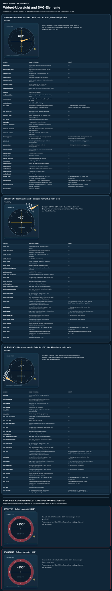
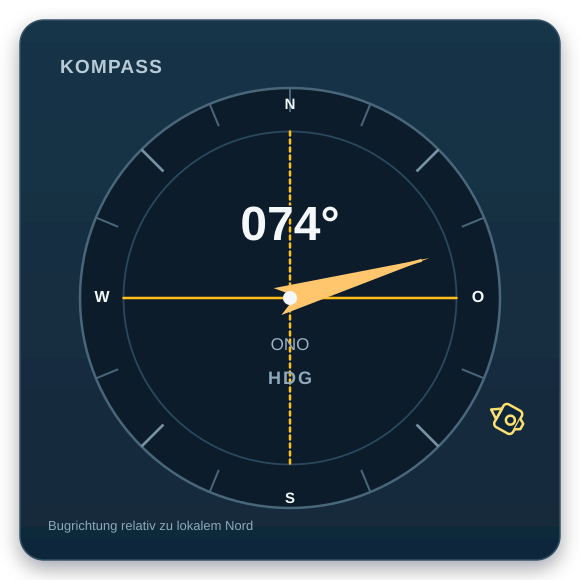
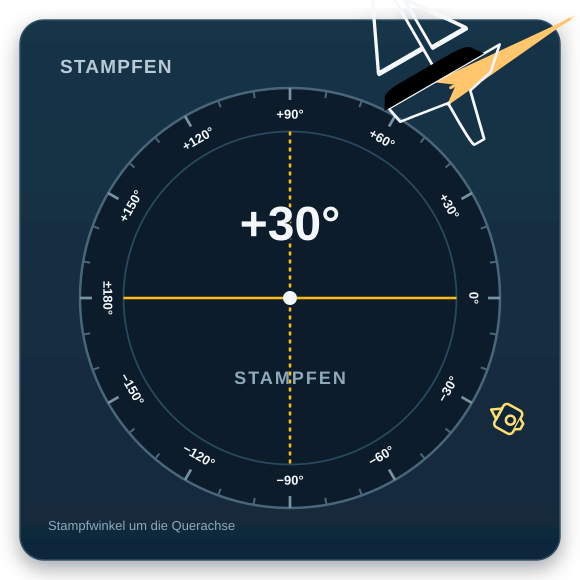

# Navigationsanzeigen – Konzept v0.7

**Anforderungsstatus:** Normative Anforderungen dieses Konzepts sind durch
die jeweils zugeordneten dauerhaften `SpecNNNN`-Kennungen in der
[Spezifikation Navigationswidgets v0.7](./Spezifikation_Navigationswidgets_v0.7.md)
oder der
[Spezifikation Weltsystem, Umwelt und Körperbewegung v0.7](./Spezifikation_Weltsystem_Bewegung_v0.7.md)
verbindlich festgelegt. Die Spezifikationspunkte sind maßgeblich; dieses
Konzept erläutert ihre visuelle Darstellung. Herstellerbeispiele und
## Anforderungszuordnung

| Konzeptabschnitt / Anforderung | Spezifikations-IDs |
|---|---|
| Zwischenlösung mit drei Widgets und 3D-Szene im Hauptfenster | `Spec0107` |
| Unabhängige langfristige Vier-Karten-Zielkomposition | `Spec0110` |
| Herstellerbeispiele als nicht zu kopierende Inspirationsquellen | Hintergrundinformation, keine umzusetzende Anforderung |
| Nummerierte Mastergrafik, gemeinsame Elementgestaltung und ausgeblendete ungenutzte Elemente | `Spec0087`, `Spec0110` |
| Kompasskarte: Beschriftung, Rose, Striche, Kardinalpunkte, Abstände, Heading-/Kamerazeiger, digitales Feld und Himmelsrichtungssektoren | `Spec0087`, `Spec0092`, `Spec0095`, `Spec0097`–`Spec0099` |
| Zielkarte Fahrt über Grund (`SOG`, `COG`, Richtungsscheibe) | `Spec0080`–`Spec0081`, `Spec0111` |
| Zielkarte Fahrt durchs Wasser (`STW`, `CTW`, `λ`, Bezugsrahmen und Vorzeichen) | `Spec0080`–`Spec0082`, `Spec0112` |
| Zielkarte Wind (Messgrößen, Gültigkeit, keine künstlichen Nullwerte) | `Spec0076`, `Spec0080`–`Spec0081`, `Spec0087`, `Spec0113` |
| Illustrative Zahlen, Vektoren und Yachtformen sind keine Laufzeitwerte | `Spec0087`, `Spec0095`, `Spec0109` |
| Einzelgrafiken, Karten-/Skalenbasis, Pose, Referenzachsen und Statusdarstellung | `Spec0093`, `Spec0095`–`Spec0106` |
| Begriffe, Formeln, Frames und Richtungsauflösung der Messgrößen | `Spec0067`–`Spec0082`, `Spec0087`–`Spec0089`, `Spec0111`–`Spec0113` |
| Qt-Widgetklassen, SVG-Elementnamen und Laufzeitbindung | `Spec0087`, `Spec0095`, `Spec0106`, `Spec0110`–`Spec0113` |
| Vier unabhängige Sichtbarkeitsoptionen | `Spec0087`, `Spec0096`, `Spec0099`, `Spec0102`, `Spec0105` |
| Gemeinsamer Snapshot, Update-Timer, getrennte Felder und nicht blockierende GUI | `Spec0087`, `Spec0096`, `Spec0106` |
| Kamera-Kopplung, Projektion und ungültige Kamerawerte | `Spec0092`, `Spec0097`–`Spec0098`, `Spec0100`–`Spec0104`, `Spec0108` |
| Einheiten und Körperwechsel | `Spec0074`, `Spec0077`, `Spec0079`, `Spec0087`, `Spec0096` |
| Fehler-, Gefahren- und Nichtverfügbarkeitszustände | `Spec0081`, `Spec0087`–`Spec0088`, `Spec0096`, `Spec0100`–`Spec0106`, `Spec0108` |
| Konzept-Abnahmepunkte | Jeweils den Spezifikations-IDs der betreffenden Anforderung zugeordnet; vollständig einzeln im Umsetzungsplan nachverfolgt |

## Zweck und Hersteller-Anregungen

Die Anzeige soll die 3D-Szene nicht durch ein Instrumentenbrett ersetzen. Als
Zwischenlösung werden Kompass, Krängung und Stampfen in einem separaten, frei
schwebenden Fenster untereinander angeordnet; die 3D-Szene bleibt im
Hauptfenster sichtbar. Die langfristige Anordnung weiterer Navigationskarten
ist davon unabhängig. Der Entwurf übernimmt allgemeine, bei
Navigationsgeräten wiederkehrende Bedienideen, nicht deren Gestaltung:

- **Garmin GPSMAP / SailAssist:** Kompass- und Kursreferenzen gemeinsam mit
  Navigationsdaten anzeigen.
- **B&G Triton²:** Segelrelevante Daten in einer konfigurierbaren, grafisch
  zusammengefassten Ansicht anordnen.
- **Raymarine i70s:** gut lesbare große Ziffern sowie wählbare numerische,
  analoge und grafische Instrumentansichten.

Quellen: [Garmin GPSMAP 1223xsv](https://www.garmin.com/en-US/p/1190849/),
[B&G Triton² Digital Display](https://www.bandg.com/en-us/bg/type/instruments/triton2-digital-display/)
und [Raymarine i70s](https://www.raymarine.com/en-us/our-products/marine-instruments/i70s-series/i70s-instrument).
Die Quellen dienen als Inspiration für Informationshierarchie und
Darstellungsformen, nicht als Vorlage zum Kopieren.

## Instrumentkarten

### Kompass-Master als gemeinsame Elementbibliothek

Die verbindlichen Funktions-, Interface- und Einstellungsanforderungen der
drei Widgets stehen in der
[Spezifikation Navigationswidgets v0.7](./Spezifikation_Navigationswidgets_v0.7.md).

Die nummerierte Mastergrafik ist die verbindliche visuelle Referenz für alle
Instrumentkarten. Die Elementnummern und Legendentexte werden fortlaufend
ergänzt, sobald neue gemeinsame oder anzeigespezifische Elemente
hinzukommen. Änderungen an Größe, Abständen, Farbe, Strichstärke und
Typografie werden zuerst gegen diesen Master abgestimmt.

Jede konkrete Karte verwendet denselben Rahmen, dieselbe Typografie und
dieselbe Anordnung der gemeinsamen Grundelemente. Sie zeigt nur die Elemente,
die zu ihrer Messgröße gehören; nicht verwendete Elemente werden
ausgeblendet, nicht durch ein alternatives Look-and-Feel ersetzt. So ist der
Kompass die vollständige Referenz und die Krängungs-, Stampf- sowie späteren
Anzeigen sind konsistente Teilansichten desselben Systems.

1. **Oben links – Kompass:** Der Widget-Titel lautet „Kompass“; die
   Titelbeschreibung „Bugrichtung relativ zu lokalem Nord“ steht unten links
   innerhalb der Widgetkarte.
   Die analoge Rose erhält 16 nautische Teilstriche im Abstand von 22,5°;
   die Striche auf Nord, Ost, Süd und West entfallen zugunsten der Buchstaben
   `N`, `O`, `S`, `W`, die sauber zwischen Innen- und Außenkreis liegen. Auch
   bei Nord gibt es keinen Strich. Die vier
   Hauptrichtungsstriche sind länger als die dazwischenliegenden. Die
   abgerundete quadratische Widgetkarte umfasst Überschrift, Beschreibung und
   Kompass mit umlaufendem Kamerasymbol. Die Kompassrose wird so groß skaliert,
   dass ihr kleinster Abstand zur Widgetgrenze dem kleinsten Abstand des `K`
   im Titel „KOMPASS“ zu dieser Grenze entspricht; maßgeblich sind die
   sichtbaren Konturen. Ein zusätzlicher Kreis um die Kamera entfällt. Der
   bestehende gefüllte
   Heading-Zeiger bleibt erhalten. Das Kamerasymbol sitzt
   außerhalb der Rose am horizontalen Kamera-Standpunktwinkel `KAM_AZ`, läuft
   bei dessen Änderung um den Kompass und zeigt mit der Linse zum Mittelpunkt.
   Innerhalb der Rose liegt das digitale Feld: in der oberen Kreishälfte der
   numerische Winkel; unterhalb der Mittellinie stehen zuerst die strichgenaue
   16-Punkt-Richtung und darunter `HDG`. Beispielsweise ergibt `074°` den
   Richtungstext `ONO`. Die Richtungsangabe ist dem nächstliegenden Strich
   zugeordnet: Bei 22,5° Strichabstand wechselt der Text genau in der Mitte,
   also 11,25° vor dem nächsten Strich. Formal wird für den normalisierten
   Headingwinkel `h` der Index
   `floor((h + 11,25°) / 22,5°) mod 16` verwendet. Die Sektoren sind
   links geschlossen und rechts offen; exakt auf der Grenze gilt der
   im Uhrzeigersinn folgende Strich. Die Reihenfolge der Richtungsnamen ab Nord im
   Uhrzeigersinn lautet `N, NNO, NO, ONO, O, OSO, SO, SSO, S, SSW, SW, WSW,
   W, WNW, NW, NNW`; der nächste Sektor wird jeweils bei der halben
   Sektorbreite erreicht. Die Schrift bleibt so groß wie möglich, muss aber
   ohne Überlappung in der Rose Platz finden. Zusätzliche Erklärungstexte zur
   Winkelmessung und zum lokalen Weltsystem entfallen aus dem Widget. Das
   Modell hat keine geografischen Koordinaten; die Anzeige darf daher keine
   GPS-Position oder geografische Nordreferenz suggerieren.
2. **Oben rechts – Fahrt über Grund:** `SOG` ist der Betrag der
   Körpergeschwindigkeit relativ zur Welt, `COG` deren gültige horizontale
   Richtung. Die kleine Richtungsscheibe kennzeichnet `COG`, nicht `HDG`.
3. **Unten links – Fahrt durchs Wasser:** `STW` und `CTW` beschreiben die
   Körpergeschwindigkeit relativ zum lokalen Wasser. `λ` ist der
   vorzeichenbehaftete Abdriftwinkel gemäß Spezifikation; Backbord ist
   negativ, Steuerbord positiv. Dadurch werden Wasser- und
   Grundgeschwindigkeit nicht zu einem einzigen, missverständlichen Kurs
   vermischt.
4. **Unten rechts – Wind, später:** Platz und Datenstruktur sind vorbereitet.
   Solange kein Windzustand existiert, zeigt die Karte ausdrücklich den
   Nichtverfügbarkeitszustand und keine Nullwerte. `TWS`, `TWD`, `AWS`, `AWA`
   und `TWA` werden erst mit gültigen Eingabedaten eingeblendet.

Alle Zahlen und Vektoren der Grafik sind illustrative Beispiele, keine
berechneten Ergebnisse. Das gilt auch für die gezeichnete Yacht und die
Vektorlängen.

## Einzelgrafiken der Instrumente

Die Einzelgrafik übernimmt die Kompasskarte direkt aus der nummerierten
Masterreferenz; Geometrie, Farben und Schriftmaße bleiben erhalten. Die
Stampfen- und Krängungsanzeigen verwenden dieselbe Karten- und Skalenbasis,
ergänzt um je ein mastloses Yacht-Icon, den gekoppelten Lagezeiger und feste
gelbe Referenzachsen. Zahlenwerte erhalten eine dunkle Kontur zur besseren
Abgrenzung vom Zifferblatt. Die benannten Elemente der drei Widgets sind in
der [Elementbeschreibung](../Widgets/BeschreibungElementeWidgets.svg)
dokumentiert. Normal- und Gefahrenzustände für Stampfen und Krängung sind in
der [Widgetspezifikation](./Spezifikation_Navigationswidgets_v0.7.md)
festgelegt. Weitere Widgets erhalten zuerst eine eigene Spezifikation und
Einzelgrafik.

## Begriffe und Bezugsrahmen

| Kürzel | Bedeutung | Bezug / Anzeige |
| --- | --- | --- |
| `HDG` | Heading, Bugrichtung | Weltazimut ab lokalem Nord, `°` |
| `SOG` | Speed Over Ground, Geschwindigkeit über Grund | Betrag, `m/s` intern; Anzeigeeinheit konvertierbar |
| `COG` | Course Over Ground, Kurs über Grund | Weltazimut ab lokalem Nord, `°` |
| `STW` | Speed Through Water, Geschwindigkeit durchs Wasser | Betrag relativ zum lokalen Wasser, `m/s` intern |
| `CTW` | Course Through Water, Kurs durchs Wasser | Weltazimut ab lokalem Nord, `°` |
| `λ` | Abdrift / Leeway | vorzeichenbehafteter Seitenwinkel, Backbord negativ, `°` |
| `TWS`, `TWD` | Wahre Windgeschwindigkeit und -richtung | Windzustand relativ zur Welt |
| `AWS`, `AWA` | Scheinbare Windgeschwindigkeit und -winkel | Wind am Körper, Winkel Backbord negativ |
| `TWA` | Wahrer Windwinkel | relativ zum Körper, Backbord negativ |

Der genaue Berechnungsvertrag und die Formeln stehen in
[Spezifikation_Weltsystem_Bewegung_v0.7.md](./Spezifikation_Weltsystem_Bewegung_v0.7.md),
insbesondere in den Abschnitten zu Welt-/Körperbewegung und `Spec0087`.
Im Weltframe zeigt `+X_W` nach Nord, `+Y_W` nach West und `+Z_W` nach oben;
damit ist `X_W × Y_W = Z_W`. Ost liegt in Richtung `−Y_W`. Die Kompassrose
zeigt weiterhin die nautische Azimutkonvention im Uhrzeigersinn ab Nord.
`HDG`, `COG`, `CTW` und `TWD` sind voneinander unabhängige Weltazimute; sie
werden nicht durch die Backbord-/Steuerbord-Vorzeichenregel für relative
Winkel umdefiniert. `COG` und `CTW` sind bei zu kleiner Geschwindigkeit nicht
bestimmt; `λ` ist nur mit gültigen Heading- und Wasser-Kursdaten verfügbar.
Die Mindestgeschwindigkeit bzw. Richtungsauflösung muss durch die
Implementierung festgelegt und getestet werden, nicht durch das Mockup.

## Umsetzung in Python/Qt

Die drei Widget-SVGs sind verbindliche Laufzeitvorlagen und müssen als
Quelldateien unverändert bleiben. Die Anwendung lädt sie und aktualisiert nur
eine flüchtige Laufzeitinstanz; sie schreibt keine veränderte SVG-Datei
zurück. Statusfarben dürfen als getrennte Render-Ebenen ergänzt werden, ohne
Geometrie, Element-IDs, Drehpunkte oder Winkeldefinitionen der Vorlagen zu
verändern. Für die GUI erhält jede Instrumentkarte eine eigene Qt-Widget-Klasse. So sind Schrift,
Skalierung, Barrierefreiheit und Verhalten bei fehlenden Daten robust
kontrollierbar. Die Gruppen- und Element-IDs der SVG sind zugleich stabile
semantische Namen für die spätere Umsetzung, zum Beispiel
`world_heading_card`, `heading_value`, `heading_direction`, `compass_rose`,
`heading_marker`, `camera_azimuth_marker`, `ground_motion_card`, `sog_value`,
`cog_marker`, `water_motion_card`, `stw_value`, `ctw_value`, `leeway_value`
und `wind_card`.

Für jede Instrumentkarte sind Titel, Titelbeschreibung, analoge Darstellung
und numerische Darstellung einzeln ein-/ausblendbar. Eine vorläufige
gemeinsame Rubrik **Einstellungen → Anzeigeoptionen** stellt dafür die
Schalter `titel_sichtbar`, `titel_beschreibung_sichtbar`, `analog_sichtbar`
und `numerisch_sichtbar` bereit. Sie gelten zunächst als globale Defaults
für alle Instrumentkarten; individuelle Einstellungen pro Anzeige können
bei der Umsetzung der jeweiligen Anzeige-Klassen ergänzt werden. Die
Einstellungen ändern eine Karte erst, wenn deren Klasse sie auswertet.

Jede Karte erhält einen unveränderlichen Daten-Snapshot. Die Physik stellt
den jüngsten Snapshot bereit; ein GUI-Timer liest ihn unabhängig vom
Simulationstakt und aktualisiert nur die betroffenen Widgets. Dadurch blockiert
das Zeichnen nicht die Physik und ein verpasster UI-Zwischenschritt erzwingt
keine zusätzliche Simulationsrechnung. Zahlen, Einheit, Gültigkeitszustand
und Richtungsmarker müssen getrennte Anzeigefelder bleiben. Fehlende oder
ungültige Richtungen erhalten einen expliziten Zustand wie „nicht verfügbar“,
niemals einen scheinbar gültigen Nullkurs.

Der Kompass-Zeiger für `HDG` und das außerhalb der Rose umlaufende
Kamerasymbol für `KAM_AZ` sind getrennte analoge Elemente und werden gemeinsam
mit der Kompassrose ein-/ausgeblendet. Das digitale Kompassfeld wird unabhängig
davon geschaltet. Die Kamerakopplung
und die Trennung zwischen Gieren und horizonthaltender Kamera sind in
[Kamerawinkel_Weltkompass_v0.7.svg](./Kamerawinkel_Weltkompass_v0.7.svg)
veranschaulicht und in `Spec0092` festgelegt. In der Kompassgrafik sind
`HDG=074°`, `KAM_AZ=119°` und damit der illustrative Offset
`Δ_Kamera=+45°`; dieser Offset ist nur eine Grafikannahme, kein
Simulations-Default.

Einheiten werden nur in der Darstellung umgerechnet; die Physik bleibt im
SI-System. Die Karte zeigt ausschließlich Werte des gewählten Körpers,
während Welt- und Umweltwerte bei einem Körperwechsel konsistent bleiben.
Die drei Widgets stehen in der Zwischenlösung in einem separaten, frei
schwebenden Fenster; sie dürfen auch bei kleiner Fenstergröße nicht
ausgeblendet oder durch eine Umschaltung ersetzt werden. Das Fenster muss
eine Mindestgröße haben, bei der alle drei Widgets gleichzeitig sichtbar
bleiben; der Nutzer kann das Fenster bei Bedarf vergrößern. Die Zielkomposition
weiterer Instrumentkarten ist davon getrennt.

Bei ungültigem oder logisch fehlerhaftem primärem Messwert bleibt das
betroffene Widget sichtbar: Die Innenfläche wird rot und das Winkelwertfeld
zeigt „FEHLER“. Nur bei einem gültigen Lagewinkel außerhalb `±90°` wird
stattdessen ausschließlich das Ringband rot dargestellt. Ein ungültiger
Nebenwert betrifft nur sein Anzeigeelement. Die Fehleranzeige bleibt
unabhängig von den Sichtbarkeitseinstellungen aktiv.

## Abnahmepunkte

- Kompassrose und `HDG` teilen dieselbe lokale Nordreferenz; Marker und Zahl
  stammen aus demselben Snapshot. (`Spec0075`, `Spec0078`, `Spec0096`–`Spec0098`)
- Die Rose verwendet 22,5°-Teilstriche; für `N`, `O`, `S`, `W` bleibt der
  jeweilige Strich frei; auch am Nordpunkt darf keine Linie erscheinen. Die
  Buchstaben sitzen sauber zwischen Innen- und Außenkreis. Das digitale Feld
  sitzt innerhalb der Rose: Winkelwert oben, darunter im unteren Halbkreis
  Richtungstext und `HDG`, ohne mit dem Zeiger zu kollidieren.
  (`Spec0087`, `Spec0097`–`Spec0098`)
- Das nach innen gerichtete Kamerasymbol liegt außerhalb der Kompassrose und
  umläuft sie entsprechend `KAM_AZ`; es folgt dem Bootsheading mit konstantem
  horizontalem Relativwinkel. (`Spec0092`, `Spec0095`, `Spec0097`–`Spec0098`)
- Kamera-Azimut folgt dem Gieren, nicht Stampfen oder Krängung. Kamera-Höhe
  und Roll bleiben horizontstabil, so dass Nick- und Krängwinkel des Boots
  sichtbar bleiben. (`Spec0092`)
- Die Kamerarahmen-Grafik zeigt Draufsicht, Höhenwinkel und die gegenüber dem
  Horizont sichtbare Bootsneigung. (`Spec0092`, `Spec0109`)
- `SOG`/`COG` und `STW`/`CTW` sind sichtbar getrennt und ihre Labels nennen
  den Bezugsrahmen. (`Spec0080`, `Spec0087`, `Spec0111`–`Spec0112`)
- Werte unterhalb der definierten Richtungsauflösung erzeugen „nicht
  verfügbar“, keinen Rausch-Kurs; `λ` benötigt Heading und `CTW`.
  (`Spec0081`, `Spec0087`–`Spec0089`, `Spec0112`)
- Ohne Windzustand sind keine Windzahlen und keine künstlichen Nullwerte
  sichtbar. Bei gültigem Wind folgen Windwerte später derselben
  Gültigkeits- und Einheitenbehandlung. (`Spec0076`, `Spec0080`–`Spec0081`,
  `Spec0087`, `Spec0113`)
- Das Aktualisieren der Karten blockiert oder beschleunigt keinen
  Physikschritt; Widget-Updates erfolgen aus dem neuesten verfügbaren
  Snapshot. (`Spec0087`, `Spec0096`, `Spec0106`)
- Die Beispielwerte der SVG werden nicht als Start- oder Fallbackwerte der
  Simulation verwendet. (`Spec0087`, `Spec0095`, `Spec0109`)
