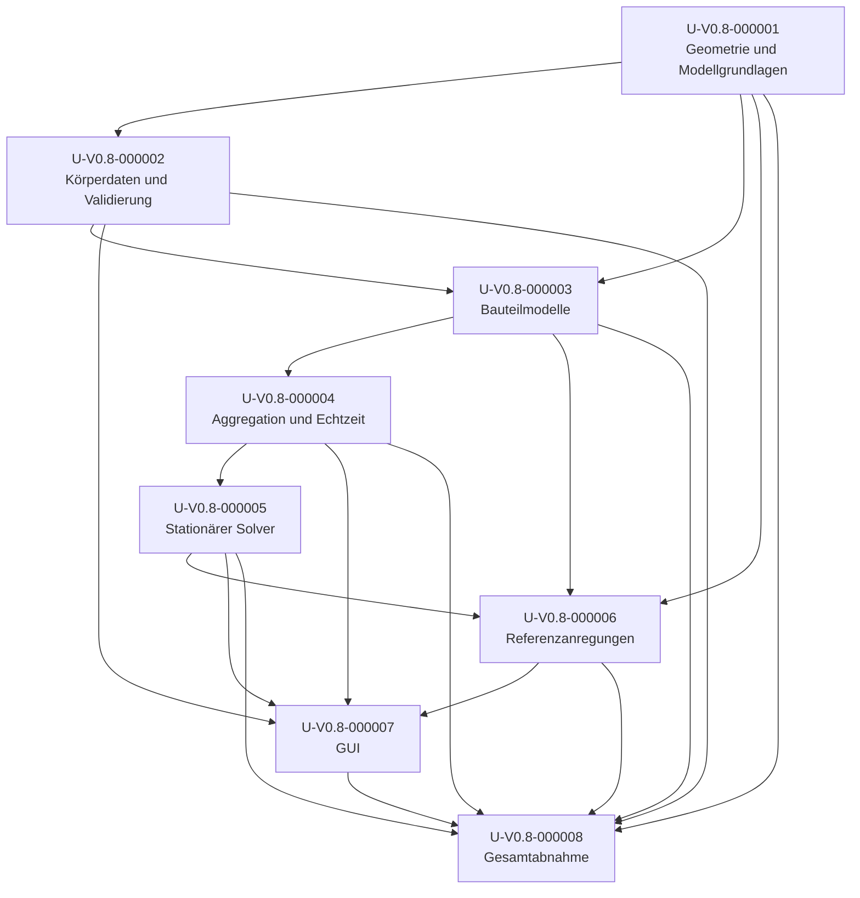

# Umsetzungsplan: Hydrodynamik

**Arbeitsbereich:** ausschließlich zuV0.8  
**Status:** teilweise umgesetzt; Yacht1-Referenzfall bestanden, Modellvalidierung und Profilabdeckung offen  
**Normative Grundlage:** [Hydrodynamik-Spezifikation](../Spezifikatonen/Hydrodynamik.md)  
**Nummerierung:** [Nummerierungs-Anweisung](../../../../../doc/Anweisungen/Nummerierungs-Anweisung.md)

## Ziel und Vorgehen

Dieser Plan beschreibt die technische Reihenfolge zur Umsetzung der aktiven
Anforderungen aus der Hydrodynamik-Spezifikation. Die Spec bleibt die
verbindliche Quelle für das geforderte Verhalten und die Abnahme. Die
Umsetzungsschritte konkretisieren Recherche, technische Arbeit,
Abhängigkeiten und Nachweise.

Die Arbeit beginnt mit Körpergeometrie, Modellgrenzen und nachvollziehbaren
Fachgrundlagen. Darauf bauen Körperdaten und Kraftmodelle auf. Erst nach
Integration des Kraftmodells folgen der stationäre Solver, die
körperbezogenen Referenzprofile, GUI-Darstellungen und die integrierte
Abnahme. Hydrostatische Berechnungen und vorhandenes Verhalten nicht
konfigurierter Körper bleiben erhalten.

Die Referenzgeschwindigkeit von Yachtkörpern (80 % der empirisch
geschätzten Rumpfgeschwindigkeit) dient der Auswahl der Testanregung und
ist allein kein unabhängiger Validierungsnachweis. Testkräfte werden als
Testkräfte gekennzeichnet und nicht als reale Segelkräfte ausgegeben.
Gleitfahrt, Wellen und Slamming bleiben außerhalb dieses Vorhabens.

## Umsetzungsstand und technische Befunde

Die Yacht1-Geometriemetadaten und der Modellpaket-Loader wurden gegen den
aktuellen Bestand geprüft. Daraus ergeben sich im Blattframe unter anderem:

| Bauteil | Rolle | Ausdehnung (m) | Oberfläche (m²) | Volumen (m³) |
|---|---|---:|---:|---:|
| Rumpf | `rumpf` | 4,225 × 1,265 × 1,137 | 14,240 | 3,112 |
| Ruder | `ruder` | 0,263 × 0,028 × 0,425 | 0,206 | 0,00236 |
| Kiel | `kiel` | 1,100 × 0,075 × 0,386 | 0,940 | 0,0227 |
| Bulb | `kiel` | 0,575 × 0,175 × 0,209 | 0,303 | 0,0106 |

Die Reibungskomponente verwendet die ITTC-1957-Reibungslinie
(`0.075 / (log10(Re) - 2)^2`). Unterhalb `Re = 1e5` wird eine laminare
Plattennäherung verwendet; zwischen `1e5` und `5e5` wird numerisch stetig
überblendet. Diese Überblendung ist eine Implementierungsannahme und kein
ITTC-Grenzwert. Die endliche Streckung der Flossen wird mit einer
Lifting-Line-Näherung behandelt; der induzierte Widerstand folgt
`CDi = CL² / (pi * e * AR)`.

Quellen:

- ITTC, Recommended Procedure 7.5-02-02-01:
  <https://ittc.info/media/1217/75-02-02-01.pdf>
- NASA Glenn, *Induced Drag Coefficient*:
  <https://www1.grc.nasa.gov/beginners-guide-to-aeronautics/induced-drag-coefficient/>

Die in `hydrodynamik.py` derzeit verwendeten Werte für Rumpf-Formfaktor,
Querströmungs- und Profilwiderstand sind explizite, vorläufige
Modellannahmen. Sie sind nicht durch Yacht1-Schlepptank-, CFD- oder
Messdaten validiert. Wellenwiderstand, Slamming und Gleiten sind gemäß
A-V0.8-00001 außerhalb des Umfangs und werden weder modelliert noch als
validiert ausgegeben. Die Kernintegration deckt daher noch nicht alle
Nachweis- und Validierungsziele aus U1/U3 ab.

Yacht1 ist derzeit das einzige Modellpaket mit hydrodynamisch markierten
Rumpf-, Kiel- und Ruderflächen. Dafür ist ein als Testanregung
gekennzeichnetes Referenzprofil hinterlegt: 510,1 N in Längsrichtung am
körperfesten Punkt `(0, 0, 1.5) m` relativ zum Schwerpunkt, Ruderausschlag
0°. Der Betrag wurde auf dem vorläufigen Modell kalibriert und ist keine
reale Segelkraft oder unabhängige Validierung der Widerstandskoeffizienten.

Die vollständige Regression lief unter Windows mit
`QT_QPA_PLATFORM=offscreen` und
`.\.venv\Scripts\python.exe -m pytest -q`: **640 bestanden, 1 übersprungen**.
Der reproduzierbare Yacht1-Referenztest in
`tests/test_hydrodynamik_referenz.py` löst das gekoppelte Gleichgewicht
unterhalb der empirischen Rumpfgeschwindigkeit und besteht die unabhängige
10-s-Dynamikprüfung. Die gezielten Solvertests enthalten zusätzlich stabile
und instabile Dynamikfälle. Auf der aktuellen Referenzumgebung dauerten
`loese_robust` 0,045 s, der stationäre Solver 0,315 s und die nachgelagerte
10-s-Simulation 8,145 s. Das Solverziel von 5 s wird damit deutlich
unterschritten. Referenzumgebung: Windows 11, Python 3.14.8, AMD Ryzen 5
8600G. Eine separate Hot-Path-Messung der Echtzeitintegration und
unabhängige hydrodynamische Referenzdaten stehen weiterhin aus.

| Schritt | Stand | Nachweis / offene Arbeit |
|---|---|---|
| U-V0.8-000001 | teilweise | Geometrie und Fachgrundlagen dokumentiert; Koeffizienten und Gültigkeitsbereich noch nicht unabhängig validiert |
| U-V0.8-000002 | teilweise | Yacht1-Testprofil und Körperwechsel-Reset umgesetzt; weitere Profile und konfigurationsseitige Validierung offen |
| U-V0.8-000003 | teilweise | Kernmodell, Benetzung, lokale Geschwindigkeit und Einzelkrafttests vorhanden; empirische Modellvalidierung offen |
| U-V0.8-000004 | teilweise | Benannte Wrenches, Worker-Integration und Regression umgesetzt; Hot-Path-Laufzeitmessung offen |
| U-V0.8-000005 | umgesetzt | Gestufter Solver, 1-%-Bilanz, engere interne Toleranz und Fehlerstatus getestet |
| U-V0.8-000006 | teilweise | Yacht1-Profil reproduzierbar kalibriert; Referenzprofile für weitere hydrodynamische Körper fehlen |
| U-V0.8-000007 | teilweise | Detailanzeigen, Testprofil, Rudereingabe und Solver-/Dynamikstatus integriert; Abnahme der übrigen Körper offen |
| U-V0.8-000008 | teilweise | Yacht1-Systemlauf und vollständige Testregression bestanden; unabhängige Modellvalidierung und Hot-Path-Bericht offen |

## Umsetzungsschritte

### U-V0.8-000001 – Geometrie und Modellgrundlagen bestimmen

**Anforderungen:** A-V0.8-00001, A-V0.8-00011, A-V0.8-00021  
**Abhängigkeiten:** keine

Körpergeometrien und verfügbare Metadaten der unterstützten Körper
ermitteln. Für Rumpf, Kiel/Schwert und Ruder werden benötigte
charakteristische Abmessungen, Flächen, Frames und mögliche
Angriffspunkte nachvollziehbar bestimmt. Empirische Fachmodelle für
Reibungs-, Form- und Auftriebsanteile werden recherchiert und
hinsichtlich Annahmen, Datenbedarf, Unsicherheit und Gültigkeitsbereich
bewertet. Es wird geprüft, welche Größen aus der Geometrie berechnet und
welche als explizite Konfigurationswerte geführt werden müssen.
Wellenwiderstand bleibt gemäß A-V0.8-00001 ausdrücklich außerhalb des
Umfangs.

Für Yachtkörper wird die Referenzgeschwindigkeit aus 80 % der empirischen
Rumpfgeschwindigkeit bestimmt. Für Körper ohne sinnvolle
Rumpfgeschwindigkeit wird ein geeigneter, dokumentierter
Referenzgeschwindigkeitsbereich vorbereitet. Ein späteres Gleitfahrtmodell
wird nicht vorweggenommen.

**Meilenstein M1:** Geometrieeingaben, Quellen, Modellwahl,
Gültigkeitsbereiche und Unsicherheiten sind nachvollziehbar dokumentiert.
Jeder unterstützte Modellparameter hat eine definierte Einheit und
Körperzuordnung; die Referenzgeschwindigkeit ist je Körper herleitbar.

### U-V0.8-000002 – Körperdaten und Parameter validieren

**Anforderungen:** A-V0.8-00012, A-V0.8-00017, A-V0.8-00026, A-V0.8-00028  
**Abhängigkeiten:** U-V0.8-000001

Ein Datenmodell für hydrodynamische Körperparameter und körperbezogene
Einstellungen festlegen und in das bestehende Konfigurations- und
Ladesystem integrieren. Es umfasst die für lageabhängige Benetzung
erforderlichen Geometrie-/Vorbereitungsdaten, Testkraft und
Angriffspunkt-Profile sowie den Ruderausschlag mit Default 0° und
GUI-Bereich −90° bis +90°. Konfigurationswerte, Einheiten und
Gültigkeitsbedingungen werden explizit validiert; fehlende oder ungültige
Parameter werden nachvollziehbar gemeldet.

Die Defaults werden je Körper getrennt gehalten. Die Benutzereingaben
gelten nur für die aktuelle Auswahl; ein erneuter Aufruf eines Körpers
lädt dessen Defaults erneut. In diesem Schritt wird das Profilschema mit
provisorischen Testwerten vorbereitet; die endgültigen körperbezogenen
Referenzwerte werden in U-V0.8-000006 hergeleitet und eingetragen.

**Meilenstein M2:** Gültige und ungültige Körperkonfigurationen sind
automatisiert geprüft. Auswahl-, Wechsel- und Rückkehrtests belegen
getrennte Profile und das Laden der jeweiligen Defaults.

### U-V0.8-000003 – Hydrodynamische Bauteilmodelle implementieren

**Anforderungen:** A-V0.8-00004, A-V0.8-00005, A-V0.8-00006, A-V0.8-00007, A-V0.8-00008, A-V0.8-00009, A-V0.8-00010, A-V0.8-00011, A-V0.8-00012  
**Abhängigkeiten:** U-V0.8-000001, U-V0.8-000002

Die lokale Relativströmung an den modellierten Angriffspunkten aus
Translation, Rotation, Hebelarm und Fluidgeschwindigkeit bestimmen.
Rumpfwiderstand mit den im Verdrängungsbereich gestützten Reibungs- und
Formanteilen,
seitlichen Rumpfwiderstand sowie Kiel-/Schwert- und Ruderbeiträge
implementieren. Kraft- und Momentenvorzeichen, Frames, dissipatives
Verhalten und gültige Betriebsbereiche sind anhand der dokumentierten
Fachgrundlagen umzusetzen.

Benetzung und daraus abgeleitete Kennwerte müssen der aktuellen Pose und
Wasserlinie folgen. Vorbereitbare Geometrieoperationen sind aus dem
Integrations-Hot-Path herauszuhalten. Das Modell meldet ungültige
Betriebszustände nachvollziehbar; es kappt Ruderausschläge nicht
stillschweigend.

**Meilenstein M3:** Automatisierte Einzelkrafttests belegen lokale
Anströmung und Framewechsel, Widerstand bei Vorwärts-/Rückwärtsfahrt,
reinen Längs- und Querbewegungsfall ohne unbegründete Kreuzkopplung,
Kielwirkung bei fehlender Anströmung, Null- und gespiegelter Abdrift,
beide Rudervorzeichen, Gierdämpfung bei Rudernull, Stetigkeit nahe
Stillstand, Energiekonsistenz und lageabhängige Benetzung. Nicht
unterstützte Modellzustände werden als solche erkannt statt als gültige
Gleitfahrtprognose ausgegeben.

### U-V0.8-000004 – Wrench-Aggregation und Laufzeitintegration absichern

**Anforderungen:** A-V0.8-00002, A-V0.8-00013, A-V0.8-00014, A-V0.8-00015  
**Abhängigkeiten:** U-V0.8-000003

Die hydrodynamischen Bauteilbeiträge als benannte Kräfte mit
Angriffspunkten in die bestehende Wrench-Aggregation einbinden. Hebelarme
und Framewechsel müssen die erwarteten Momente erzeugen; die aggregierte
Hydrodynamik wird dem Integrator genau einmal übergeben. Körper ohne
Hydrodynamikkonfiguration bleiben unverändert.

Die vorhandene Hydrostatik wird nicht ersetzt oder doppelt angesetzt.
Geometrie- und Benetzungsdaten werden außerhalb der pro-Schritt
Mesh-I/O-/Integrationsarbeit vorbereitet oder effizient wiederverwendet.
Die bestehende Echtzeitsemantik bleibt erhalten: keine schnellere
Simulation als Echtzeit, keine verworfene Simulationszeit und kein
automatischer Stopp bei Rechenverzug.

**Meilenstein M4:** Wrench- und Integrationsregressionen bestehen.
Hydrostatiktests belegen unverändertes Verhalten einschließlich ruhendem
Wasser ohne hydrodynamische Anströmung. Tests nicht konfigurierter Körper
belegen unverändertes Verhalten und unveränderte Hydrostatik- und
Kraftmodell-APIs. Eine Laufzeitmessung weist keine unnötigen Meshoperationen
im Hot-Path nach und bestätigt, dass Rechenverzug weder Simulationszeit
überspringt noch automatisch stoppt.

### U-V0.8-000005 – Gestuften stationären Gleichgewichtssolver erstellen

**Anforderungen:** A-V0.8-00019, A-V0.8-00020, A-V0.8-00024, A-V0.8-00027  
**Abhängigkeiten:** U-V0.8-000004

Den stationären Zustand direkt als gekoppeltes Gleichungssystem lösen.
Mit Geradeausfahrt beginnen und Vorwärtsgeschwindigkeit, Hub/Eintauchen
sowie Nick/Trim bestimmen. Danach weitere relevante Freiheitsgrade
schrittweise freigeben und in jedem Stadium alle bereits freigegebenen
Variablen gemeinsam erneut lösen. Den vorgegebenen Ruderwinkel als festen
Eingang verwenden; der Solver darf ihn nicht automatisch ändern.
Automatische Lenkregelung ist nicht Teil dieses Umsetzungsschritts. Für
Solverentwicklung und -tests kann eine explizit übergebene Testkraft
verwendet werden; die endgültigen Körper-Defaults aus U-V0.8-000006 sind
keine Voraussetzung für diesen Schritt.

Jedes Stadium liefert Status, Pose, Restkräfte/-momente und
Fehlschlagsgrund. Zwischenstände sind vorläufig; bei einem Fehler bleibt
der letzte gültige Zustand verfügbar und als nicht vollständig
konvergiert markiert. Die normierte Restkraft (relativ zur
charakteristischen Antriebskraft) und das normierte Restmoment (relativ
zum Produkt aus charakteristischer Antriebskraft und charakteristischer
Körperlänge) müssen jeweils höchstens **1 %** betragen; zusätzlich gelten
die numerischen Iterationsschranken aus A-V0.8-00027. Werte in N und Nm
werden ebenfalls ausgegeben. Für sehr kleine Normierungsgrößen darf kein
scheinbarer Konvergenzerfolg entstehen; der dort verwendete Grenzfall ist
zu dokumentieren und zu testen.

Der Solver wird ohne unnötige zeitliche Dynamikintegration ausgeführt,
bleibt abbrechbar und meldet Fortschritt.
Die Laufzeit wird für einen dokumentierten Referenzfall gegen das
Fünf-Sekunden-Ziel gemessen, ohne eine harte Abbruchfrist einzuführen.

**Meilenstein M5:** Reproduzierbare Solvertests belegen erfolgreiche
Teil- und Endstadien, die jeweilige 1-%-Kraft- und Momentenschranke,
absolute Restwerte, numerische Iterationsschranken,
Abbruch/Fehler ohne Erfolgsschein sowie Erhalt des letzten gültigen
Zustands. Tests belegen außerdem, dass der Solver den vorgegebenen
Ruderwinkel nicht verändert. Die Laufzeitmessung und Referenzumgebung sind
dokumentiert.

### U-V0.8-000006 – Körperbezogene Referenzanregungen festlegen

**Anforderungen:** A-V0.8-00018, A-V0.8-00021, A-V0.8-00026  
**Abhängigkeiten:** U-V0.8-000001, U-V0.8-000003, U-V0.8-000005

Für jeden unterstützten Körper einen Referenz-Test-Wrench einschließlich
Betrag, Richtung und Angriffspunkt herleiten. Yachtprofile werden so
gewählt, dass der theoretische stationäre Referenzzustand nahe 80 % der
empirischen Rumpfgeschwindigkeit liegt. Für Volumenkörper ohne
Rumpfgeschwindigkeit werden plausible normale Referenzbereiche aus
Geometrie und begründeten Versuchen festgelegt.

Die Testkraft darf nicht als reale Segelkraft erscheinen. Das gezielte
Erreichen der Referenzgeschwindigkeit wird als Kalibrierung der
Testanregung dokumentiert und nicht als unabhängiger Genauigkeitsnachweis
für hydrodynamische Koeffizienten ausgegeben. Die gewählten Werte werden
in die Körperprofile aus U-V0.8-000002 übernommen.

**Meilenstein M6:** Jeder unterstützte Körper hat ein nachvollziehbares
Referenzprofil. Referenzläufe sind reproduzierbar; Geschwindigkeit,
Wrench, Angriffspunkt, Modellgültigkeit und Unsicherheit sind dokumentiert.

### U-V0.8-000007 – GUI für Kräfte, Settings und Solverstatus integrieren

**Anforderungen:** A-V0.8-00008, A-V0.8-00016, A-V0.8-00022, A-V0.8-00023, A-V0.8-00024, A-V0.8-00026, A-V0.8-00027, A-V0.8-00028  
**Abhängigkeiten:** U-V0.8-000002, U-V0.8-000004, U-V0.8-000005, U-V0.8-000006

Hydrodynamische Einzelbeiträge werden mit den tatsächlich berechneten
Vektoren und modellierten Angriffspunkten angezeigt. Die Summenkraft wird
auf ihrer Wirkungslinie an einem Schnittpunkt mit der benetzten Geometrie
gezeichnet; ohne Schnittpunkt wird die Wirkungslinie statt eines
erfundenen körperlichen Angriffspunkts gezeigt. Freies Restmoment und
Summenmoment werden als Momentenvektoren angezeigt. Hydrostatische
Kraftpfeile bleiben unverändert.

Die GUI bietet unabhängige, standardmäßig eingeschaltete und gemäß dem
bestehenden Settings-Verhalten gespeicherte Detailanzeigen für Rumpf,
Ruder und Kiel/Schwert. Das Umschalten verändert weder Kräfte noch
Bewegung. Die Ruderwinkel-Eingabe ist von der Fremdkraft getrennt, auf
−90° bis +90° begrenzt und startet pro Körper bei 0°.
Modellbereichsverletzungen werden sichtbar gemeldet. Beim Körperwechsel
werden die zugehörigen Testkraft- und Rudereinstellungen geladen.

Während des stationären Solvers zeigt die GUI Status und neu gerenderte
Bilder der letzten gültigen Zustände. Sie unterscheidet vorläufige
Teilgleichgewichte, endgültige Konvergenz und Fehler und zeigt
Geschwindigkeit, normierte und tatsächliche Restkräfte/-momente,
Laufzeit sowie bestanden/nicht bestanden und Messwerte der dynamischen
Verifikation an.

**Meilenstein M7:** GUI-Tests prüfen Vektor und Ort der Kraftanzeigen,
Wirkungslinie und Momente, unabhängige Toggles, Default und gespeicherten
Zustand, unveränderte Physik beim Umschalten,
Rudereingabe/Gültigkeitsmeldung, Körperwechsel sowie Fortschritts-,
Zwischen- und Fehlerzustände. Die Anzeige verwendet dieselben Daten wie
das Kraftmodell.

### U-V0.8-000008 – Gesamtsystem integrieren und Anforderungen abnehmen

**Anforderungen:** A-V0.8-00001, A-V0.8-00002, A-V0.8-00004, A-V0.8-00005, A-V0.8-00006, A-V0.8-00007, A-V0.8-00008, A-V0.8-00009, A-V0.8-00010, A-V0.8-00011, A-V0.8-00012, A-V0.8-00013, A-V0.8-00014, A-V0.8-00015, A-V0.8-00016, A-V0.8-00017, A-V0.8-00018, A-V0.8-00019, A-V0.8-00020, A-V0.8-00021, A-V0.8-00022, A-V0.8-00023, A-V0.8-00024, A-V0.8-00025, A-V0.8-00026, A-V0.8-00027, A-V0.8-00028  
**Abhängigkeiten:** U-V0.8-000001, U-V0.8-000002, U-V0.8-000003, U-V0.8-000004, U-V0.8-000005, U-V0.8-000006, U-V0.8-000007

Die vollständige Regression und die zusammenhängenden Referenzläufe auf
allen unterstützten Körpern ausführen. Der stationäre Endzustand wird
anschließend mit unveränderter Testkraft **10 simulierte Sekunden**
dynamisch verifiziert: Die Vorwärtsgeschwindigkeit ändert sich höchstens
um 1 %, und Lage-/Drehbewegungen wachsen nicht systematisch an. Kein
Nachregeln der Testkraft und kein erneutes Gleichgewichtslösen sind in
dieser Prüfung zulässig. Referenzläufe bestätigen, dass 80 % der
empirischen Rumpfgeschwindigkeit nur als Testanregungsziel verwendet wird;
außerhalb des Verdrängerbereichs wird insbesondere keine gültige
100-kn-Prognose behauptet oder durch willkürliches Begrenzen vorgetäuscht.
Quantitative Genauigkeit wird nur innerhalb vorab dokumentierter
Akzeptanzbereiche und Referenzdaten behauptet.

Die Rückverfolgbarkeitsmatrix der Spec und dieses Plans auf tatsächliche
Nachweise aktualisieren. Erst nach erfolgreicher Abnahme werden die
erfüllten Anforderungen entsprechend der Nummerierungsanweisung im
Projektlog vermerkt. Nicht bestandene Kriterien bleiben offen; sie werden
nicht durch Lockerung der Spec ohne nachvollziehbare Abstimmung ersetzt.

**Meilenstein M8:** Alle aktiven A-IDs sind durch Tests oder dokumentierte
Messungen nachgewiesen; Regression, Referenzläufe, dynamische Prüfung und
Laufzeitberichte sind erfolgreich. Die Abschlussmatrix enthält Fundstellen
zu den Nachweisen.

## Abhängigkeiten

## Rückverfolgbarkeitsmatrix

| Aktive A-ID | Umsetzungsschritt(e) | Meilenstein/Nachweis | Status |
|---|---|---|---|
| A-V0.8-00001 | U-V0.8-000001, U-V0.8-000008 | Geltungsbereich dokumentiert; hydrodynamische Körperabdeckung derzeit Yacht1 | teilweise |
| A-V0.8-00002 | U-V0.8-000004, U-V0.8-000008 | Hydrostatik-Regression in der Gesamtsuite bestanden | belegt |
| A-V0.8-00004 | U-V0.8-000003, U-V0.8-000008 | Lokale Geschwindigkeit und Wrench-Frame-Tests bestanden | belegt |
| A-V0.8-00005 | U-V0.8-000003, U-V0.8-000008 | Vorwärts-/Rückwärtswiderstand getestet; Koeffizienten vorläufig | teilweise |
| A-V0.8-00006 | U-V0.8-000003, U-V0.8-000008 | Querwiderstands- und Energietests bestanden | belegt |
| A-V0.8-00007 | U-V0.8-000003, U-V0.8-000008 | Kielbeiträge bei Abdrift getestet | belegt |
| A-V0.8-00008 | U-V0.8-000003, U-V0.8-000007, U-V0.8-000008 | Ruderwirkung/Gierdämpfung getestet; Modellannahmen offen | teilweise |
| A-V0.8-00009 | U-V0.8-000003, U-V0.8-000008 | Grenz- und Stetigkeitstests bestanden | belegt |
| A-V0.8-00010 | U-V0.8-000003, U-V0.8-000008 | Dissipationstests bestanden | belegt |
| A-V0.8-00011 | U-V0.8-000001, U-V0.8-000003, U-V0.8-000008 | Quellen und Annahmen dokumentiert; Validierung offen | teilweise |
| A-V0.8-00012 | U-V0.8-000002, U-V0.8-000003, U-V0.8-000008 | Benetzungs-/Pose-Tests und Regression bestanden | belegt |
| A-V0.8-00013 | U-V0.8-000004, U-V0.8-000008 | Wrench- und Hebelarmtests bestanden | belegt |
| A-V0.8-00014 | U-V0.8-000004, U-V0.8-000008 | Regression nicht hydrodynamisch konfigurierter Körper bestanden | belegt |
| A-V0.8-00015 | U-V0.8-000004, U-V0.8-000008 | Hot-Path-/Echtzeit-Laufzeitmessung noch offen | teilweise |
| A-V0.8-00016 | U-V0.8-000007, U-V0.8-000008 | Kraftbeitragsanzeigen aus Modellwerten getestet | belegt |
| A-V0.8-00017 | U-V0.8-000002, U-V0.8-000008 | Modellparameter- und Profilkonfiguration noch nicht schema-validiert | offen |
| A-V0.8-00018 | U-V0.8-000006, U-V0.8-000008 | Reproduzierbarer Yacht1-Systemlauf bestanden; weitere Körper offen | teilweise |
| A-V0.8-00019 | U-V0.8-000005, U-V0.8-000008 | Gestufter Gleichgewichtssolver und Fehlerfälle getestet | belegt |
| A-V0.8-00020 | U-V0.8-000005, U-V0.8-000008 | `loese_robust`: 0,045 s; stationärer Solver: 0,315 s; Windows 11/Python 3.14.8/Ryzen 5 8600G | belegt |
| A-V0.8-00021 | U-V0.8-000001, U-V0.8-000006, U-V0.8-000008 | Yacht1-Profil und Referenzgeschwindigkeit getestet; weitere Körper offen | teilweise |
| A-V0.8-00022 | U-V0.8-000007, U-V0.8-000008 | Wirkungslinie und Momentenanzeigen getestet | belegt |
| A-V0.8-00023 | U-V0.8-000007, U-V0.8-000008 | Drei unabhängige Toggles/Defaults und Speichern getestet | belegt |
| A-V0.8-00024 | U-V0.8-000005, U-V0.8-000007, U-V0.8-000008 | Solver- und Dynamikstatus mit Messwerten getestet | belegt |
| A-V0.8-00025 | U-V0.8-000008 | Test-/Steuer-API und Verhaltensregression bestanden | belegt |
| A-V0.8-00026 | U-V0.8-000002, U-V0.8-000006, U-V0.8-000007, U-V0.8-000008 | Yacht1-Defaults und Rücksetzen getestet; weitere Profile offen | teilweise |
| A-V0.8-00027 | U-V0.8-000005, U-V0.8-000007, U-V0.8-000008 | 1-%-Bilanz und stabile/instabile 10-s-Prüfung bestanden | belegt |
| A-V0.8-00028 | U-V0.8-000002, U-V0.8-000003, U-V0.8-000007, U-V0.8-000008 | Rudereingabe, Default und Bereichsvalidierung getestet | belegt |
