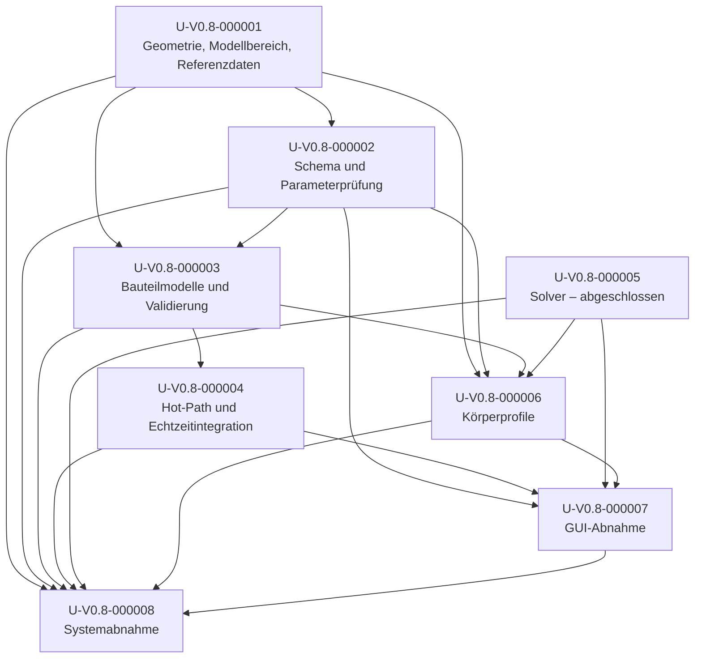

# Umsetzungsplan 2: Hydrodynamik

**Arbeitsbereich:** Fortsetzung zuV0.8  
**Status:** In Umsetzung; die Abschlusskriterien M1–M8 sind noch nicht vollständig abgenommen  
**Normative Grundlage:** [Hydrodynamik-Spezifikation](../Spezifikatonen/Hydrodynamik.md)  
**Vorgänger:** [Umsetzungsplan Hydrodynamik](./Hydrodynamik.md)  
**Nummerierung:** [Nummerierungs-Anweisung](../../../../../doc/Anweisungen/Nummerierungs-Anweisung.md)

## Ziel und Abgrenzung

Dieser Plan führt alle im Vorgängerplan noch nicht vollständig
abgeschlossenen Umsetzungsschritte zu Ende. Er ist kein Ersatz für die
Spec und führt keine neuen fachlichen Anforderungen ein. Alle 27 aktiven
Spec-IDs bleiben unverändert; die zurückgezogene
**A-V0.8-00003** wird nicht wieder aufgenommen.

Die hydrodynamische Modellabdeckung muss über den Yacht1-Sonderfall hinaus
gehen. Zum Abschluss gehören mindestens Yacht1, die in
`konfigurationen/koerper.json` vorhandenen generischen Volumenkörper und
automatisierte Geometriefälle mit abweichender Rumpflänge und Rumpfform.
Ein Körper gilt nur dann als hydrodynamisch unterstützt, wenn seine
Geometrie, erforderlichen Parameter, Gültigkeitsgrenzen und sein
Referenzprofil vollständig vorhanden und geprüft sind. Nicht unterstützte
Konfigurationen werden ausdrücklich als solche gemeldet; es gibt keinen
stillen Rückfall auf Yacht1-Koeffizienten. Die generischen Volumenkörper,
für die A-V0.8-00021 körperbezogene Referenzwerte fordert, dürfen nicht
allein durch Einstufung als „nicht unterstützt“ aus der Abnahme
herausgenommen werden. Körper außerhalb dieses Spec-Umfangs ohne
Hydrodynamikkonfiguration behalten dagegen das Verhalten nach A-V0.8-00014.

Hydrostatik bleibt unverändert. Seegang/äußere Wellen, Slamming und
Gleitfahrt sind ausgeschlossen. Der empirische Wellenbildungswiderstand des
Rumpfes im ruhigen Wasser bleibt gemäß A-V0.8-00005 Teil des
Widerstandsmodells. Der frühere Yacht1-Testwert von 510,1 N war eine vorläufige
Modellkalibrierung, keine reale Segelkraft und kein unabhängiger
Gütebeleg. Das aktive Konfigurationsprofil wurde nach der
LWL-Neuberechnung auf 469,08 N kalibriert; auch dieser Wert ist kein
Ersatz für hydrodynamische Referenzdaten.

**Abschlussregel:** Ein Punkt gilt erst als erfüllt, wenn die unten
angegebenen Tests oder Messungen tatsächlich bestanden und in der
Rückverfolgbarkeitsmatrix belegt sind. Fehlen unabhängige Daten oder
erfüllt das Modell die vorab festgelegten Toleranzen nicht, bleibt der
betroffene Punkt offen; Toleranzen oder Spec werden nicht nachträglich
gelockert, um einen Erfolg auszuweisen.

## Aktueller Umsetzungsstand

Die additive Profilkonfiguration, der generische geometrische
Widerstandsbeitrag und die GUI-/Echtzeit-Anbindung sind implementiert.
Gezielte Regressionen für Modell, Schema, GUI und Worker sowie die unten
aufgeführten Matrix- und Überlastfälle bestehen.
Das ist noch keine Meilensteinabnahme:

| Arbeit | Implementiert / geprüft | Weiterhin offen |
|---|---|---|
| U-V0.8-000001 / M1 | LWL wird aus den Rumpfmesh-Dreiecken am hydrostatischen Wasserstand bestimmt. | Das Modellmesh ergibt `LWL = 3,789 m`; die Spec nennt näherungsweise `4,14 m`. Die Abweichung ist ungeklärt. Kein verifizierter Yacht1-spezifischer unabhängiger Widerstandsdatensatz gefunden. |
| U-V0.8-000002 / M2 | Validiertes additives `hydrodynamik`-Schema; Körperprofile und Negativtests. | Vollständige Abnahme bleibt von geklärter Support-Matrix und M1 abhängig. |
| U-V0.8-000003 / M3 | Generischer Widerstand aus benetzter projizierter Meshfläche und konfiguriertem `Cd`; pro benetztem Dreieck ausgewertete lokale Geschwindigkeit und resultierendes Moment ergänzen nun die Rotationswirkung. Größen-, Form-, Rotationsdissipations- und Wasserliniengrenzfälle sind getestet. | Keine unabhängige Yacht1-Kalibrierung; Ruderdrehachse/-moment und weitere Modellgrenzen nicht vollständig validiert. Die genauere Dreiecksauswertung erfordert eine neue Hot-Path-Messung. |
| U-V0.8-000004 / M4 | Generisches Profil wird auch im Echtzeit-Worker verwendet; Regressionstest vorhanden. Starke konfigurierte lineare/quadratische Dämpfung wird im 6-DOF-Schritt implizit stabilisiert statt explizit übersteuert. Dadurch besteht das zuvor instabile Plattenprofil jetzt die 10-s-Dynamikprüfung. Fehler während der Dynamikprüfung liefern einen expliziten Fehlergrund, den die GUI anzeigt. Vorhandene Kernel-/Worker-/IPC-Benchmarks wurden vor der neuen Dreiecksauswertung gemessen und gelten nicht als deren Laufzeitnachweis. | GUI-Taktung und reale Rückstandsentwicklung sind nicht vollständig gemessen; Benchmarks des aktuellen Hydrodynamik-Hot-Paths müssen wiederholt werden. |
| U-V0.8-000006 / M6 | Defaultprofile für Yacht1 und alle vorhandenen generischen Formen; Yacht1-Kalibrierung für die geometrische LWL auf `469,08 N` angepasst. Alle acht generischen Profile haben einen Test auf endlichen, dissipativen Widerstand bei 1 m/s. Mit den konfigurierten Testkräften bestehen `pyramide`, `rolle` und nach der Integratorstabilisierung auch `platte` die Stationär- und 10-s-Dynamikprüfung. | Profile bleiben vorläufige Schätzungen ohne unabhängige Referenzbereiche. `kegel`, `kugel`, `bleistift` und `unregelmaessig` scheitern bereits in der Newton-Stufe Geradeausfahrt (Schritt senkt Residuum nicht); `quader` erreicht diese Stufe, scheitert aber im gekoppelten Gleichgewicht. Toleranzen wurden nicht gelockert und Testkräfte nicht passend gemacht, um Konvergenz vorzutäuschen. Modellintern aus dem Widerstand abgeleitete Gegenkräfte bestehen für sieben von acht Körpern; dies ist ausdrücklich kein unabhängiger Referenznachweis. |
| U-V0.8-000007 / M7 | Körperwechsel lädt konfiguriertes Profil; GUI- und Echtzeitpfade verwenden dasselbe generische `Cd`. GUI-Regressionen prüfen Defaultwerte aller acht generischen Profile und weisen nun auch Fehlergründe einer dynamischen Fehlprüfung aus. | Vollständige GUI-Abnahme der Kraft-/Momentendarstellung, Bereichsmeldungen und realer Laufzeitkörper steht aus. |
| U-V0.8-000008 / M8 | Gezielte Regressionen für implizite Dämpfung, Oberflächen-Rotationswiderstand, Platten-Gleichgewicht und explizite Dynamikfehler sind ergänzt. Vollsuite nach den aktuellen Änderungen: `675 passed, 1 skipped`. | Spec-Matrix, unabhängige Referenzen, aktueller Echtzeit-/IPC-Überlastnachweis und übrige M1–M7-Abnahmen stehen noch aus; M8 ist nicht abgenommen. |

Aktuelle Support-Matrix der Körperkonfiguration:

| Körper | Modell | Profilparameter | Nachweisstand |
|---|---|---|---|
| `yacht1` | Rumpf/Kiel/Ruder nach annotierten Meshrollen | Testkraft `469,08 N` bei `(0, 0, 1,5) m`; LWL-Ziel aus tatsächlicher Wasserlinie | Numerisch reproduzierbar; Messreferenz und LWL-Abweichung offen |
| `kegel` | generischer Volumenkörper | `Cd = 0,60` | vorläufige Annahme |
| `quader` | generischer Volumenkörper | `Cd = 1,05` | vorläufige Annahme |
| `pyramide` | generischer Volumenkörper | `Cd = 0,80` | vorläufige Annahme |
| `kugel` | generischer Volumenkörper | `Cd = 0,47` | vorläufige Annahme |
| `rolle` | generischer Volumenkörper | `Cd = 1,20` | vorläufige Annahme |
| `platte` | generischer Volumenkörper | `Cd = 1,20` | vorläufige Annahme |
| `bleistift` | generischer Volumenkörper | `Cd = 1,10` | vorläufige Annahme |
| `unregelmaessig` | generischer Volumenkörper | `Cd = 1,05` | vorläufige Annahme |
| Körper ohne Profil | unverändert / kein Hydrodynamikbeitrag | keines | Kompatibilität bleibt zu regressieren |

Auf Nutzerentscheidung wurden die Dichten von `rolle`, `platte` und
`unregelmaessig` in der Konfiguration und den jeweils verwendeten
Modellmanifesten auf `500 kg/m³` gesetzt. Damit liegen sie unter der
Süßwasserdichte und sind als frei schwimmende generische Testkörper
konfiguriert. Ein Regressionstest prüft die Übereinstimmung beider
Dichtequellen. Diese Anpassung schließt die Stationär-/Dynamikabnahme
nicht: `platte` besteht die Stationär- und 10-s-Dynamikprüfung nach der
impliziten Dämpfungsintegration. `bleistift` erreicht mit seiner aktuellen
Testkonfiguration kein stationäres Gleichgewicht und wird nicht als
bestanden gewertet.

Der [Mendeley-Datensatz zu systematischen Yachtserien](https://data.mendeley.com/datasets/gw23dgzn6h/4)
beschreibt 1.018 Schlepptankmessungen aus Delft-, US-Sailing- und
Il-Moro-di-Venezia-Serien. Die Metadaten nennen unter anderem Serien- und
Rumpfkennung, `Rt/Delta`, Reynolds- und Froude-Zahl sowie
Geometriekennwerte. Die Messtabelle wurde in dieser Umsetzung nicht
ausgewertet; es liegt daher noch kein numerischer Vergleich vor. Die
verfügbare Beschreibung belegt keine Übereinstimmung mit dem
SegelPhysik-Yacht1-Mesh. Auf Nutzerentscheidung darf der Datensatz
ausschließlich als indirekter Plausibilitätsvergleich dienen, nicht als
Yacht1-Validierung. Der M1-/M3-Status bleibt offen, bis ein passender
Referenzdatensatz vorliegt.
Kernel-, Worker- und Prozessmessungen wurden unter Windows 11, AMD Ryzen
5 8600G und Python 3.14.8 ausgeführt. Die Prozessmessung enthält IPC und
zeigt beim 16-Schritt-Yacht1-Batch ein p95 unter dem Budget von `64 ms`,
aber einen Einzel-Maximalwert darüber. Sie misst weder GUI-Taktung noch
reale Rückstandsentwicklung und ist daher kein vollständiger Nachweis der
Echtzeitsemantik.

## Prüfung des Vorgängerplans

Alle acht Umsetzungsschritte des Vorgängerplans sind geprüft. Für jeden
nicht abgeschlossenen Schritt wird dieselbe U-Kennung in diesem Folgeplan
weitergeführt. U-V0.8-000005 ist abgeschlossen und wird nicht als offene
Arbeit neu angelegt. Es sind keine neuen U-Kennungen erforderlich: Die
verbleibenden Arbeiten gehören zu den bereits vergebenen Schritten
U-V0.8-000001 bis U-V0.8-000008.

| Vorgänger-ID | Befund im Vorgängerplan | Behandlung in diesem Plan |
|---|---|---|
| U-V0.8-000001 | Teilweise: Geometrie und Grundlagen sind dokumentiert; Geometrieabdeckung, unabhängige Koeffizientenvalidierung und Rumpf-Gültigkeitsgrenzen sind nicht vollständig nachgewiesen. | Wird unter derselben ID fortgesetzt; Abschluss in M1. |
| U-V0.8-000002 | Teilweise: Yacht1-Testprofil und Rücksetzen sind vorhanden; Profile weiterer Körper sowie schema- und konfigurationsseitige Validierung fehlen. | Wird unter derselben ID fortgesetzt; Abschluss in M2. |
| U-V0.8-000003 | Teilweise: Kernkräfte, Benetzung und Einzeltests sind vorhanden; generische Volumenkörper, Rudergeometrie/-achse und unabhängige Modellvalidierung fehlen. | Wird unter derselben ID fortgesetzt; Abschluss in M3. |
| U-V0.8-000004 | Teilweise: Wrench-Integration und Regression sind vorhanden; Messung des Echtzeit-Hot-Paths fehlt. | Wird unter derselben ID fortgesetzt; Abschluss in M4. |
| U-V0.8-000005 | Umgesetzt: gestufter Solver, normierte Bilanz, Fehlerbehandlung und Laufzeitmessung sind nachgewiesen. | Abgeschlossen; M5 gilt als erreicht. In M8 nur Regression, keine erneute offene Umsetzung. |
| U-V0.8-000006 | Teilweise: Yacht1-Profil ist kalibriert; Yacht1-LWL-Abgleich und Profile für weitere unterstützte Körper fehlen. | Wird unter derselben ID fortgesetzt; Abschluss in M6. |
| U-V0.8-000007 | Teilweise: Anzeigen, Toggles, Rudereingabe und Solverstatus sind integriert; Profilabdeckung, Bereichsmeldungen und Abnahme über alle unterstützten Körper fehlen. | Wird unter derselben ID fortgesetzt; Abschluss in M7. |
| U-V0.8-000008 | Teilweise: Yacht1-Systemlauf und Testsuite bestanden; Endabnahme über die gesamte Support-Matrix und unabhängige Modellnachweise fehlen. | Wird unter derselben ID fortgesetzt; Abschluss in M8. |

Damit ist jeder Punkt des Vorgängerplans entweder als abgeschlossen
festgehalten oder explizit mit derselben Kennung in die Folgeplanung
übernommen. Die alte Rückverfolgbarkeitsmatrix enthielt noch geplante
Einträge; die aktualisierten Befunde und Folgearbeiten stehen in den
Matrizen dieses Dokuments.

Die Rückverfolgbarkeitstabelle in Abschnitt 7 der Spec wurde mit der
Freigabe des Folgeplans bereits auf diesen Plan synchronisiert. Sie bleibt
die Statusübersicht der Spec; die vorstehende Tabelle protokolliert
zusätzlich den aktuellen technischen Zwischenstand und ersetzt keine
Meilensteinabnahme.

## Verbindliche Reihenfolge und Meilensteine

| Reihenfolge | Umsetzungsschritt | Meilenstein | Voraussetzung |
|---:|---|---|---|
| 1 | U-V0.8-000001 – Geometrie, Modellbereich und unabhängige Referenzen abschließen | M1 | — |
| 2 | U-V0.8-000002 – Konfiguration, Parameter und Profilvalidierung abschließen | M2 | M1 |
| 3 | U-V0.8-000003 – Modellabdeckung, Ruderkinematik und Referenzvalidierung abschließen | M3 | M1, M2 |
| 4 | U-V0.8-000004 – Echtzeit-Hot-Path und Integrationssemantik abnehmen | M4 | M3 |
| — | U-V0.8-000005 – Gestuften stationären Solver | M5 bereits erreicht | Vorgängerplan |
| 5 | U-V0.8-000006 – Referenzprofile für jeden unterstützten Körper festlegen | M6 | M1, M2, M3, M5 |
| 6 | U-V0.8-000007 – GUI, Einstellungen und Profile über die Support-Matrix abnehmen | M7 | M2, M4, M5, M6 |
| 7 | U-V0.8-000008 – Gesamtsystem, Regression und Nachweismatrix abnehmen | M8 | M1–M7 |

## Umsetzungsschritte

### U-V0.8-000001 – Geometrie, Modellbereich und unabhängige Referenzen abschließen

**Anforderungen:** A-V0.8-00001, A-V0.8-00005, A-V0.8-00008, A-V0.8-00011, A-V0.8-00018, A-V0.8-00021  
**Abhängigkeiten:** keine

1. Eine Support-Matrix aller vorhandenen Modellpakete und konfigurierten
   Körper erstellen. Pro Bauteil Rolle, Mesh-Frame, Geometriequelle,
   charakteristische Länge, benetzbare Fläche, Angriffspunkt- und
   Ruderachsen-Verfügbarkeit aufführen.
2. Die Yacht1-Wasserlinienlänge aus der tatsächlichen Wasserliniengeometrie
   im Referenzschwimmzustand bestimmen. Der bisherige Näherungswert
   `ptp(x) = 4,225 m` darf nicht ungeprüft als Wasserlinienlänge benutzt
   werden; die Spec nennt näherungsweise `LWL = 4,14 m`. Herleitung,
   Immersionsebene und Unsicherheit müssen dokumentiert werden. Die
   aktuelle Mesh-Auswertung liefert `3,789 m`; bis zur Klärung der
   Abweichung von `4,14 m` ist M1 nicht bestanden.
3. Für mindestens zwei automatisierte Rumpf-Testgeometrien mit
   unterschiedlichen Längen und unterschiedlichen Querschnitts-/Form-
   verhältnissen festlegen, welche Koeffizienten aus der Geometrie folgen
   und welche Modellparameter konfiguriert werden müssen. Die Ergebnisse
   dürfen nicht von der Körper-ID `yacht1` abhängen.
4. Unabhängige, reproduzierbare Widerstandsreferenzen für Yacht1
   recherchieren und festschreiben: bevorzugt Schlepptankmessungen,
   andernfalls nachvollziehbar beschriebene CFD-Daten mit Geometrie,
   Fluid, Geschwindigkeit, Trimm und Unsicherheit. Kalibrierwerte aus
   dem implementierten Modell sind keine Referenzdaten. Bisher gefundene
   systematische Yachtserien liefern keine belegte Geometrieidentität mit
   dem Yacht1-Mesh.
5. Vor dem Modellabgleich den Referenzdatensatz, die ausgewerteten
   Betriebspunkte, Unsicherheiten und numerischen Akzeptanzgrenzen
   dokumentieren. Wo die Daten keine Toleranz begründen, darf keine
   quantitative Genauigkeit behauptet werden; der Meilenstein bleibt
   offen, bis ein prüfbarer unabhängiger Datensatz vorliegt.
6. Den Verdränger-Gültigkeitsbereich aus den vorhandenen Daten und
   physikalischen Eingaben ableiten. Seegang/äußere Wellen, Slamming,
   Gleitfahrt und Prognosen außerhalb des begründeten Bereichs bleiben
   ausdrücklich ausgeschlossen. Der Wellenbildungswiderstand im ruhigen
   Wasser bleibt nach A-V0.8-00005 Bestandteil des Rumpfmodells.

**Meilenstein M1 – Eingaben und Modellgrenzen sind belegbar.** Abnahme:

- Support-Matrix enthält jeden vorhandenen Körper und kennzeichnet
  unterstützt, ausdrücklich nicht unterstützt oder noch ungeklärt.
- Jeder generische Volumenkörper, für den A-V0.8-00021 einen
  Referenzbereich verlangt, ist als unterstützter Referenzfall eingeplant;
  „nicht unterstützt“ ist für diese Fälle kein Abschlussstatus. Andere
  Körper ohne Hydrodynamikkonfiguration bleiben als Kompatibilitätsfälle
  nach A-V0.8-00014 separat erfasst.
- Yacht1-LWL ist geometrisch hergeleitet und stimmt mit dem Spec-
  Referenzwert innerhalb der dokumentierten Geometrieunsicherheit
  überein.
- Zwei unterschiedliche Rumpf-Testgeometrien belegen, dass Modellparameter
  aus Geometrie/Profil und nicht aus einer fest codierten Yacht1-ID folgen.
- Mindestens ein unabhängiger Yacht1-Widerstandsdatensatz enthält
  reproduzierbare Testbedingungen und dokumentierte Unsicherheit; die
  vorab festgelegten Abnahmegrenzen sind maschinenlesbar oder in einem
  versionierten Testnachweis festgehalten.
- Modellbereich und Ausschlüsse sind eindeutig dokumentiert. Ist kein
  geeigneter unabhängiger Datensatz verfügbar, ist M1 **nicht** bestanden.

### U-V0.8-000002 – Konfiguration, Parameter und Profilvalidierung abschließen

**Anforderungen:** A-V0.8-00012, A-V0.8-00017, A-V0.8-00026, A-V0.8-00028  
**Abhängigkeiten:** M1

1. Hydrodynamikparameter und körperbezogene Testprofile aus
   fest codierten Yacht1-Defaults in die vorhandene Konfigurations- und
   Ladearchitektur überführen. Eine versionierte Konfigurationsdatei bzw.
   ein klar definierter Abschnitt muss Modell-ID, Einheiten, Werte,
   Angriffspunkt, Kraftvektor, Gültigkeitsbereich und – falls vorhanden –
   Ruderdrehachse eindeutig abbilden.
2. Pflichtwerte und optionale Werte dokumentieren. Ein unterstützter
   Körper ohne Pflichtparameter, mit unbekanntem Profil, falscher Einheit,
   ungültiger Rolle oder nicht endlichem Wert muss beim Laden eine
   kontextreiche Fehlermeldung erzeugen. Nicht unterstützte Körper dürfen
   ihr bisheriges Verhalten behalten, werden aber sichtbar als nicht
   hydrodynamisch unterstützt behandelt.
3. Koeffizienten, Dichten, Längen, Flächen, Testkräfte und Angriffspunkte
   gegen Einheiten- und Wertebereiche validieren. Kein stiller Ersatz
   durch Yacht1-Werte.
4. Ruder-Default `0°`, GUI-Eingabe `−90°…+90°` und den vom Modell
   physikalisch abgesicherten Bereich getrennt führen. Der abgesicherte
   Bereich wird aus der jeweiligen Rudergeometrie/-achse und den
   Referenzannahmen bestimmt; Überschreitung wird gemeldet, nicht
   gekappt.
5. Konfigurationsmigration oder additive Schemaänderung nach den Regeln
   der bestehenden Settings-/Konfigurationsarchitektur dokumentieren.

**Meilenstein M2 – Konfiguration ist vollständig und fehlersicher.** Abnahme:

- Gültige Profile für sämtliche in M1 als unterstützt ausgewiesenen
  Körper laden mit erwarteten Einheiten und Defaults.
- Automatisierte Negativtests decken fehlende Pflichtfelder, unbekannte
  Körper-IDs, ungültige Rollen, falsche Vektorform, `NaN`/Unendlich,
  negative Größen und Winkel außerhalb des abgesicherten Bereichs ab.
- Vorhandene Einstellungen ohne Hydrodynamikprofil behalten ihr
  spezifiziertes Verhalten; keine ungeprüfte Defaultübernahme.
- Tests belegen Körperwechsel, Änderbarkeit und erneutes Laden des
  ursprünglichen Defaults für Kraft, Angriffspunkt und Ruderausschlag.

### U-V0.8-000003 – Modellabdeckung, Ruderkinematik und Referenzvalidierung abschließen

**Anforderungen:** A-V0.8-00001, A-V0.8-00004, A-V0.8-00005, A-V0.8-00006, A-V0.8-00007, A-V0.8-00008, A-V0.8-00009, A-V0.8-00010, A-V0.8-00011, A-V0.8-00012, A-V0.8-00018  
**Abhängigkeiten:** M1, M2

1. Die vorhandene Mesh-basierte Benetzung und lokalen Geschwindigkeiten
   beibehalten; Vorbereitungsarbeit bleibt außerhalb des pro-Schritt-
   Hot-Paths. Tests müssen für dieselbe Pose und Wasserlinie belegen, dass
   Solver, Dynamik und GUI konsistente Benetzungsdaten und Beiträge
   verwenden.
2. Das Rumpfmodell gegen die unabhängigen Yacht1-Daten aus M1 prüfen und
   Koeffizienten innerhalb der vorab festgelegten Grenzen kalibrieren.
   Rohdaten, Skript, Parametersatz und Abweichungen versioniert ablegen.
   Reibungs- und Form-/Wellenwiderstandsanteil müssen entsprechend der
   Spec getrennt berechenbar und auswertbar sein. Der Wellenanteil meint
   Wellenbildungswiderstand im ruhigen Wasser, nicht Seegang. Keine
   doppelte Anrechnung desselben Widerstandseffekts.
3. Hydrodynamische Beiträge für die in M1 unterstützten generischen
   Volumenkörper ergänzen. Modelle müssen aus Form und benetzter Geometrie
   ableitbar sein und dissipative Widerstandskräfte gegen die lokale
   Relativströmung liefern. Ein Yacht-Rumpfgeschwindigkeitsmodell darf
   nicht auf solche Körper übertragen werden.
4. Yacht1-Ruderachse und -Drehpunkt aus Paketgeometrie oder validierter
   Konfiguration bestimmen und im Rudermodell verwenden. Winkelabhängige
   Kräfte müssen zur tatsächlichen Achse und zum Moment um den
   Schwerpunkt passen. Für Körper ohne Ruder bleibt die Rudereingabe
   deaktiviert bzw. neutral und erzeugt keine Scheinkraft.
5. Modellgültigkeitsgrenzen, Ruderstall-/Winkelbereich und Zustände ohne
   ausreichende benetzte Fläche explizit behandeln. Nicht unterstützte
   Betriebsfälle werden sichtbar gemeldet, nicht extrapoliert oder
   stillschweigend begrenzt.
6. Vorhandene Einzelkrafttests vervollständigen: Vorwärts/Rückwärts,
   Querfahrt, Abdrift mit Vorzeichenwechsel, reine Rotation,
   Rudervorzeichen und Rudernull, Stillstandsgrenze, Energie-/Dissipations-
   bilanz, Pose/Wasserlinie, Framewechsel und Beitragssumme. Rumpf-
   Reibungs- und Form-/Wellenanteile sowie ihre Summe getrennt testen.
7. Die beiden Test-Rumpfgeometrien aus M1 durch dieselben Tests führen,
   damit Längen- und Formunabhängigkeit nachgewiesen und keine
   Yacht1-Sonderbehandlung eingeführt wird.

**Meilenstein M3 – Physiktests und unabhängige Referenz bestehen.** Abnahme:

- Yacht1-Widerstand an allen vorab gewählten Mess-/CFD-Punkten liegt
  innerhalb der in M1 begründeten Akzeptanzgrenzen; Tabellen/Plots,
  Testparameter und Unsicherheit werden gespeichert.
- Reibungs- und Form-/Wellenwiderstand werden gemäß der Spec getrennt
  ausgewiesen und getestet; der wellenerzeugte Anteil bezieht sich auf
  ruhiges Wasser und wird nicht mit Seegangswiderstand gleichgesetzt.
  Dieselbe Wirkung wird nicht doppelt gezählt.
- Kraft wirkt bei Vorwärts- und Rückwärtsfahrt entgegen der jeweiligen
  Relativgeschwindigkeit; Quer- und Kielbeiträge erfüllen die
  spezifizierten Vorzeichen- und Energietests.
- Ruderwinkel beider Vorzeichen erzeugen korrekte Kraft- und
  Hebelarmmomente relativ zur konfigurierten Achse. Winkel außerhalb des
  abgesicherten Bereichs werden mit konkretem Status abgewiesen/gemeldet.
- Benetzung und Kraft ändern sich stetig an der Wasserlinie innerhalb der
  definierten numerischen Toleranz; trockene Bauteile tragen keine
  hydrodynamische Kraft bei. Solver, Dynamik und GUI stimmen für
  identische Pose und Wasserlinie in den verwendeten Benetzungsdaten und
  Kraftbeiträgen überein.
- Die beiden unterschiedlichen Rumpfgeometrien verwenden dieselbe
  Modellimplementierung und liefern finite, dimensions-/geometrie-
  abhängige Ergebnisse ohne harte Körper-ID-Verzweigung.
- Die komplette bestehende Hydrostatik- und Nicht-Hydrodynamik-
  Regression bleibt grün.

### U-V0.8-000004 – Echtzeit-Hot-Path und Integrationssemantik abnehmen

**Anforderungen:** A-V0.8-00002, A-V0.8-00013, A-V0.8-00014, A-V0.8-00015  
**Abhängigkeiten:** M3

1. Mesh-I/O, Geometrieaufbereitung und unveränderliche Größen aus dem
   dynamischen Zeitschritt fernhalten. Benetzungs- und Kräfteberechnung
   mit aktivierter Hydrodynamik profilieren.
2. Laufzeitmessung auf der dokumentierten Referenzhardware für Yacht1
   sowie den teuersten unterstützten generischen Körper ausführen.
   Eine erste Kernelmessung ist mit 100 Warm-ups und je 3 × 1.000
   Einzelschritten erfolgt (Messwerte oben); Messreihe des vollständigen
   Echtzeitpfads muss zusätzlich Simulationsschritte, Wandzeit, Median,
   p95 und Rückstand enthalten.
3. Echtzeitsemantik unter Normal- und Überlast prüfen: Simulationszeit
   läuft nie schneller als angeforderte Echtzeit, kein Schritt wird
   übersprungen, ein Rückstand löst keinen automatischen Stopp aus.
4. Wenn die Standardkonfiguration über längere Lastmessung hinter
   Echtzeit zurückfällt, Hot-Path optimieren und erneut messen. Ergebnisse
   berichten die gemessene Grenze ehrlich; keine Änderung an der
   Simulationssemantik zur Schönung der Laufzeit.

**Meilenstein M4 – Integration ist regressions- und laufzeitgeprüft.**
Abnahme:

- Jede Bauteilkraft wird genau einmal aggregiert; Wrench- und
  Hebelarmtests vergleichen alle sechs Wrench-Komponenten in SI mit
  `|Ist − Soll| ≤ 1e-9 + 1e-9 · |Soll|`. Diese Toleranz gilt nur für die
  numerische Aggregations-/Hebelarmprüfung, nicht als Genauigkeitsmaß des
  hydrodynamischen Modells.
- Hydrostatikwerte im unveränderten Referenzfall weichen nicht von der
  vorbestehenden Regression ab.
- Körper ohne Hydrodynamikprofil behalten unveränderte Kräfte und
  Schnittstellen.
- Automatisierte Überlasttests belegen Zeitbuchung ohne Sprünge und ohne
  automatischen Stopp.
- Das Benchmarkprotokoll enthält Eingaben, Referenzhardware, Python-
  Version, Messmethode, Median/p95 und etwaige Echtzeitdefizite. Es wird
  kein nicht gemessener Laufzeitwert als bestanden ausgegeben.

### U-V0.8-000005 – Gestuften stationären Gleichgewichtssolver (abgeschlossen)

**Anforderungen:** A-V0.8-00019, A-V0.8-00020, A-V0.8-00024, A-V0.8-00027  
**Status:** im Vorgängerplan umgesetzt; M5 erreicht.

Die vorhandenen Tests belegen den gestuften Solver, normierte Restkraft
und Restmoment, Fehlerfälle, stabile/instabile 10-s-Verifikation und
Solverlaufzeit. Der Yacht1-Solver wurde mit rund `0,315 s` gegen das
Fünf-Sekunden-Ziel gemessen. Diese U-ID bleibt in der Traceability
referenziert; sie wird nicht ein zweites Mal als offene Arbeit geführt.
U-V0.8-000008 führt eine vollständige Regression aus.

### U-V0.8-000006 – Referenzprofile für jeden unterstützten Körper festlegen

**Anforderungen:** A-V0.8-00018, A-V0.8-00021, A-V0.8-00026  
**Abhängigkeiten:** M1, M2, M3, M5

1. Profile für alle in M1 als unterstützt klassifizierten Körper in der
   Konfiguration aus M2 bereitstellen. Baseline-Support umfasst Yacht1,
   die vorhandenen generischen Volumenkörper und die geometrischen
   Rumpf-Testfälle; Testfälle sind nicht automatisch Produktprofile.
2. Yacht1-Referenzgeschwindigkeit aus der geometrisch bestimmten
   Wasserlinienlänge berechnen: `1,34 * sqrt(LWL_ft)` kn und davon 80 %
   als Testziel. Den bisher verwendeten maximalen Mesh-Längenwert nicht
   ungeprüft mit `LWL` gleichsetzen. Test-Wrench inklusive Richtung und
   Angriffspunkt anhand dokumentierter Bedingungen wählen; die frühere
   510,1-N-Kalibrierung wurde für die Mesh-LWL auf 469,08 N neu bewertet.
3. Für generische Körper ohne Rumpfgeschwindigkeit einen begründeten
   normalen Referenzbereich aus Abmessungen und Dichte festlegen.
   Angriffspunkt und Wrench werden für jeden Körper dokumentiert; es
   wird weder eine Yacht-Rumpfgeschwindigkeit noch eine 100-kn-Prognose
   behauptet.
4. Jeden Test-Wrench klar als Testanregung kennzeichnen und davon
   abgrenzen, ob der Profilwert zur Referenzgeschwindigkeit kalibriert
   wurde oder durch unabhängige Daten gestützt ist.
5. Referenzläufe reproduzierbar automatisieren und Werte, Körper-ID,
   Profilversion, Modellgültigkeit, Bilanz, dynamisches Prüfergebnis und
   Geschwindigkeit protokollieren.

**Meilenstein M6 – Profile sind pro Körper begründet und reproduzierbar.**
Abnahme:

- Für jeden unterstützten Körper existiert genau ein gültiges Default-
  profil mit Einheiten, Test-Wrench, Angriffspunkt und Ruderdefault.
- Alle generischen Volumenkörper im Geltungsbereich von A-V0.8-00021
  besitzen einen reproduzierbaren körperbezogenen Referenzlauf; sie
  können nicht durch die Kennzeichnung „nicht unterstützt“ aus der
  Abnahme entfallen.
- Yacht1 erreicht mit geometrisch abgeleiteter `LWL` den Referenzbereich
  um 80 % der empirischen Rumpfgeschwindigkeit; die Toleranz ist vor dem
  Lauf festgelegt und begründet. Der Solver bleibt unter der
  Rumpfgeschwindigkeit.
- Generische Körper liegen innerhalb ihrer vorher dokumentierten
  Referenzbereiche und werden nicht anhand der Yacht1-Formeln bewertet.
- Stationäre Kraft- und Momentenresiduen erfüllen A-V0.8-00027; die
  unabhängige Dynamikprüfung läuft 10 simulierte Sekunden mit derselben
  unveränderten Kraft und besteht die festgelegten Grenzwerte.
- Reproduktionsläufe mit identischer Konfiguration liefern Werte
  innerhalb der protokollierten numerischen Toleranzen.

### U-V0.8-000007 – GUI, Einstellungen und Profile über die Support-Matrix abnehmen

**Anforderungen:** A-V0.8-00008, A-V0.8-00016, A-V0.8-00022, A-V0.8-00023, A-V0.8-00024, A-V0.8-00026, A-V0.8-00027, A-V0.8-00028  
**Abhängigkeiten:** M2, M4, M5, M6

1. Bestehende hydrodynamische Einzelkraft- und Summenkraftanzeigen,
   Wirkungslinien, Momentenanzeigen und Hydrostatikdarstellung
   regressionsprüfen; erforderliche Korrekturen nutzen dieselben
   Kraftmodell-Werte und Angriffspunkte. Testen, dass Detailpfeile an
   Modellangriffspunkten liegen, der Summenkraftpfeil einen Schnittpunkt
   mit der benetzten Geometrie nutzt oder andernfalls nur die
   Wirkungslinie zeigt, und bei numerisch verschwindender Summenkraft
   kein Angriffspunkt erfunden wird. Ein freies Restmoment und das
   Summenmoment sind als Momentenvektoren am GUI-Referenzpunkt mit
   getrenntem Maßstab darzustellen. Konfigurierte Segel-/Testkräfte
   behalten ihren eigenen Angriffspunkt.
2. Drei unabhängige Detail-Toggles mit Default `an` und persistiertem
   Zustand prüfen. Umschalten darf keine Modellkräfte oder Zustände
   verändern.
3. Für jeden unterstützten Körper beim Auswählen Profildefaults für
   Testkraft, Angriffspunkt und Ruder laden; Änderungen gelten nur
   während der aktuellen Auswahl. Körperwechsel und Rückkehr müssen die
   Defaults erneut laden.
4. Rudereingabe auf `−90°…+90°`, Default `0°` und getrennte Bedienung
   gegenüber dem Test-Wrench prüfen. Modellseitig ungesicherte Bereiche
   sichtbar melden, ohne Werte stillschweigend zu begrenzen.
5. Für jedes Solverstadium Status und neu gerendertes Bild des letzten
   gültigen Zustands sowie vorläufige Teilgleichgewichte sichtbar prüfen.
   Für den Endzustand normierte und tatsächliche Restkräfte/-momente,
   Konvergenz, Fehlergrund und Laufzeit anzeigen. Die GUI-Abnahme für
   A-V0.8-00027 prüft die 1-%-Schranken und die unabhängige 10-s-Prüfung
   mit unveränderter Testkraft einschließlich bestanden/nicht bestanden
   und Messwerten.
6. Hydrodynamische Körper ohne Ruder und nicht unterstützte Körper
   dürfen keine aktivierte, funktionslose Eingabe oder Erfolgsmeldung
   vortäuschen.

**Meilenstein M7 – GUI und Settings sind mit realen Profilen konsistent.**
Abnahme:

- GUI-Tests prüfen für alle Support-Matrix-Einträge Profile laden,
  editieren, wechseln und zurücksetzen.
- Die Kraftpfeile stimmen mit Richtung, Betrag und Angriffspunkt des
  Modells überein; die Summenkraft liegt auf der Wirkungslinie, ohne
  erfundenen Schnittpunkt. Tests umfassen verschwindende Summenkraft,
  freies Restmoment, Momentenvektoren und den getrennten Momentenmaßstab.
- Jedes Solverstadium zeigt den Status und das Bild des letzten gültigen
  Zustands; Zwischenstadien sind als vorläufig gekennzeichnet. Angezeigte
  Restwerte umfassen normierte Werte sowie N und Nm.
- Jeder Toggle ändert nur Sichtbarkeit; Modellbeiträge und Zustand
  bleiben numerisch gleich.
- Testfälle decken Ruderbereich, fehlendes Ruder, ungültige Konfiguration,
  Konvergenz, dynamisches Scheitern und Solverfehler ab.

### U-V0.8-000008 – Gesamtsystem, Regression und Nachweismatrix abnehmen

**Anforderungen:** alle aktiven Anforderungen A-V0.8-00001,
A-V0.8-00002 und A-V0.8-00004 bis A-V0.8-00028 außer der zurückgezogenen
A-V0.8-00003  
**Abhängigkeiten:** M1, M2, M3, M4, M5, M6, M7

1. Vollständige Regression auf der dokumentierten Referenzumgebung
   ausführen, einschließlich Hydrostatik, nicht unterstützter Körper,
   GUI, Settings, Prozess-/Echtzeitintegration und aller
   Hydrodynamiktests.
2. Referenzfälle für alle unterstützten Körper wiederholen und Ergebnisse
   mit M1/M6-Profilen vergleichen. Keine Fremdkraft während der 10-s-
   Prüfung nachregeln; den stationären Solver in diesem Prüfintervall
   nicht erneut ausführen.
3. Fehler injizieren (fehlende Konfiguration, ungültige Geometrie,
   Singularität/Nichtkonvergenz, dynamisches Scheitern) und sicherstellen,
   dass weder GUI noch Protokoll Erfolg melden und der letzte gültige
   Zustand – falls vorhanden – erhalten bleibt.
4. Rückverfolgbarkeitsmatrix dieses Plans anhand tatsächlicher Test- und
   Messfundstellen aktualisieren. Nach erfolgreicher Abnahme die
   geforderten Erfüllungseinträge im Projektlog gemäß Nummerierungs-
   Anweisung ergänzen. Die normative Spec selbst wird in diesem Auftrag
   nicht geändert; eine Aktualisierung ihrer Statusmatrix wird vor einer
   späteren Bearbeitung gesondert freigegeben.
   Für A-V0.8-00025 ist ausdrücklich nachzuweisen, dass gegebenenfalls
   ergänzte Test-/Steuer-APIs nur die Prüfbarkeit ändern und weder
   Produktionsverhalten noch bestehende Produktfunktionen verändern;
   Regressionen und Tests der neuen Zugänge gehören in den Nachweis.
5. Erst nach bestandenem M8 gilt die Folgeumsetzung als abgeschlossen.
   Nicht erfüllte Kriterien bleiben als offen ausgewiesen; keine
   Spec-Anforderung wird stillschweigend umgedeutet oder gelöscht.

**Meilenstein M8 – Version 0.8 ist vollständig nachgewiesen.** Abnahme:

- Vollständige Testsuite besteht; Testbefehl, Umgebung, Ergebnis und
  bekannte Übersprünge sind protokolliert.
- Jede aktive A-ID ist mit bestandenem Nachweis in der folgenden Matrix
  belegt. „Teilweise“ und „offen“ sind keine Abnahmezustände.
- Yacht1 erfüllt Referenzgeschwindigkeit, Gleichgewichtsresiduen und
  dynamische 10-s-Kriterien. Alle unterstützten generischen Körper
  erfüllen ihre vorab definierten Bereichstests.
- M1–M7 sind erreicht; Benchmark- und Konfigurationsnachweise sind
  auffindbar.

## Rückverfolgbarkeitsmatrix der aktiven Spec-Punkte

Status „bereits belegt“ bezeichnet den Nachweisstand des Vorgängerplans;
„Folgearbeit“ benennt den Schritt in diesem Plan, der den Punkt vollständig
schließen muss. Noch nicht geprüfte Punkte werden nicht als erfüllt
vorausgesetzt.

| Aktive A-ID | Kurzinhalt | Vorgänger-Nachweis | Folgearbeit / Abschlussmeilenstein |
|---|---|---|---|
| A-V0.8-00001 | Verdrängungsbereich und Geometrieabdeckung | Teilweise; bisher Yacht1 | U-V0.8-000001, U-V0.8-000003, U-V0.8-000006, U-V0.8-000008 / M1, M3, M6, M8 |
| A-V0.8-00002 | Hydrostatik unverändert | Regression belegt | U-V0.8-000004, U-V0.8-000008 / M4, M8 |
| A-V0.8-00004 | Lokale Relativströmung | Einzeltests belegt | U-V0.8-000003, U-V0.8-000008 / M3, M8 |
| A-V0.8-00005 | Dissipativer Längswiderstand | Verhalten getestet, Koeffizienten vorläufig | U-V0.8-000001, U-V0.8-000003, U-V0.8-000008 / M1, M3, M8 |
| A-V0.8-00006 | Seitlicher Rumpfwiderstand | Verhalten/Energietest belegt | U-V0.8-000003, U-V0.8-000008 / M3, M8 |
| A-V0.8-00007 | Kielwirkung bei Abdrift | Einzeltest belegt | U-V0.8-000003, U-V0.8-000008 / M3, M8 |
| A-V0.8-00008 | Ruderwirkung und Gierdämpfung | Teilweise; Modellbereich offen | U-V0.8-000001, U-V0.8-000003, U-V0.8-000007, U-V0.8-000008 / M1, M3, M7, M8 |
| A-V0.8-00009 | Stetige, begrenzte Modellbereiche | Tests belegt | U-V0.8-000003, U-V0.8-000008 / M3, M8 |
| A-V0.8-00010 | Energetische Konsistenz | Dissipationstest belegt | U-V0.8-000003, U-V0.8-000008 / M3, M8 |
| A-V0.8-00011 | Geometrie, Quellen, Unsicherheit | Teilweise dokumentiert; Validierung offen | U-V0.8-000001, U-V0.8-000003, U-V0.8-000008 / M1, M3, M8 |
| A-V0.8-00012 | Lageabhängige Benetzung | Benetzungstests belegt | U-V0.8-000002, U-V0.8-000003, U-V0.8-000008 / M2, M3, M8 |
| A-V0.8-00013 | Wrench-Aggregation | Wrench-/Hebelarmtests belegt | U-V0.8-000004, U-V0.8-000008 / M4, M8 |
| A-V0.8-00014 | Nicht konfigurierte Körper kompatibel | Regression belegt | U-V0.8-000004, U-V0.8-000008 / M4, M8 |
| A-V0.8-00015 | Echtzeitfähigkeit | Teilweise; Hot-Path nicht gemessen | U-V0.8-000004, U-V0.8-000008 / M4, M8 |
| A-V0.8-00016 | Kraftanzeigen aus Modellbeiträgen | GUI-Test belegt | U-V0.8-000007, U-V0.8-000008 / M7, M8 |
| A-V0.8-00017 | Explizite Parametervalidierung | Offen; kein Hydrodynamik-Konfigurationsschema | U-V0.8-000002, U-V0.8-000008 / M2, M8 |
| A-V0.8-00018 | Reproduzierbare Systemtests | Teilweise; Yacht1-Lauf vorhanden | U-V0.8-000001, U-V0.8-000006, U-V0.8-000008 / M1, M6, M8 |
| A-V0.8-00019 | Stationären Zustand direkt lösen | Solvertests belegt | U-V0.8-000005, U-V0.8-000008 / M5, M8 |
| A-V0.8-00020 | Solverlaufzeit höchstens 5 s als Ziel | 0,315 s für stationären Solver belegt | U-V0.8-000005, U-V0.8-000008 / M5, M8 |
| A-V0.8-00021 | Körperbezogene Referenzgeschwindigkeit | Teilweise; Yacht1-Kalibrierung nutzt noch zu prüfende Längenbasis | U-V0.8-000001, U-V0.8-000006, U-V0.8-000008 / M1, M6, M8 |
| A-V0.8-00022 | Angriffspunkte, Wirkungslinien, Momente | Anzeige-/Geometrietests belegt | U-V0.8-000007, U-V0.8-000008 / M7, M8 |
| A-V0.8-00023 | Drei unabhängige Detailanzeigen | Toggles, Defaults und Speicherung belegt | U-V0.8-000007, U-V0.8-000008 / M7, M8 |
| A-V0.8-00024 | Solverergebnis und Konvergenz anzeigen | GUI-Status belegt | U-V0.8-000005, U-V0.8-000007, U-V0.8-000008 / M5, M7, M8 |
| A-V0.8-00025 | Test-API ohne Produktverhaltensänderung | Test-/Steuer-API und Regression belegt | U-V0.8-000008 / M8 |
| A-V0.8-00026 | Körperdefaults laden/zurücksetzen | Teilweise; nur Yacht1-Profil vorhanden | U-V0.8-000002, U-V0.8-000006, U-V0.8-000007, U-V0.8-000008 / M2, M6, M7, M8 |
| A-V0.8-00027 | 1-%-Bilanz und 10-s-Verifikation | Solver- und stabile/instabile Prüftests belegt | U-V0.8-000005, U-V0.8-000007, U-V0.8-000008 / M5, M7, M8 |
| A-V0.8-00028 | Rudereingabe und Gültigkeitsmeldung | UI-Bereich/Default belegt; Geometrie-Gültigkeit offen | U-V0.8-000002, U-V0.8-000003, U-V0.8-000007, U-V0.8-000008 / M2, M3, M7, M8 |

## Ausschlüsse und Abschlussregeln

- **A-V0.8-00003** ist zurückgezogen und bleibt ausschließlich im
  „Nicht umsetzen“-Archiv der Spec.
- Seegang/äußere Wellen, Slamming und Gleitfahrt werden nicht in U1–U8
  hineingedeutet; der Wellenbildungswiderstand im ruhigen Wasser bleibt
  nach A-V0.8-00005 enthalten.
- Der Referenzwert von 80 % der Rumpfgeschwindigkeit ist ein
  Testanregungsziel, keine unabhängig validierte Geschwindigkeitsprognose.
- Kein Test- oder Fremdkraftprofil wird als reale Segelkraft bezeichnet.
- Die Spec selbst wird durch diesen Folgeplan nicht geändert.
- Nach M8 muss jede aktive A-ID einen bestandenen, reproduzierbaren
  Nachweis besitzen; bei Fehlschlag wird der Status samt Ursache offen
  gelassen.
